# Exploratory data analysis: what the data say about running the battery

FME Datathon 2026, UPC Sostenible challenge. Train set: 282 days (6,768 hours) between 1 Sep 2025 and 1 Sep 2026, i.e. every month without its last 7 days. All figures are in `figs/`, every number quoted here is in `stats/*.json`, and the scripts are in `experiments/eda/` (`run_all.py` regenerates everything).

Two definitions are used throughout:

- **Break-even.** With 90 % round-trip efficiency, moving energy from a cheap hour to a dear hour pays off only if the dear hour is more than 1/0.9 = 1.11× the cheap one.
- **Combined signal `w`.** `w_t = 0.7·co2_t/c̄ + 0.3·price_t/p̄`, where `c̄` = 84.0 g CO₂/kWh and `p̄` = 14.3 c€/kWh are the import-weighted means of the no-battery baseline in the organisers' train table (5,993 h, 551.8 t CO₂, 939.6 k€, 0.587 kg CO₂ per €). `w` = 1 is an average hour. Avoiding 1 kWh of import in hour `t` raises the score in proportion to `w_t`.

## What this means for the battery strategy

1. **It is a pure arbitrage problem on signals the agent already sees.** Net load is above the 500 kW battery limit in 99.5 % of hours and PV never exceeds demand (2.4 % of campus energy, at most 24 % of the load in an hour). There is no free solar to store and no need to forecast load or PV for control.
2. **Every day pays.** The dearest hour of `w` is 2.7× the cheapest (median over 282 days, minimum 1.24×), against a break-even of 1.11×. The same holds for CO₂ alone (2.5×, minimum 1.22×) and price alone (3.5×, minimum 1.32×).
3. **The ceiling is low and the 24-hour lookahead reaches it.** Perfect foresight of the whole train year scores 5.74 points (CO₂ −5.3 %, cost −6.7 %). A linear programme re-solved every hour on the next 24 hours scores 99.99 % of that. Knowing hours 24–71 perfectly adds 0.00002 points. Forecasting price or CO₂ beyond the lookahead is not worth building.
4. **The optimal battery cycles 1.4 times a day, not once.** It charges at the solar trough (13:00–17:00) and discharges on the evening peak (18:00–22:00) all year. From October to April it adds a night charge (00:00–05:00) for the morning peak (06:00–09:00); in summer it keeps part of the midday charge for the next dawn instead. A fixed daily timetable gets only 64 % of the optimum, because the best hours move from day to day.
5. **CO₂ leads, price follows.** Inside a day the CO₂ term carries 59 % of the variance of `w`, price alone 11 %. The two signals agree on the midday trough and the evening peak but disagree at night, when power is cheap and the grid is dirty. Optimising CO₂ alone keeps 91 % of the best score; optimising price alone keeps 73 %.
6. **The exact weighting barely matters.** The score changes by less than 0.05 points when the CO₂ weight moves between 0.6 and 0.8. Using train-year weights on a test-like 12-week sample costs 0.0001 points, so the unknown baseline of the hidden test set is not a risk.
7. **Details now outweigh modelling.** One physical infraction costs 0.20 points, 3.5 % of the ceiling. The optimal schedule ends on a state-of-charge limit in 45 % of hours: replayed in the official simulator without the `eps` safety clamp it collected 414 infractions and scored 0; with the clamp it scored 5.74 with none. The free initial 1,000 kWh is worth about 0.08 points on a 12-week run, so the run must end empty.
8. **Guard against meter faults.** When the meter loses communication it reports 0 kW (15 train hours: 14 in a row on 17–18 June, 1 on 6 August). In those hours every discharged kWh is exported for nothing. If last hour's load reads 0, do not discharge: the next hour was also 0 in 13 of 15 cases.

## 1. Coverage and quality

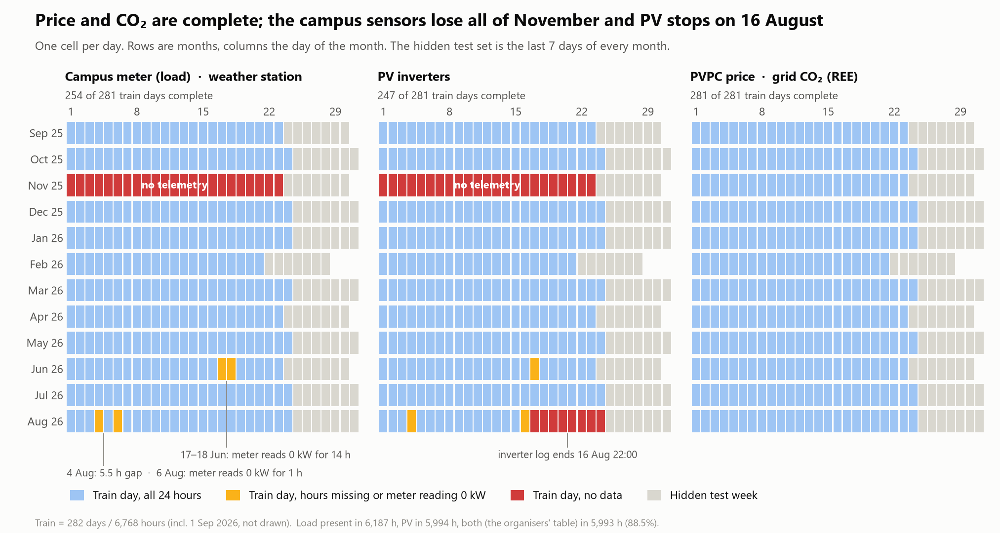

Price and CO₂ are complete on all 282 train days. The campus telemetry (meter, inverters, weather station) is missing for all of November 2025 (23 train days) and has two short gaps (17 June, 2.4 h; 4 August, 5.5 h). The inverter log stops on 16 August 2026 at 22:00. The organisers' table, which keeps only hours with both load and PV, therefore has 5,993 of 6,768 train hours (88.5 %): load is present in 6,187 hours and PV in 5,994. The meter reads exactly 0 kW for 15 hours (17 June 17:00 to 18 June 06:00, and 6 August 08:00); the communication-status field shows a fault and the inverters also read 0 while the irradiance sensor shows sun, so these are telemetry faults and not real zero consumption.

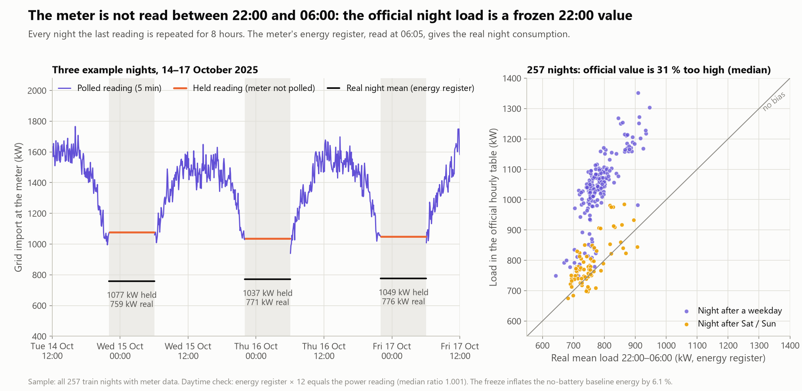

A third of the 5-minute meter samples repeat the previous value because **the meter is never polled between 22:00 and 06:00**: 98 % of night samples are repeats against 1.6 % by day, on every one of the 257 nights with data. The hourly "load" for those eight hours is the 22:00 reading held flat. The meter's energy register, read at 06:05, gives the real night consumption: a median of 766 kW against 1,015 kW in the official table, so the official night value is 31 % too high on a median night (by day the register and the power reading agree within 0.1 %). This inflates the no-battery baseline by 6.1 % in energy, 7.3 % in CO₂ and 5.6 % in cost. It does not change how to run the battery, since the real night load (5th percentile 704 kW) is still above 500 kW, but the "last hour's load" the agent receives at night carries no information.

Other oddities: the wind sensor reads 0 all year; the "ambient" temperature reaches 56.6 °C and exceeds 45 °C in 185 hours, so it is a sun-heated sensor; CO₂ intensity is exactly 0.37 kg/kWh × the share of emitting generation.

## 2. Load

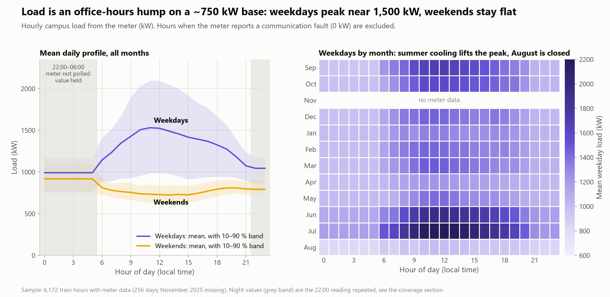

Sample: 6,172 valid meter hours on 256 days (November missing, fault hours excluded). Load averages 1,118 kW. Weekdays form an office-hours hump that peaks at 1,531 kW at 11:00 (mean profile); weekends stay between 724 and 918 kW. Weekday means are 1,236 kW against 805 kW at weekends (65 %). The flat night segment is the held 22:00 value described above.

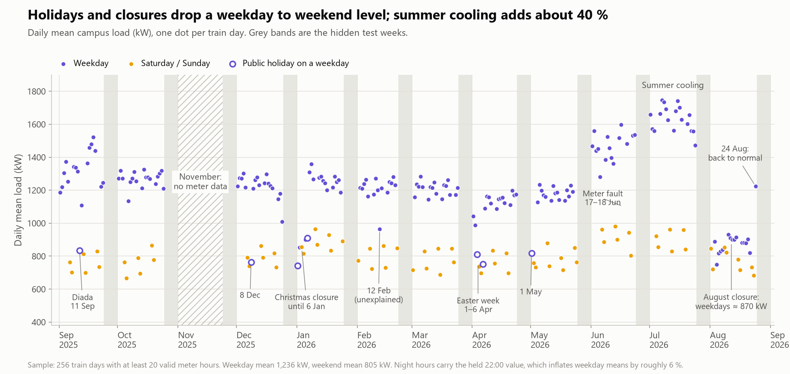

Summer cooling lifts July weekdays to 1,634 kW, 39 % above March–May (1,172 kW). Holidays and closures drop a weekday to weekend level: 11 September (835 kW), 8 December (764 kW), the Christmas closure until 6 January (878 kW on 2 and 5 January), Easter week, 1 May (819 kW) and the first three weeks of August (weekdays 869 kW). Activity is back to normal on 24 August (1,223 kW), the day before the August test week. The hidden test weeks contain 24 September, 25–31 December and 24 June, so their baseline is probably lower than the train average.

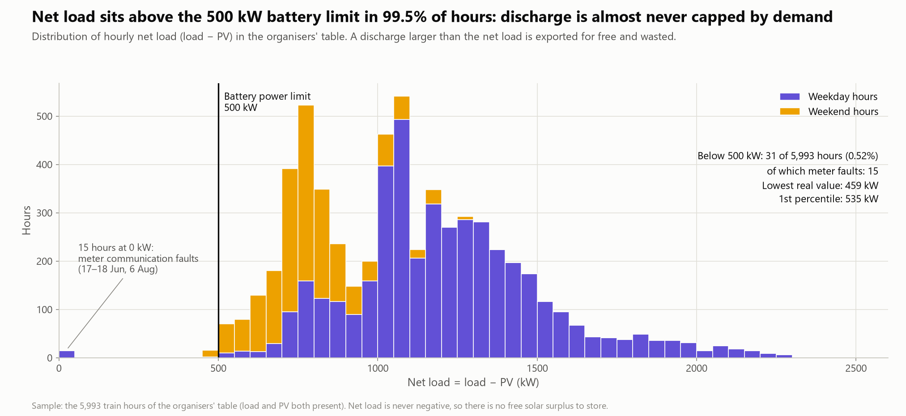

Net load (load − PV) is below 500 kW in 31 of 5,993 hours (0.52 %): 15 are the meter-fault hours at 0 kW, 2 are hours partly hit by the 6 August fault, and 14 are spring Sunday middays (lowest real value 459 kW). Net load is never negative. A battery discharging at full power in every hour would lose 0.26 % of its output to exports.

## 3. PV

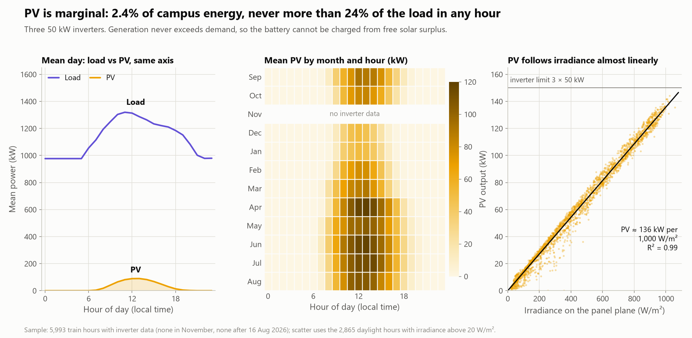

Sample: 5,993 hours with inverter data. Three 50 kW inverters produce 26.5 kW on average and 144 kW at most, which is 2.4 % of campus energy. PV never exceeds the load in any hour (largest ratio 24 %, on Sunday 17 May at 11:00), and the best PV day yields 1,116 kWh, about half the battery capacity. Output follows irradiance almost linearly: 136 kW per 1,000 W/m², R² = 0.99 over 2,865 daylight hours. PV would be easy to predict, but it is too small to change any battery decision.

## 4. CO₂ intensity

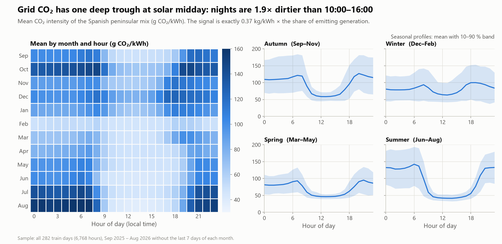

Sample: all 282 train days. The mean is 85 g CO₂/kWh (5th–95th percentile 40–169). The daily shape has one deep trough at solar midday: 55 g between 10:00 and 16:00 against 104 g between 20:00 and 08:00, a factor of 1.9. The trough comes from clean generation rising from 19.0 GW at night to 29.8 GW at midday while emitting generation falls only from 7.5 to 5.2 GW. October (114 g), August (104 g) and December (103 g) are the dirtiest months; February is the cleanest (51 g) and the flattest.

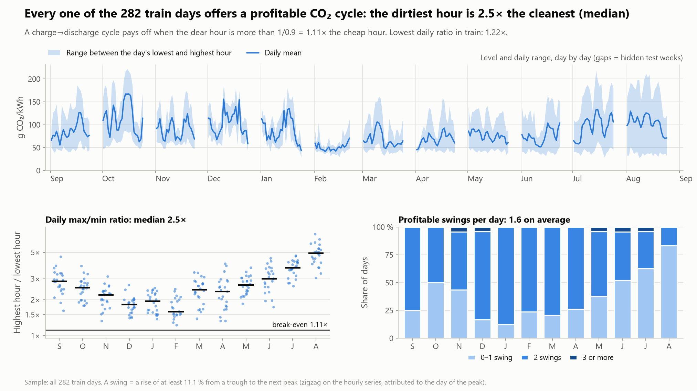

The level moves a lot between days (the daily mean has a coefficient of variation of 31 %; 41 % of the hourly variance is between days). The intraday spread is always wide enough: the dirtiest hour is 2.45× the cleanest on a median day, 1.22× on the worst day, so **100 % of days clear the 1.11× break-even** (99.6 % if the cheap hour must come before the dear hour inside the same calendar day). Averaged over the four cheapest and four dearest hours, which is what a 4-hour battery uses, the ratio is still 2.28× (minimum 1.20×). The spread is widest in August (4.9×) and narrowest in February (1.6×).

One trough or two: counting every rise of at least 11.1 % from a trough to the next peak, the signal offers 1.6 profitable swings a day, and 62 % of days have two or more. The second swing is shallow. Requiring a 25 % rise leaves 1.25 swings a day and two or more on 35 % of days. In practice: one deep cycle every day (midday trough to evening peak), and a second, weaker one (night dip to morning peak) on roughly half the days, least often in summer.

## 5. Price (PVPC)

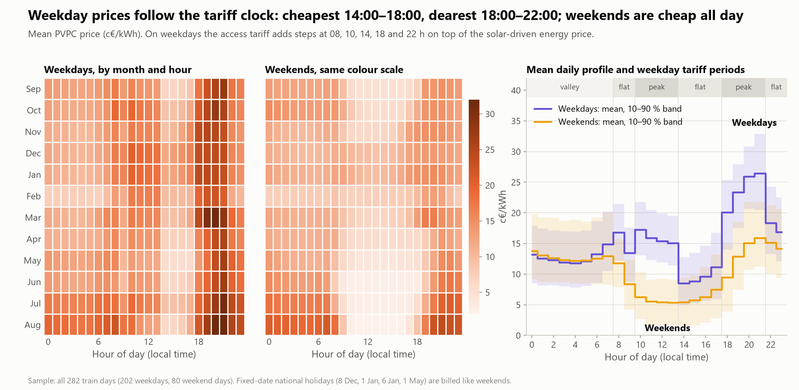

Sample: all 282 train days (202 weekdays, 80 weekend days). The mean is 13.9 c€/kWh. On weekdays the access tariff adds steps on top of the solar-driven energy price (median hour-to-hour changes of +4.3 c€ at 10:00, −6.8 at 14:00, +8.7 at 18:00, −7.8 at 22:00). The cheapest weekday block is 14:00–18:00 (9.5 c€), cheaper than the night valley (12.8 c€); the dearest is 18:00–22:00 (24.0 c€). Weekends carry the valley tariff all day: 5.7 c€ at midday, 15.5 c€ in the evening, 10.5 c€ on average against 15.2 c€ on weekdays. Fixed-date national holidays (8 December, 1 and 6 January, 1 May) are billed like weekends; Good Friday, Easter Monday and 11 September are not.

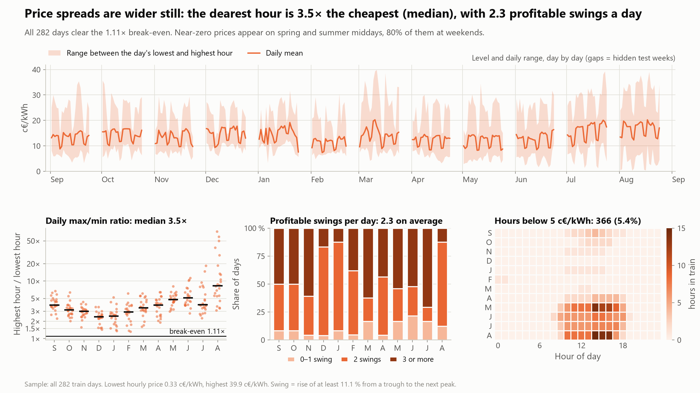

The dearest hour is 3.5× the cheapest on a median day (minimum 1.32×), so again every day clears break-even. Prices offer 2.3 profitable swings a day, and 89 % of days have two or more: the afternoon trough and the night valley are both real. Near-zero prices exist but are rare: 366 hours below 5 c€/kWh (5.4 %) on 59 days, 67 hours below 2 c€. They fall between 09:00 and 18:00 (93 %), from April to September (93 %) and mostly at weekends (80 %), and they coincide with a clean grid (42 g CO₂/kWh against 85 g on average).

## 6. Do the two objectives agree?

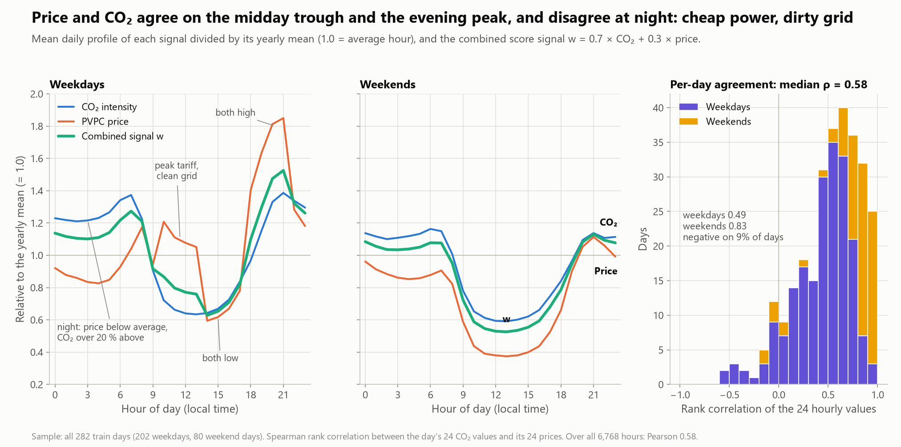

Partly. Over all 6,768 hours the correlation between price and CO₂ is 0.58 (Pearson; Spearman 0.62). Inside a day, the rank correlation of the 24 hourly values has a median of 0.58 (0.49 on weekdays, 0.83 at weekends) and is negative on 9 % of days. Both signals are low in the early afternoon and high in the evening. They disagree on weekday nights (price 8–17 % below average, CO₂ over 20 % above) and between 10:00 and 14:00 on weekdays (peak tariff, clean grid). Only 1.8 of the four cheapest hours and 1.8 of the four dearest hours are shared between the two signals on an average day.

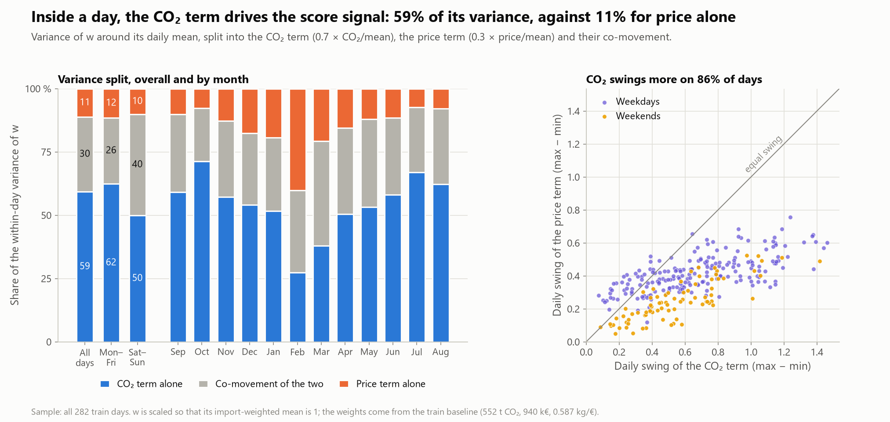

In the combined signal the CO₂ term dominates: 59 % of the within-day variance of `w` comes from CO₂ alone, 11 % from price alone and 30 % from their co-movement; the CO₂ term has the larger daily swing on 86 % of days. February is the exception (CO₂ is flat, price leads). `w` itself has a median daily max/min ratio of 2.66× (minimum 1.24×) and offers 1.85 profitable swings a day.

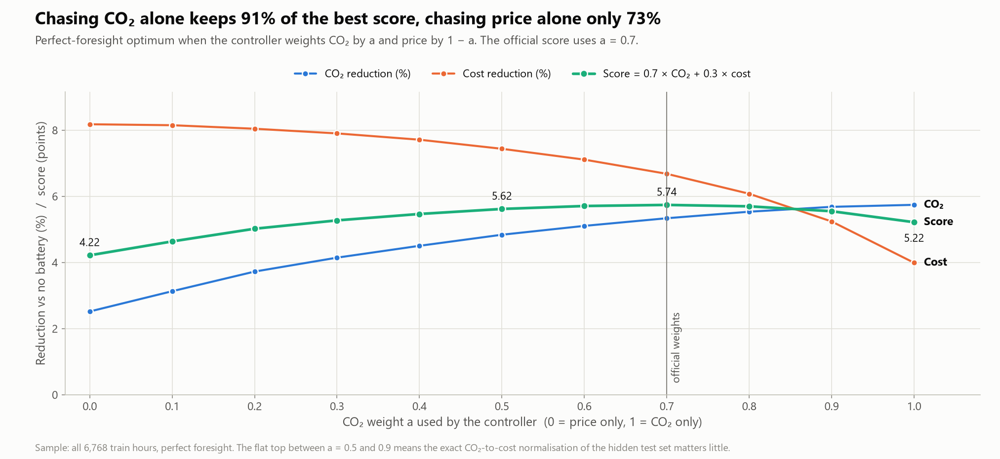

With perfect foresight on the train year, a controller that weights CO₂ by `a` and cost by `1 − a` scores 5.74 at the official `a` = 0.7, 5.71 at 0.6 and 5.70 at 0.8. CO₂ alone gives 5.22 (91 %), price alone 4.22 (73 %). The top is flat, which matters because the true normalisation depends on the hidden test baseline: the kg-per-€ ratio is 0.587 on train, ranges from 0.43 (February) to 0.75 (October) by month, and is about 0.605 on the public test half according to the leaderboard snapshot. Those differences move the effective CO₂ weight by a few hundredths at most.

## 7. Predictability beyond the 24-hour lookahead

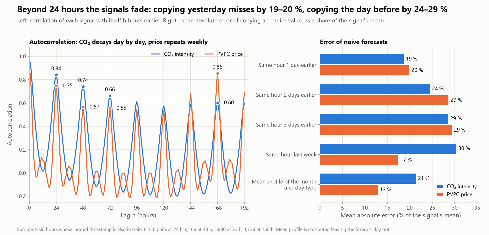

Sample: train hours whose lagged timestamp is also in train (6,456 pairs at 24 h, 6,168 at 48 h, 5,880 at 72 h, 4,728 at 168 h); lags never jump across a hidden week. CO₂ autocorrelation decays day by day: 0.84 at 24 h, 0.74 at 48 h, 0.66 at 72 h, 0.60 at 168 h. Price repeats weekly: 0.75, 0.57, 0.55, then 0.86 at 168 h. Copying the same hour one day earlier misses by 19 % of the mean for CO₂ and 20 % for price. For the day after the lookahead (two days earlier) the error rises to 24 % and 29 %. For price, last week's value (17 %) or the mean profile of the month and day type (13 %) beat any recent day; for CO₂ nothing simple beats yesterday.

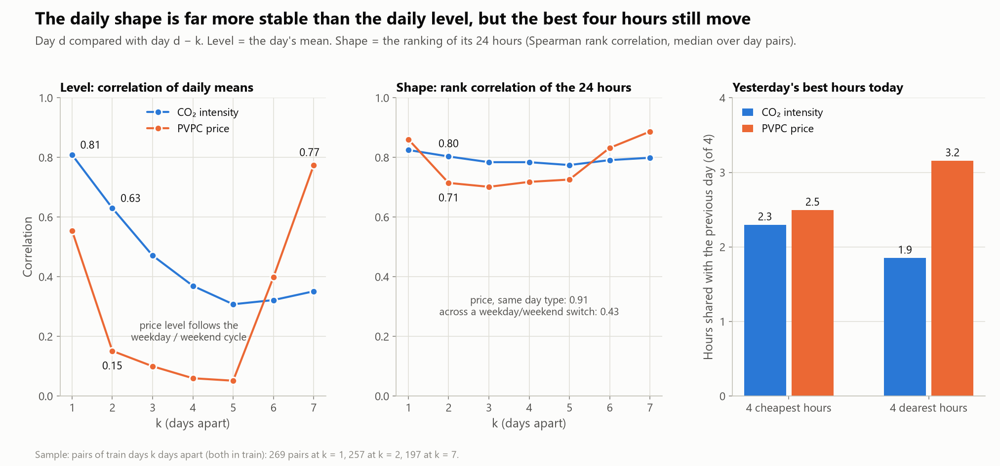

The level is the hard part. The correlation between daily means falls from 0.81 at one day to 0.63 at two days for CO₂ (median change 11 % and 17 %), and from 0.55 to 0.15 for price, whose level follows the weekday/weekend cycle (0.77 at seven days). The shape is stable: the ranking of the 24 hours correlates at about 0.8 with the previous day at any lag for CO₂, and at 0.91 for price between days of the same type (0.43 across a weekday/weekend switch). Even so, only 2.3 (CO₂) to 2.5 (price) of yesterday's four cheapest hours are again among today's four cheapest. Sample: 269 day pairs at one day, 257 at two, 197 at seven.

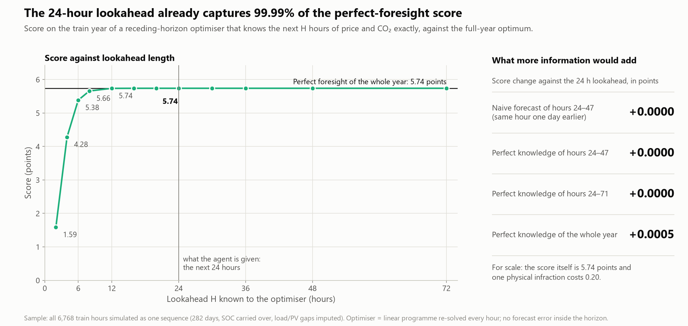

The operational answer makes the forecasting question moot. A receding-horizon optimiser that knows only the next H hours scores 4.28 points with H = 4, 5.66 with H = 8, 5.737 with H = 12 and 5.7394 with H = 24, against 5.7399 for perfect foresight of the whole year. Extending perfect knowledge to 48 or 72 hours adds 0.00002 points; adding a naive forecast for hours 24–47 changes nothing. The reason is physical: the battery fills in 4.2 hours and empties in 3.8, and the signals offer one or two swings a day, so every decision depends only on the next trough and the next peak, both inside the lookahead. Sample: all 6,768 train hours simulated as one sequence with the state of charge carried over (load and PV gaps imputed; the discharge cap binds in 0.5 % of hours).

## 8. When are the best hours?

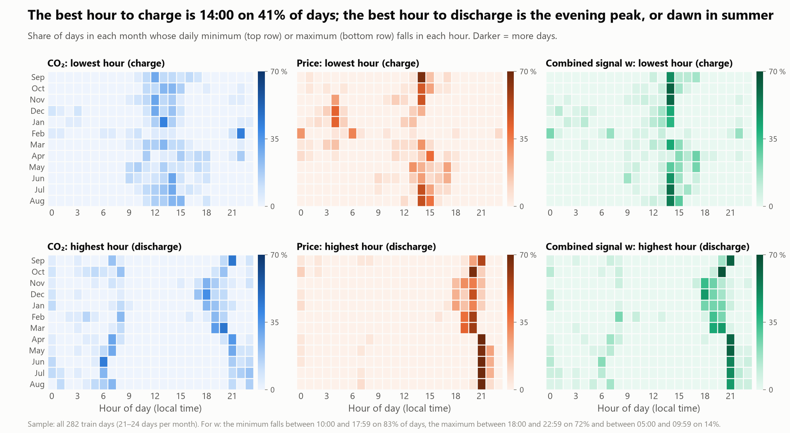

Sample: all 282 train days. The minimum of `w` falls at 14:00 on 41 % of days and between 10:00 and 18:00 on 83 %; in winter it falls at night (22:00–08:00) on 43 % of days. The maximum of `w` falls between 18:00 and 23:00 on 72 % of days (18:00–19:00 in winter, 21:00 from April to September) and between 05:00 and 10:00 on 14 % (20 % in summer). Price is the more regular signal (maximum in the evening on 93 % of days); the CO₂ maximum is split between the evening (45 %), the morning (31 %) and the small hours (20 %), and in summer it is at dawn on 42 % of days.

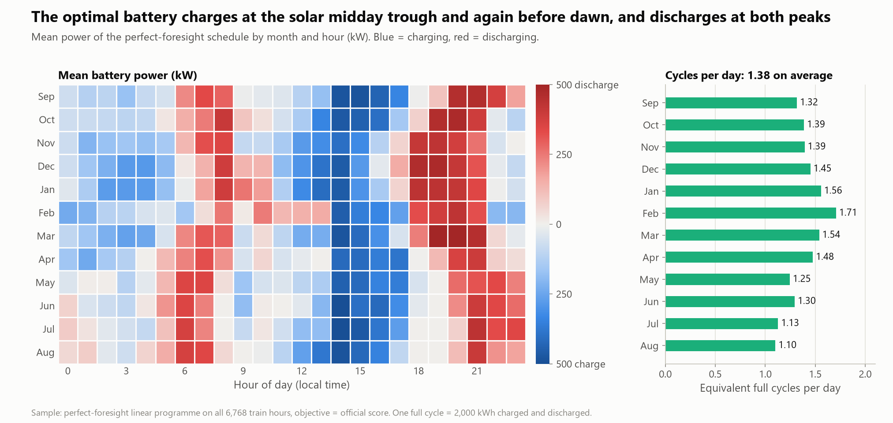

The perfect-foresight schedule turns this into operating hours. Charging concentrates in 13:00–17:00 in every month and discharging in 18:00–22:00. The morning peak (06:00–09:00) is served in every month: from October to April by a second charge between 00:00 and 05:00, and from May to August by energy held over from the midday charge, because summer nights are as dirty as the evening. The battery makes 1.38 equivalent full cycles a day on average (1.10 in August, 1.71 in February; 10th–90th percentile of days 0.7–2.0). It is idle in 49 % of hours and at full power in 41 %.

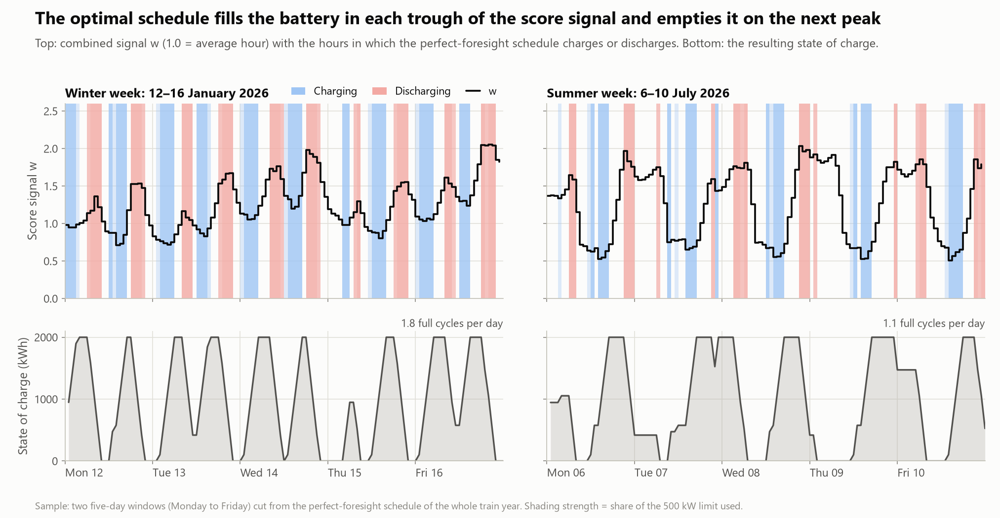

## 9. Other findings that affect operation

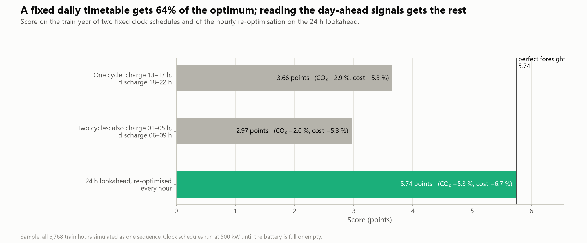

**A timetable is not enough.** Charging 13:00–17:00 and discharging 18:00–22:00 every day scores 3.66 points on the train year (64 % of the optimum). Adding a fixed night cycle lowers it to 2.97, because charging at night is often dirty. The gain comes from reading the day-ahead signals each day. The single-cycle timetable also lost one full discharge (1,897 kWh) during the 17 June meter fault.

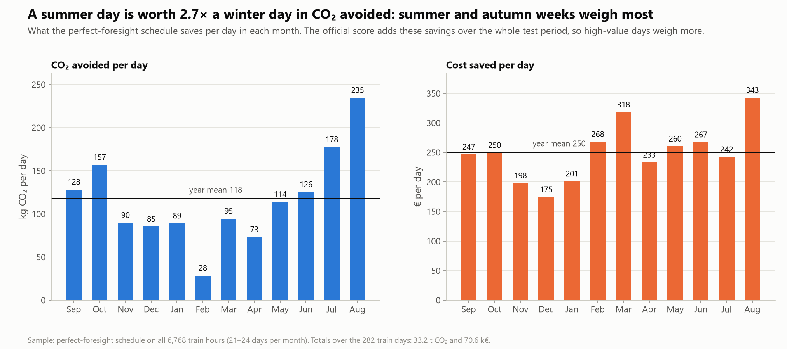

**Summer and autumn weeks weigh most.** The optimal schedule avoids 118 kg CO₂ and saves 250 € a day on average (33.2 t and 70.6 k€ over the 282 train days), but 235 kg a day in August against 28 kg in February. A summer day is worth 2.7× a winter day in CO₂ and 1.3× in cost. Because the score sums savings over the whole test period, the July, August, September and October test weeks carry most of it.

**A test-like sample scores 6.0.** Concatenating the last 7 train days of each month the way the hidden test is built (12 × 168 hours, state of charge carried across the jumps) gives 6.01 points with perfect foresight and 6.01 with the 24-hour lookahead. The free initial 1,000 kWh contributes 0.08 of those points. Of these hours, 338 use imputed load or PV (November and 17–23 August).

**Checked in the official simulator.** The perfect-foresight schedule replayed in `starter_kit/environment.py` gives CO₂ −5.34 %, cost −6.68 % and 5.74 points with 0 infractions when passed through the website's `eps` clamp, and 414 infractions (score 0) without it.

## Measured versus inferred, and open questions

Measured directly on train data: everything in sections 1–8, the LP benchmarks and the simulator replay.

Inferred, with the evidence:

- **The hidden test may hold fewer than 2,016 hours.** November has no meter data at all and the inverter log ends on 16 August, so the organisers' `dropna()` pipeline would drop the November and August test weeks. The leaderboard snapshot implies a public baseline of 71.8 t CO₂ and 118.8 k€. Spread over 1,008 hours that is 71 kg/h and 118 €/h, 23–25 % below the train rate (92 kg/h, 157 €/h); over 840 hours (10 weeks) it is 7–10 % below, which lower holiday loads in the test weeks could explain. We cannot tell which from here. The strategy does not depend on it, but the agent must not assume a fixed number of weeks or hours.
- **The ceiling on the hidden set is probably 6 to 6.5 points.** Our test-like sample gives 6.01; the only leaderboard entry on 14 November scored 6.43 with a similar CO₂/cost split (−5.97 %, −7.5 %). Teams that solve the 24-hour problem exactly will be separated by hundredths of a point and by infractions.
- **The meter probably already nets out PV.** On 46 non-summer weekend days the midday dip of the meter reading falls by 0.78 kW (± 0.13) per kW of PV. If so, the simulator's `load − PV` subtracts PV twice. This changes nothing for control, since the simulator's definition is what is scored.
- **Clock changes fall in test weeks.** 26 October 2025 and 29 March 2026 are both hidden; train has no 23- or 25-hour day. The agent should rely on the vectors in `obs`, not on counting hours.
- **The meter-fault guard rests on two episodes** (15 hours). The rule is cheap, but its benefit on the hidden set cannot be estimated.

Limits of the analysis: load statistics exclude November and treat the held night values as given; LP benchmarks assume the current hour's net load is known for the discharge cap (it binds in 0.5 % of hours) and use imputed load and PV in 775 hours.
