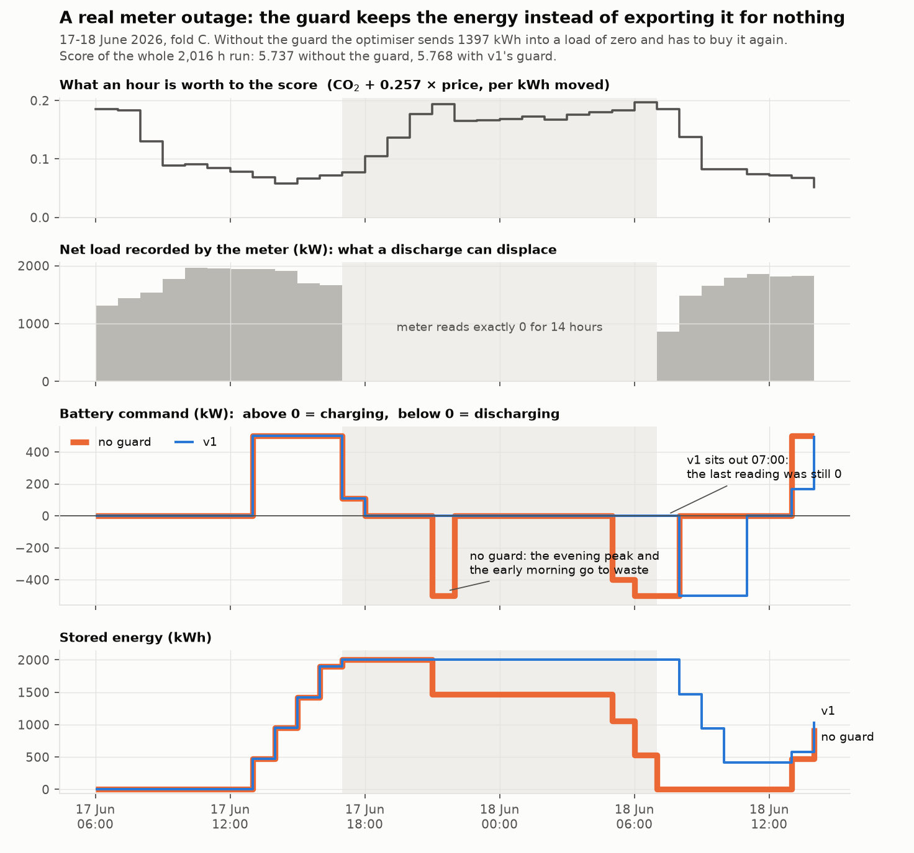
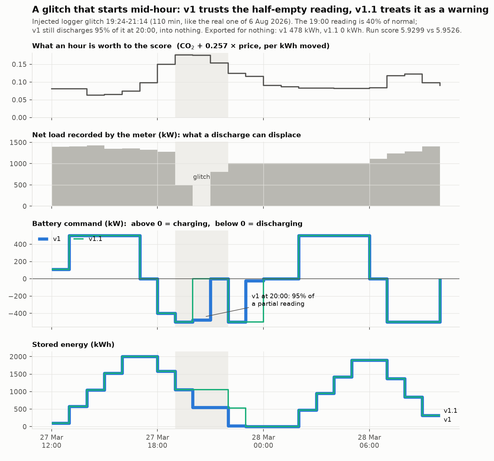

# Robustness report: red-team of agent v1, stress harness, guard tuning

## 1. Bottom line

- **v1 never caused an infraction and never returned a bad value** in 660 adversarial calls, 9,828 state-of-charge edge cases and 114 full scenario runs. Its only hard failure: `act()` raises if `soc_kwh` is missing, `None` or text.
- **The real hazard in the data is the data-logger glitch**, where meter and inverters read 0 together. One glitch at a discharge peak costs v1 0.01 to 0.03 points, more than the whole spread of the leaderboard pack.
- **A tested v1.1 candidate is ready** at `experiments/02_stress/candidate/agent.py` (drop-in file, numpy only). It is identical to v1 on clean folds A and B and 0.0006 lower on fold C.
- **The 0.06–0.12 dead-week residual is mostly not recoverable.** About 0.064 of it at the November position is free solar that only the oracle gets, because that scenario kept PV alive. About 0.025 per dead week is energy stored before the week starts, which needs foreknowledge.
- **Surplus-solar charging does not apply:** 0 of 5,993 train hours have PV above load, and in every 5-minute sample where the meter reads 0 the three inverters read 0 as well.

## 2. Problems found, ranked by points at stake

"Regret" is oracle score minus agent score on the same table, in leaderboard points.

| # | Problem in v1 | Points at stake | Evidence | In v1.1 |
|---|---|---|---|---|
| 1 | A glitch that starts mid-hour gives a partial reading (6 Aug 2026 07:00: 465 kW, then 0). v1 discharges 95% of it into a dead hour. | 0.010–0.020 per glitch of 110 min or more at a peak; 0.008 averaged over six start times | Injected glitches with the real shape, figure 2 | Fixed by the sudden-drop rule. Price: 0.003–0.004 per 25-minute glitch at a peak. |
| 2 | One NaN or `None` in the price or CO₂ lookahead makes v1 idle for about 24 hours. | 0.052 for one missing hour, 0.179 for three | Full run, fold C | Fixed: −0.0009 and 0.0000 |
| 3 | `act()` raises `KeyError`/`TypeError`/`ValueError` when `soc_kwh` is missing, `None` or text. | A failed run | 12 of 660 fuzz calls | Fixed: falls back to `soc_pct`/`soc_percent`, else 0 kW |
| 4 | Dead week (load = PV = 0). The leaderboard reading says it is not in the public half. | v1 regret 0.03–0.11 per dead week, worst run 0.155 | 36 runs, every week position | 0.015–0.020 mid-run; 0.128 if it is the last week (worse than v1's 0.112) |
| 5 | Low load, where net load is often under 500 kW. Not seen in train or on the public half. | v1 regret 0.09 / 0.49 / 2.5 for the whole run at load ×0.6 / ×0.45 / ×0.3; 0.009–0.049 for one week | Scaled folds | Not in v1.1. Optional tested variant cuts it by 60%. |
| 6 | Outage persistence of 2× hours-so-far is too pessimistic for long outages. | 0.006 per 3-day outage, 0.016 per dead week | Tuning grid | Changed to 1× |
| 7 | With constant or backward timestamps every step looks like a calendar jump and the guard switches off. | 0.031 on fold C | Full run | Repeated timestamps handled; backward ones still disable it |
| 8 | If the hidden evaluator rounded the one-way efficiency to 0.9487 or 0.95, each fill-to-full would be clipped. | 101 infractions, −20 points | Variant physics, fold B | Not changed. Retired if v1's leaderboard row shows 0 infractions (it does). |

Losses that no causal rule can avoid, for calibration:

- **First hour of a glitch at a discharge time:** 0.028 per 1-hour outage at 20:00.
- **Recovery hour:** on 18 June at 07:00 v1 sat out a 0.032-point hour because the last reading was still 0.
- **Blocking after a single zero reading:** it costs v1 0.004 per 1-hour outage at 20:00 against no guard at all, and gains 0.033 per 3-hour outage. It is the right call if more than about 10% of outages continue; in train 1 of 2 did.

## 3. What the red-team agent recommends

Submit `experiments/02_stress/candidate/agent.py` as v1.1. Each rule has a constant at the top of the file.

1. **Interface hardening.** No behaviour change on valid input: with the three guard rules switched off, the candidate reproduces v1 action for action on all 114 scenario runs.
2. **`PERSIST_X = 1`.** An outage is assumed to last `max(4, hours so far)` more hours instead of `max(4, 2 × hours so far)`.
3. **`CALENDAR_EXIT = True`.** Blocked hours never extend past the end of the calendar month.
4. **`DROP_RATIO = 0.70`.** A reading below 70% of the previous one is treated like a zero reading. It is skipped at 07:00, because the 06:00 reading is the first after the night freeze and legitimately falls up to 28%.

Rule 4 is a bet, and the evidence for it is synthetic:

- **Train history:** it fires twice in 5,993 hours. On 20 Jan 2026 at 10:00 (reading 1,456 → 886 kW) it is a false alarm and costs 0.0006 on fold C. On 6 Aug 2026 at 08:00 (810 → 465 kW) it is a true alarm, but the battery was already empty, so nothing was gained.
- **Injected glitches:** it loses about 0.002 per 25- or 50-minute glitch and gains about 0.008 per glitch of 110 minutes or more, averaged over six start times.
- **Break-even:** it pays if at least one in five glitches that trigger it continues into the next hour. In train one of two did.
- **To opt out:** set `DROP_RATIO = 0.0`.

On the leaderboard, v1.1 returns exactly v1's actions unless a reading in the run falls below 50 kW or below 70% of its predecessor. A score below v1's would mean a false alarm of rule 4.

Parameters tuned and left alone:

- **5% margin:** it is the optimum. Mean regret on the low-load scenarios is 0.473 at 0%, 0.444 at 2%, 0.430 at 5%, 0.461 at 10% and 0.538 at 15%. Clean folds are unaffected.
- **50 kW outage threshold:** 20, 50 and 100 kW give identical results. 300 kW is catastrophic under low load (regret up to 8.2).

## 4. What passed

Both agents were run through `stress.py` (46 checks each).

| Section | v1 | v1.1 candidate |
|---|---|---|
| Packaging: AST scan, imports, `check_submission.py` on the `.py` and on a zip | pass | pass |
| Fuzz, 660 calls: no exception | **12 raise** (problem 3) | pass |
| Fuzz: finite number returned, 0 infractions through the official physics | pass | pass |
| State of charge at 0, 2000, within 1e-12 to 1e-3 of either, at lattice points, slightly outside (9,828 cases) | 0 infractions | 0 infractions |
| Timestamp as text, `datetime`, `numpy.datetime64`, tz-aware, `None`, missing, epoch, mixed | same score | same score |
| Timestamp constant / going backwards (fold C) | −0.031 / −0.031 | 0.000 / −0.031 |
| One 23-hour and one 25-hour day (DST) | no infraction, regret unchanged | same |
| One / three hours without price | −0.052 / −0.179 | −0.0009 / 0.0000 |
| 49 garbage calls interleaved in a real run | score unchanged, 5 raised | score unchanged, 0 raised |
| 114 scenario runs | 0 crashes, 0 infractions | 0 crashes, 0 infractions |
| Time inside `act()` for 2,016 steps | 0.26 s, slowest step 0.54 ms | 0.27 s, slowest step 1.58 ms |
| Fresh interpreter, import plus 2,016 steps | 0.36 s | 0.44 s |
| Official `CampusBatteryEnv` against `src.sim.simulate`, 4 full runs | equal | equal |

The DST test matters because both clock changes (26 Oct 2025, 29 Mar 2026) fall in test weeks and none is in train.

The official-environment runs were fold A 5.96, B 5.78, C 5.77 and A with November and August dropped 5.55, all with 0 infractions.

## 5. Scenario table

Scores in points, mean of folds A, B and C on the hidden test's calendar. "×12" means twelve events in one run. "No guard" is v1 with `_discharge_limits` returning `(500, 0)`.

| Scenario | no guard | v1 | v1.1 | oracle | regret v1 | regret v1.1 | v1.1 − v1 |
|---|---|---|---|---|---|---|---|
| clean | 5.826 | 5.836 | 5.836 | 5.844 | 0.0075 | 0.0077 | −0.0002 |
| drop Nov week | 5.935 | 5.947 | 5.946 | 5.955 | 0.0082 | 0.0084 | −0.0002 |
| drop Aug week | 5.392 | 5.403 | 5.403 | 5.410 | 0.0070 | 0.0072 | −0.0002 |
| drop Nov + Aug weeks | 5.467 | 5.479 | 5.479 | 5.487 | 0.0077 | 0.0079 | −0.0002 |
| dead week (load = PV = 0), first | 5.222 | 5.818 | 5.866 | 5.881 | 0.0632 | 0.0153 | +0.0479 |
| dead week, Nov position | 5.132 | 5.966 | 5.985 | 6.002 | 0.0359 | 0.0172 | +0.0187 |
| dead week, Mar position | 4.981 | 5.757 | 5.765 | 5.785 | 0.0285 | 0.0202 | +0.0083 |
| dead week, last | 4.918 | 5.298 | 5.282 | 5.410 | 0.1120 | 0.1284 | −0.0164 |
| zero load, PV real, Nov position | 5.189 | 5.968 | 5.990 | 6.068 | 0.1002 | 0.0774 | +0.0228 |
| zero PV week, Aug | 5.817 | 5.827 | 5.827 | 5.835 | 0.0074 | 0.0076 | −0.0002 |
| zero PV, whole run | 5.735 | 5.746 | 5.745 | 5.753 | 0.0073 | 0.0075 | −0.0002 |
| outage 1 h from 20:00 (×12) | 5.556 | 5.508 | 5.508 | 5.852 | 0.3441 | 0.3443 | −0.0002 |
| outage 1 h from 14:00 (×12) | 5.852 | 5.862 | 5.862 | 5.870 | 0.0076 | 0.0078 | −0.0002 |
| outage 1 h from 17:00 (×12) | 5.850 | 5.838 | 5.838 | 5.877 | 0.0398 | 0.0399 | −0.0002 |
| outage 3 h from 20:00 (×12) | 5.143 | 5.535 | 5.535 | 5.844 | 0.3093 | 0.3095 | −0.0002 |
| outage 3 h from 14:00 (×12) | 5.909 | 5.914 | 5.914 | 5.927 | 0.0133 | 0.0135 | −0.0002 |
| outage 3 h from 17:00 (×12) | 5.566 | 5.805 | 5.805 | 5.907 | 0.1017 | 0.1018 | −0.0002 |
| outage 14 h from 20:00 (×12) | 4.789 | 5.496 | 5.490 | 5.902 | 0.4062 | 0.4119 | −0.0057 |
| outage 14 h from 14:00 (×12) | 4.980 | 6.003 | 6.003 | 6.060 | 0.0571 | 0.0572 | −0.0001 |
| outage 14 h from 17:00 (×12) | 4.769 | 5.664 | 5.663 | 5.900 | 0.2366 | 0.2368 | −0.0002 |
| outage 3 days from 20:00 (×4) | 4.652 | 5.676 | 5.744 | 5.988 | 0.3120 | 0.2437 | +0.0682 |
| outage 3 days from 14:00 (×4) | 4.629 | 5.786 | 5.786 | 5.890 | 0.1037 | 0.1037 | 0.0000 |
| outage 3 days from 17:00 (×4) | 4.632 | 5.778 | 5.782 | 5.898 | 0.1202 | 0.1163 | +0.0040 |
| glitch 25 min from 07:35 (×12) | 5.843 | 5.854 | 5.819 | 5.864 | 0.0107 | 0.0450 | −0.0343 |
| glitch 25 min from 19:24 (×12) | 5.847 | 5.857 | 5.805 | 5.865 | 0.0077 | 0.0594 | −0.0517 |
| glitch 110 min from 07:35 (×12) | 5.751 | 5.755 | 5.870 | 5.911 | 0.1561 | 0.0411 | +0.1150 |
| glitch 110 min from 19:24 (×12) | 5.587 | 5.558 | 5.794 | 5.894 | 0.3354 | 0.0994 | +0.2360 |
| glitch 13.9 h from 07:35 (×12) | 5.324 | 5.874 | 6.081 | 6.238 | 0.3639 | 0.1569 | +0.2070 |
| glitch 13.9 h from 19:24 (×12) | 4.801 | 5.521 | 5.676 | 5.924 | 0.4032 | 0.2474 | +0.1557 |
| load ×0.60, Dec week | 6.063 | 6.082 | 6.082 | 6.091 | 0.0093 | 0.0095 | −0.0002 |
| load ×0.45, Dec week | 6.098 | 6.170 | 6.169 | 6.187 | 0.0170 | 0.0172 | −0.0002 |
| load ×0.30, Dec week | 5.919 | 6.214 | 6.214 | 6.263 | 0.0485 | 0.0487 | −0.0002 |
| load ×0.60, whole run | 9.525 | 9.741 | 9.742 | 9.829 | 0.0886 | 0.0874 | +0.0012 |
| load ×0.45, whole run | 10.863 | 12.572 | 12.576 | 13.064 | 0.4917 | 0.4875 | +0.0043 |
| load ×0.30, whole run | 5.676 | 15.947 | 15.951 | 18.476 | 2.5290 | 2.5252 | +0.0038 |
| NaN load readings 12×4 h, truth real | 5.826 | 5.836 | 5.836 | 5.844 | 0.0075 | 0.0077 | −0.0002 |
| NaN PV readings 12×4 h, truth real | 5.826 | 5.836 | 5.836 | 5.844 | 0.0075 | 0.0077 | −0.0002 |
| NaN readings 12×4 h, truth is an outage | 5.704 | 5.715 | 5.715 | 5.937 | 0.2215 | 0.2217 | −0.0002 |

Notes on the table:

- The recurring −0.0002 is the 20 January false alarm in fold C (−0.0006 on that fold, zero on A and B).
- Clean folds one by one: A 5.9613 for both; B 5.7794 for both; C 5.7679 for v1 and 5.7674 for v1.1. Without the guard, fold C is 5.7368.
- "Glitch" rows use sub-hour timing, so the first and last hours are partial. They also honour the meter's night freeze: a glitch active at 22:00 reads 0 until 06:00.
- The hour-aligned outage rows have no partial hour, so the sudden-drop rule never fires there.



*Figure 1. The real 14-hour outage of 17–18 June 2026. Without the guard the optimiser sends 1,397 kWh into a load of zero; the run scores 5.737 against 5.768 with v1's guard.*



*Figure 2. One injected 110-minute glitch starting at 19:24. v1 exports 478 kWh for nothing at 20:00, v1.1 exports none; this single glitch is worth 0.023 points (5.9299 against 5.9526).*

## 6. Guard tuning in detail

Every variant was run on 142 scenario runs: 3 clean, 72 realistic glitches, 16 hour-aligned outages, 33 dead weeks and 18 low-load runs.

### 6.1 Mean regret by family

| Variant | clean | glitches | outages | dead week | low load |
|---|---|---|---|---|---|
| v1 | 0.0075 | 0.1199 | 0.1895 | 0.0584 | 0.4298 |
| v1 + sudden-drop rule only | 0.0077 | 0.0858 | 0.1895 | 0.0586 | 0.4273 |
| v1 + persistence 1× only | 0.0075 | 0.1177 | 0.1750 | 0.0421 | 0.4298 |
| both | 0.0077 | 0.0827 | 0.1750 | 0.0423 | 0.4273 |
| **both + calendar boundary (= v1.1)** | 0.0077 | 0.0827 | 0.1750 | 0.0403 | 0.4273 |
| v1.1 + "week starts dead" rule | 0.0077 | 0.0827 | 0.1750 | 0.0360 | 0.4273 |
| v1.1 + night-freeze rule | 0.0077 | 0.0821 | 0.1735 | 0.0423 | 0.4184 |
| v1.1 + low-load plan caps, 6 h | 0.0077 | 0.0827 | 0.1750 | 0.0423 | 0.1726 |

The last three rows were run without the calendar boundary, which only affects the dead-week column.

### 6.2 Extra regret per event

In thousandths of a point, against the clean run.

| Event | v1 | v1.1 |
|---|---|---|
| glitch 10 min | 0.02 | 0.02 |
| glitch 25 min | 0.13 | 2.16 |
| glitch 50 min | 0.95 | 3.22 |
| glitch 110 min | 14.50 | 6.52 |
| glitch 5 h | 17.39 | 10.30 |
| glitch 13.9 h | 26.06 | 18.24 |
| outage 1 h | 11.99 | 11.99 |
| outage 3 h | 12.53 | 12.53 |
| outage 14 h | 25.32 | 22.63 |
| outage 3 days | 39.94 | 33.51 |

Glitch rows average six start times on folds A and B; outage rows average four start hours on fold B.

The five real glitches in train lasted 5, 10 and 25 minutes, 110 minutes and 13.9 hours. Weighting the table by that mix gives 0.0082 per glitch for v1 and 0.0054 for v1.1.

### 6.3 Sudden-drop threshold

| Threshold | glitch regret | clean folds |
|---|---|---|
| none (v1) | 0.1199 | 0.0075 |
| 0.55 | 0.0972 | 0.0075 |
| 0.60 | 0.0960 | 0.0075 |
| 0.65 | 0.0924 | 0.0077 |
| 0.70 | 0.0858 | 0.0077 |
| 0.75 | 0.0859 | 0.0097 |
| 0.80 | 0.0952 | 0.0184 |

- **Why 0.70:** it is the highest value with no false alarm on normal load.
- **What breaks at 0.75:** it fires on an ordinary 06:00 reading and costs 0.0063 on fold B.
- **What normal load looks like:** outside glitch hours the lowest hour-to-hour ratio in train is 0.717, at 06:00. The lowest outside 06:00 is 0.742, which precedes a data gap; the next lowest is 0.770.
- **Why the 07:00 exemption:** 06:00 is when the night-frozen meter value is released, so that reading is the one place where a large real drop is routine.

### 6.4 Persistence

| Rule: `max(a, b × hours so far)` | glitches | outages | dead week |
|---|---|---|---|
| a = 4, b = 2 (v1) | 0.1199 | 0.1895 | 0.0584 |
| a = 4, b = 1 | 0.1177 | 0.1750 | 0.0421 |
| a = 1, b = 1 | 0.1177 | 0.1750 | 0.0427 |
| a = 1, b = 0 (this hour only) | 0.1195 | 0.1761 | 0.0432 |
| a = 4, b = 3 | 0.1267 | 0.2084 | 0.0616 |
| a = 24, b = 0 | 0.1603 | 0.2486 | 0.0630 |

- **Why shorter is better:** blocking future hours stops the plan from buying cheap energy during the outage, so the battery is not ready when the load returns.
- **The downside:** if the load never returns, that energy is wasted. This is the dead-last-week row (−0.016) and the 14-hour outage from 20:00 (−0.0005 per outage).
- **On the real 14-hour outage in fold C** the change makes no difference.

### 6.5 Dead week and the calendar idea

The dead week was run at all 12 positions on 3 folds, with v1's 2× persistence as the base.

| Variant | mean regret | Nov position (A / B / C) |
|---|---|---|
| no guard | 0.759 | 0.941 / 0.685 / 0.986 |
| v1 | 0.063 | 0.052 / 0.018 / 0.038 |
| + boundary rule | 0.045 | 0.032 / 0.004 / 0.026 |
| + boundary + "week starts dead" | 0.042 | 0.029 / 0.009 / 0.028 |
| + dead week known in advance (foreknowledge) | 0.018 | 0.028 / 0.009 / 0.029 |

- **The boundary rule works:** it gains 0.018 per dead week on v1. On top of 1× persistence it adds only 0.002, because 1× already lets the plan buy on day one.
- **The entry-side rule** (a zero reading in the first two hours of a week means the whole week is dead) hurts alone (0.067) and adds 0.003–0.004 with the boundary rule. It was left out.
- **Downside of the boundary rule:** with two dead weeks in a row, the mean regret still improves (0.044 → 0.032); the worst fold loses 0.0004. With a dead last week nothing changes, because the lookahead ends with the run.
- **What is left:** about 0.025 per dead week is energy the agent stores on the last evening before the dead week for a morning peak that never comes. Worst case 0.13 (fold C, July position).
- **Hard-coding "November is dead":** it gains nothing at the November position on these folds. It costs 0.002 if November was dropped instead, and 0.38 if November is present with real load. Not recommended.
- **A "buy at the week's cheapest hours" rule** adds 0.002 on average and was dropped.

### 6.6 Low load

Capping the discharge of future hours in the plan is the one alternative rule that pays. When the last net load is under 500 kW, the next 6 hours are capped at that value, rounded down to 50 kW so the solver stays exact.

- **Gain:** low-load regret falls from 0.430 to 0.173. For the whole run at ×0.45 that is +0.185 points; at ×0.30 it is +1.49.
- **Cost elsewhere:** none measurable. Clean folds are identical to four decimals; the largest loss in any of 114 runs is 0.001.
- **Horizon:** 6 hours (0.173) is slightly better than 24 (0.180). Perfect knowledge of the next 24 hours of load would reach 0.124.
- **Hour-of-day margin profile** (5% quantile of the hour-to-hour ratio) is worse than the flat 5%: 0.448.
- **Why it is not in v1.1:** it changes the solver's inner loop, and low load is absent from train and, by the leaderboard reading, from the public half. A tested variant is at `experiments/02_stress/candidate_lowload/agent.py`. It equals v1.1 exactly when `LOWLOAD_HOURS = 0` and passes the harness with 0 FAIL.

### 6.7 Night freeze

Confirmed on the hourly table: for hours 01:00–05:00 the load equals the previous hour's in 100% of rows, and at 00:00 in every consecutive pair. Using it gains 0.0001–0.0008 per long outage and 0.009 on the low-load family. Not worth the lines.

## 7. Code

The whole candidate is `experiments/02_stress/candidate/agent.py`. Against `agents/v1/agent.py`: the solver functions `marginal_values` and `first_step` are unchanged, `_time_jump` is removed, and the guard constants and the class are replaced. The optional low-load variant is `experiments/02_stress/candidate_lowload/agent.py`.

## 8. Verified by running, inferred, and not tested

**Verified by running:**

- Everything in sections 4, 5 and 6.
- The candidate with its three rules off equals v1 on 114 runs (maximum action difference 0 kW).
- The candidate equals the tuning agent with the same parameters on 114 runs.
- The solver with per-hour discharge caps matches an LP on 300 random instances (worst relative difference 8e-15).
- Relabelling the folds to the test calendar does not change v1's scores.
- The calendar parser matches `datetime` over nine years of hours.

**Inferred from reading code or data, not from the server:**

- That a table with NaN load or PV cannot be on the server: by `environment.py`, it would score 0 for every team.
- That the efficiency risk (problem 8) is retired: this rests on v1's public score matching the plain optimum with 0 infractions.
- That the test weeks share the logger's behaviour, namely load and PV failing together and the night freeze.
- That the hidden weeks end at 23:00 on the last day of the month.

**Not tested:**

- The hidden evaluator itself, and the server's Python and numpy versions.
- What the server really sends as `timestamp`. `check_submission.py` sends the same text string 24 times, which both agents handle.
- How the server built the November and August weeks.
- The public/private mask.
- Glitch frequency in the test. Train has five glitch runs in 282 days, so one or two in 84 days would be expected, but that is five samples.

## 9. Harness and files

```
.venv/Scripts/python.exe experiments/02_stress/stress.py <agent.py>
    --ref agents/v1/agent.py    scenario table against another agent instead of "no guard"
    --fast                      scenarios on fold B only
    --calendar train            keep the real train dates
    --skip scenarios,evaluator  leave sections out
```

- **Run time:** 106 s for v1 and 144 s for the candidate, with other agents using the machine.
- **Exit code:** 1 if any check fails.
- **Output:** `checks.csv`, `scenarios.csv` and `scenarios_by_fold.csv` under `experiments/02_stress/out/<folder>_<file>/`.
- **Calendar caveat:** by default the folds are relabelled to the last 7 days of each month, so weekday labels no longer match the data. Use `--calendar train` for an agent that uses the weekday.
- **"No guard" column:** it needs a `_discharge_limits(obs, horizon)` method on the agent; otherwise pass `--ref`.

Files are in `experiments/02_stress/`: `stress.py` (the harness), `lib.py` (scenario builders, cached oracle), `guard_lab.py` (configurable guard used for tuning), `tune.py`, `zero_week.py`, `glitch.py`, `check_candidate.py`, `figs.py`, `candidate/agent.py`, `candidate_lowload/agent.py`.
