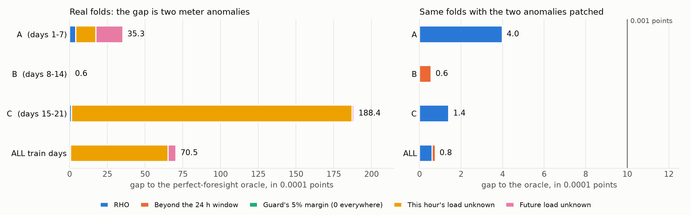
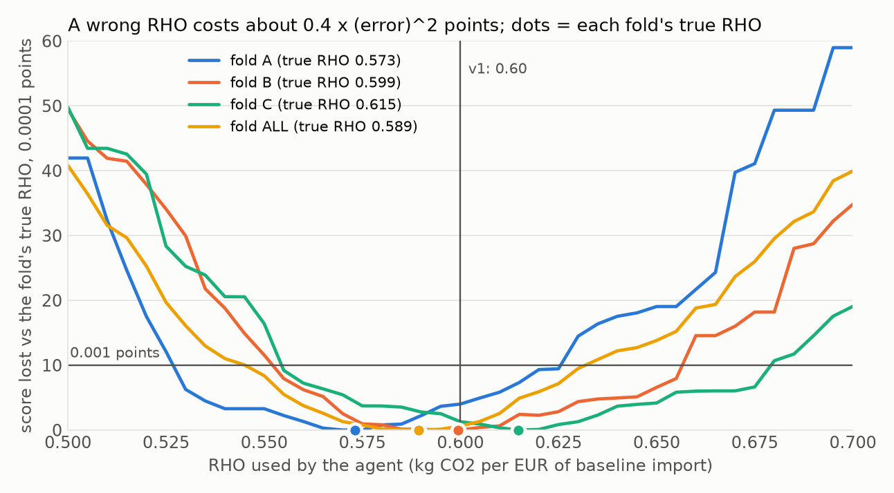

# 03 — Where v1's last gap comes from, and what can honestly be recovered

## Summary

- **v1 is at the perfect-foresight optimum except in meter-fault hours.** On train data without a fault, the gap to the oracle is 0.00006 to 0.0004 points. Every larger gap (0.003 to 0.023) contains an hour where the meter reads at or near zero.
- **Knowing more of the future is worth nothing.** Giving v1 the true price and CO₂ for the whole rest of the run changes 0 to 5 actions per run and gains at most 0.00018 points over 45 test-like runs.
- **RHO = 0.60 is the most robust constant.** A wrong value costs about 0.4 × (error)² points, so an error of 0.02 costs about 0.0002.
- **No terminal-value or forecast idea gives a robust gain.** Most change nothing; the rest win on one fold and lose on another.
- **No honest change improves the full-set score by more than 0.001.**

All gains below are in units of 0.0001 points unless stated. Fold scores use each fold's own baseline, as the leaderboard does.

## 1. Gap decomposition

### Method

Each row of the waterfall gives v1 one more piece of knowledge it cannot honestly have, in this order:

1. the fold's true RHO;
2. the true signal for the whole rest of the run;
3. no guard margin;
4. the true net load of the current hour;
5. everything (the linear-programme oracle).

The steps add up exactly to oracle − v1. Two checks support the method. The research twin of v1 (`lib.GapAgent`) reproduces v1's actions exactly on all folds. With the true RHO and the full future it reaches the oracle exactly on fold B.

### Real folds

| Cause | A | B | C | ALL |
|---|---|---|---|---|
| (a) RHO 0.60 instead of the fold's true value | 4.01 | 0.00 | 1.28 | 0.60 |
| (b) Nothing known beyond the 24 h window | 0.00 | 0.57 | 0.00 | 0.16 |
| (c) Guard's 5% margin | 0.00 | 0.00 | 0.00 | 0.00 |
| (d1) This hour's load unknown (last hour's reading used) | 13.42 | 0.00 | 186.01 | 64.48 |
| (d2) Future load unknown (cannot plan around a dropout) | 17.85 | 0.00 | 1.08 | 5.26 |
| **Total gap (oracle − v1)** | **35.27** | **0.57** | **188.37** | **70.49** |
| v1 score | 5.96134 | 5.77943 | 5.76792 | 5.71758 |
| Oracle score | 5.96486 | 5.77948 | 5.78676 | 5.72463 |
| Fold's true RHO | 0.573 | 0.599 | 0.615 | 0.589 |

### Clean folds

These are the same folds with the two meter faults replaced by the load of the same hours one day earlier (3 hours in A, 14 in C).

| Fold | Gap | RHO | Horizon | Load |
|---|---|---|---|---|
| A | 4.0 | 4.0 | 0.0 | 0.0 |
| B | 0.6 | 0.0 | 0.6 | 0.0 |
| C | 1.4 | 1.4 | 0.0 | 0.0 |
| ALL | 0.8 | 0.6 | 0.2 | 0.0 |

### What each row says

**(a) RHO.** The exactly right value is worth 0 to 4 over v1's 0.60. Section 2 covers this.

**(b) Horizon.** The true future for +1 h gives nothing. From +3 h up to the whole run, the gain is identical: 0 / 0.57 / 0 / 0.15 on A / B / C / ALL.

- The 24 h plan and the full-foresight plan differ in 0, 5, 0 and 5 hours respectively.
- The reason is that a 4-hour battery fills and empties inside any normal day. The end-of-window assumption reaches the current hour in only 1.5% of windows (100 of 6,720).
- The three episodes in the whole train set are 2026-02-14 01:00, 2026-02-18 02:00 and 2026-04-12 11:00. In each, the full-foresight plan charges more than v1.
- 14 February and 12 April are the 3rd and 4th flattest days of 281 (daily max/min of the signal 1.36, median 2.66). No cycle pays inside the window, so "leftover energy is worth 0" makes v1 stock up too little before the signal returns to normal.

**(c) Guard margin.** Margins of 0% to 5% give identical scores on every fold. A 10% margin costs 0.7 in A and a 20% margin costs 2.8.

- Removing the guard entirely costs 311 in C and 99 in ALL, and nothing in A and B.
- Disabling the outage heuristic changes nothing in any fold.

**(d) Meter faults.** There are two events in the train set.

- *Fold C, 2026-06-17 17:00 to 06-18 06:00 (14 h at zero).* v1 correctly sits full through the outage. The loss is a single hour, 06-18 07:00: the load is back (866 kW) and it is the third-best hour of the day, but v1 holds because the last reading was 0. Knowing that hour's load recovers 186 of the 187.
- *Fold A, 2026-08-06 07:00 to 09:00 (465 / 0 / 480 kW).* At 07:00, the highest-signal hour of the fold, v1 discharges 500 kW into 465 kW and exports 35 kWh. The guard does not act, since the previous reading was 810 kW. Knowing that hour's load recovers 13.4; knowing the dropout in advance recovers another 17.9.

**(e) Anything else.** Nothing. The whole gap sits on these dates: 5–6 August in A, 12 April and 14 February in B, and 17–18 June in C. The first and last days of every run contribute 0.

### 45 test-like runs

Each run is 7 consecutive train days from every month: 15 sliding starts and 30 random draws. These overlap, so they are not 45 independent samples.

| Group | Runs | Total gap, mean | Total gap, max | RHO part, max | Horizon part, max |
|---|---|---|---|---|---|
| No fault hour | 14 | 1.8 | 7.3 | 7.3 | 1.8 |
| Contains a fault hour | 31 | 118.8 | 233.4 | 12.1 | 0.8 |

- The horizon part averages 0.27 and never exceeds 1.76 (0.00018 points). Measured on top of v1's own RHO it peaks at 2.3.
- In 3 of the 31 fault runs the fault costs nothing, because the block ends before the meter comes back.
- The only non-fault effect that reaches 0.001 is RHO, in one run whose true RHO is 0.637.

## 2. RHO

### What a wrong value costs

The loss fits 0.26–0.50 × (error)² points on the four folds. Read off the sweep:

| Error in RHO | Loss (range over A, B, C, ALL and both signs) |
|---|---|
| 0.005 | 0.0 – 0.5 |
| 0.01 | 0.1 – 0.9 |
| 0.02 | 0.8 – 3.1 |
| 0.03 | 2.9 – 5.8 |
| 0.05 | 6.0 – 14.1 |

For scale, v1's 0.60 against the public half's 0.6048 is an error of 0.005, worth about 0.00001 points.

### Which constant is most robust

Loss against each run's own true RHO, over the 45 runs (true RHO 0.569 to 0.641, mean 0.598, standard deviation 0.020):

| Fixed RHO | Mean | 90th percentile | Max | Runs losing more than 0.001 |
|---|---|---|---|---|
| 0.58 | 2.58 | 10.0 | 16.2 | 5 |
| 0.59 | 2.00 | 7.7 | 14.2 | 3 |
| **0.60** | **2.05** | **6.0** | **12.1** | **1** |
| 0.61 | 3.13 | 6.4 | 15.0 | 1 |
| 0.62 | 5.04 | 10.6 | 26.3 | 6 |

The private half can differ from the public half. On our folds the RHO of one half differs from the full fold's by about 0.015 for random days, 0.006 for random hours, and up to 0.047 for a first-half versus last-half week split. That argues for a central value, not one tuned to 0.6048.

### Estimators compared with the constant

Gain over v1 (fixed 0.60), with weeks better / worse in brackets. Folds A, B and C have 12 weeks; ALL has 43. Tables were fitted on `train_complement(fold)` only, so there is no ALL column for them.

| Estimator | A | B | C | ALL |
|---|---|---|---|---|
| True RHO (cheat, the ceiling) | +4.01 (7/0) | 0.00 (0/0) | +1.28 (6/0) | +0.60 (19/0) |
| Fixed 0.587 (train-wide) | +2.86 (5/0) | −0.13 (0/4) | −2.26 (0/6) | +0.57 (18/2) |
| Fixed 0.605 (public half) | −0.94 (0/2) | −0.40 (0/3) | +0.36 (1/0) | −0.74 (0/7) |
| Month-table prediction, fixed | +1.36 (5/0) | −0.13 (0/4) | −2.45 (0/8) | n/a |
| Online, prior weight 1 week | +2.62 (2/0) | −2.73 (0/7) | −5.23 (3/6) | −6.84 (4/15) |
| Online, prior weight 4 weeks | +2.54 (2/0) | −2.52 (0/7) | −2.18 (4/3) | −4.32 (4/13) |
| Online, prior weight 12 weeks | +2.15 (2/0) | −0.50 (0/3) | +0.59 (5/1) | −2.67 (4/11) |
| Online, prior = share of run still to come | +2.54 (2/0) | −1.87 (0/7) | −1.82 (4/2) | −1.79 (4/10) |
| Online, month table for the months still to come | +3.35 (6/0) | −0.13 (0/4) | +0.88 (4/1) | n/a |

- As a share of the fold's oracle gap, the ceiling is 11% in A, 0% in B, 0.7% in C and 0.9% in ALL.
- The online estimates fail because RHO is strongly seasonal: 0.43 in February, 0.75 in October. The running ratio after the first months is a biased guess of the final one.
- The month table predicts a fold's RHO worse than the constant 0.60 in two of three folds (errors +0.021, −0.016, −0.039, against +0.027, +0.001, −0.015 for 0.60). Week-to-week weather dominates the month effect.
- The last row is the only estimator that is not clearly worse, but its average gain is 0.00014 points and it depends on the block calendar being exactly as assumed.

**Choice: keep RHO = 0.60 (KAPPA = 0.2571).**

## 3. Beyond the window: terminal values and forecasts

Every variant keeps v1 unchanged except for what the solver assumes after the 24 known hours. Gain over v1, with share of the fold's oracle gap in brackets where it is not zero.

| Idea | A | B | C | ALL | Hours changed |
|---|---|---|---|---|---|
| Ceiling: true future, +6 h up to the whole run | 0 | +0.57 (99%) | 0 | +0.15 (0.2%) | 5 in B, 5 in ALL |
| Constant tied to the window (η × 25th, 50th or 75th percentile; minimum / η) | 0 | 0 | 0 | 0 | 0 |
| Scenario-averaged water value, own history rescaled to the window level (1, 3, 7 days) | 0 | 0 | 0 | 0 | 0 |
| Scenario-averaged water value, train analogs by month × hour (24 h, 48 h) | 0 | 0 | 0 | 0 | 0 |
| Forecast of hours 24–47: periodic, yesterday × trend, month-hour climatology | 0 | 0 | 0 | 0 | 0 |
| Absolute level: any constant ≥ 0.09, η × train median, or "end the window full" | −0.63 | +0.57 | 0 | −0.02 | 2 in A, 5 in B, 7 in ALL |
| Scenario-averaged water value, own history not rescaled, 7 days | 0 | 0 | 0 | +0.13 | 3 in ALL |
| Same, 14 days | −0.63 | +0.57 | 0 | +0.13 | — |
| 0.8 × mean signal of the last 7 days (candidate `v1_tv`) | 0 | +0.53 (93%) | 0 | +0.13 (0.2%) | 3 in B, 3 in ALL |

For ALL the train tables are fitted in-sample, which can only flatter them.

- **Why most ideas do nothing.** Anything scaled to the window's own level assumes tomorrow looks like today. The only days where the horizon matters are days when tomorrow does not.
- **Why an absolute level is not a gain.** It fixes the two "stock up" days in B but makes v1 hold energy wrongly on one day in A, for the same amount. By our own rule, a change that helps one fold and hurts another equally is not a gain.
- **Why the last row is fragile.** Neighbouring settings lose in A: 7 days × 1/η gives −0.63, and 14 days × η gives −0.63. The whole effect rests on three events in 281 days.
- **Not built.** The gradient-boosting forecast, because even the true future is worth only 0.00006 points.

## 4. Candidate

`experiments/03_gap/candidates/v1_tv/agent.py` is a copy of v1 where leftover energy is valued at 0.8 × the mean signal of the last 7 days lived. The value returns to 0 when the lookahead shrinks at the end of the run. The solver, safety clamp and guard are unchanged.

| Fold | v1 | v1_tv | Oracle | Gain (points) | Share of gap | Weeks better / worse |
|---|---|---|---|---|---|---|
| A | 5.96134 | 5.96134 | 5.96486 | 0 | 0% | 0 / 0 of 12 |
| B | 5.77943 | 5.77948 | 5.77948 | +0.00005 | 93% | 1 / 0 of 12 |
| C | 5.76792 | 5.76792 | 5.78676 | 0 | 0% | 0 / 0 of 12 |
| ALL | 5.71758 | 5.71759 | 5.72463 | +0.00001 | 0.2% | 1 / 0 of 43 |

- **45 runs:** better in 17, equal in 24, worse in 4 (worst −0.000002); mean +0.00001, max +0.00006.
- **Constraints:** numpy only, passes `starter_kit/check_submission.py`, 0 infractions, 0.26 s per 2,016-step run, same score in the organisers' environment on fold B (5.78).
- **Risk:** the three hours it changes in fold B move −0.0104 and +0.0104 points gross, for a net of +0.00005. On the full set that is harmless.

## 5. Recommendation

1. **Keep v1 as it is, with RHO = 0.60.** Nothing in RHO, the horizon or the guard margin is worth 0.001 on the full set.
2. **Do not adopt `v1_tv` for score.** Its expected full-set gain is about 0.00001 points, which cannot move a score rounded to two decimals except by luck.
3. **Meter-fault hours are the only sizeable gap.** Each costs 0.003 to 0.02 points. The two patterns to handle are the hour the meter comes back (fold C) and the partial-hour dropout that the guard does not see (fold A).

## 6. Open observations (conjecture)

- **A clean-looking public result does not prove the test has no fault hour.** In the fold-A event v1 acts exactly like an optimiser without a guard, while the oracle is 0.0031 higher. If another team's +0.0066 is real on the full set, a fault hour is the only place in the train data where a gap of that size exists.
- **Tiny net differences hide large hour-level ones.** Using the true RHO instead of 0.60 in fold A changes 43 hours, with +0.2217 and −0.2213 points gross and +0.0004 net. A score computed on a subset of hours that separates charging from discharging would see that as noise of about 0.01.
- **The public baseline is lower than train predicts.** Train month tables predict 92.1 t CO₂ and 156.6 k€ per 1,008 h; the leaderboard implies 71.8 t and 118.7 k€ (ratios 0.78 and 0.76). v1-type savings are predicted at 4,856 kg and 10,506 €, against about 4,289 kg and 8,908 € (ratios 0.88 and 0.85). This would fit fewer scored hours and/or lower load in the test weeks. It was not investigated further.

## Reproduce

All scripts are in `experiments/03_gap/` and run from the repo root with `.venv/Scripts/python.exe`. Outputs go to `experiments/03_gap/out/`.

| Script | What it does |
|---|---|
| `lib.py` | Research twin of v1 with hooks and cheats; weekly paired gains that credit carried-over energy to the week that stored it |
| `00_check.py` | Twin equals v1; baseline gaps |
| `01_decompose.py` | All cheat runs behind the waterfall |
| `02_where.py`, `03_load_events.py` | Horizon episodes; low-load hours and per-day gap |
| `04_rho_tables.py`, `06_rho.py`, `09_rho_split.py` | Monthly RHO, sweep and estimators, half versus full |
| `05_public_baseline.py` | Public baseline against train month tables |
| `07_terminal.py`, `10_terminal_level.py`, `11_terminal_recent.py` | Terminal-value and forecast ideas, with sensitivity |
| `08_tables_figs.py` | Waterfall tables, clean folds, both figures |
| `12_candidate.py` | Validates a candidate against v1 and the oracle |
| `13_many_runs.py`, `14_many_runs_choices.py` | The 45 test-like runs |
