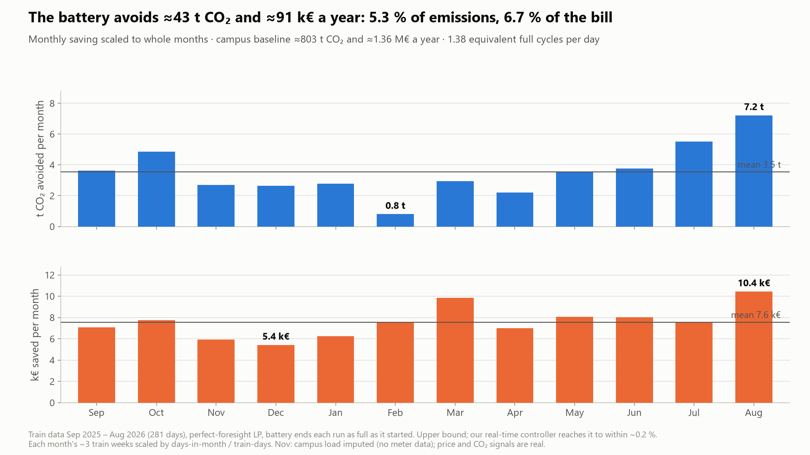
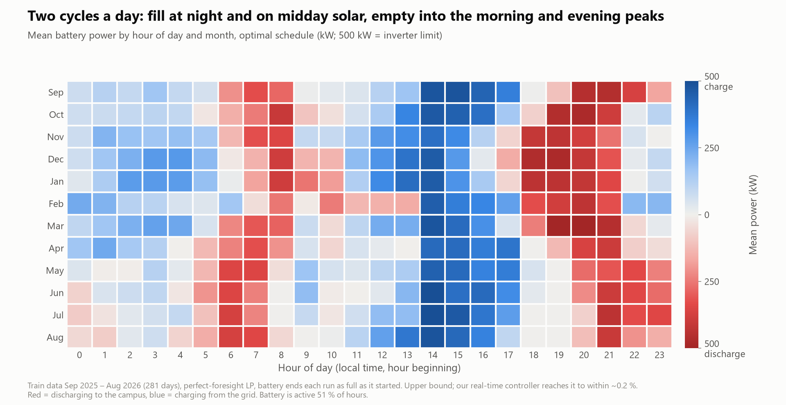
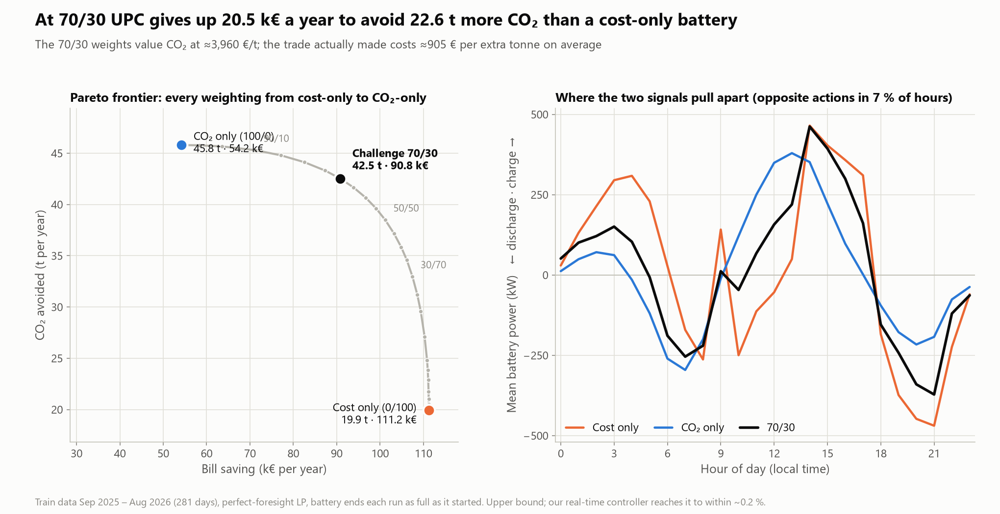
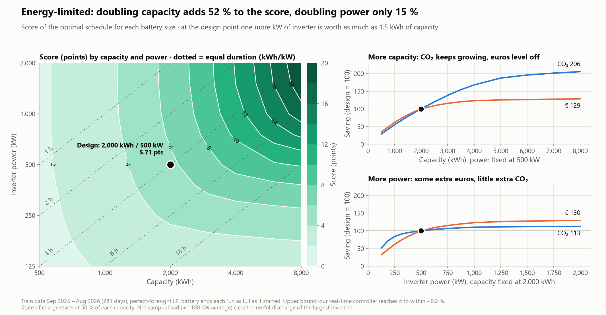
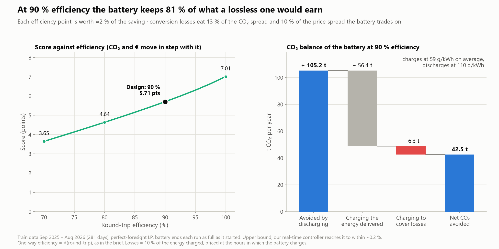
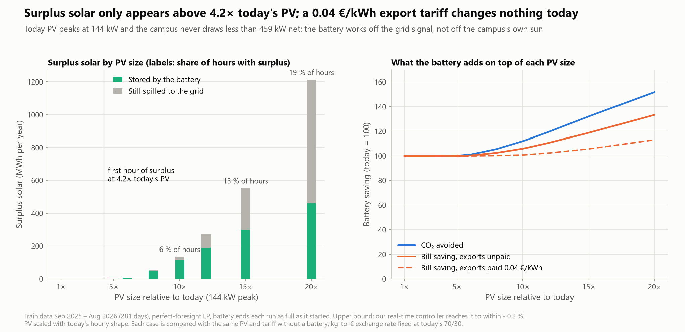
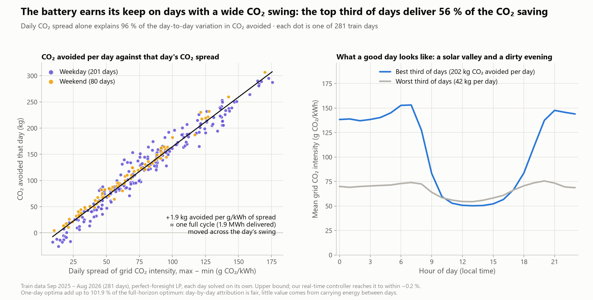
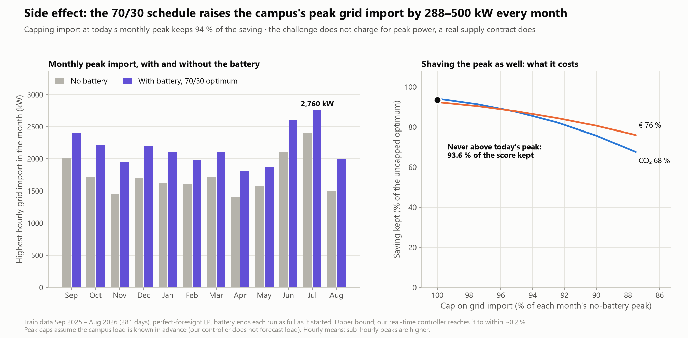

# What the battery is worth, what limits it, and what 70/30 implies

FME Datathon 2026, UPC Sostenible challenge. What-if analyses for the 2,000 kWh / 500 kW / 90 % battery at Campus Nord.

> **All numbers here come from the train data with perfect foresight. They are an upper bound, and our real-time controller reaches it to within about 0.2 %** (5.718 against 5.725 points on the same 281 days, with no infractions).

## Five things UPC Sostenible should know

1. **Worth.** About 42.5 t CO₂ and 91 k€ a year: 5.3 % of the campus's electricity emissions and 6.7 % of its energy bill (5.7 % and 7.0 % against a baseline corrected for the overstated night load), at 1.4 cycles a day.
2. **70/30.** Compared with running the battery for cost alone, UPC gives up 20.5 k€ a year (−18 %) to avoid 22.6 t more CO₂ (+113 %). That is 905 €/t on average and about 3,960 €/t at the margin, and it keeps 93 % of the achievable CO₂ and 82 % of the achievable euros.
3. **Limit.** Energy, not power. Doubling capacity adds 68 % to the CO₂ avoided; doubling the inverter adds 10 %. One more kWh is worth 17.9 kg CO₂ and 23 € a year, one more kW 13.5 kg and 88 €. Each point of efficiency is worth 2 % of the saving.
4. **Source of value.** The daily swing in grid CO₂ explains 96 % of the day-to-day variation in CO₂ avoided. August avoids 7.2 t, February 0.8 t. The midday floor is about 50 g/kWh all year, so the value is set by how much gas runs after sunset.
5. **Side effect.** The 70/30 schedule raises the campus's monthly peak grid import by 290–500 kW (15–34 %) in every month. Capping import at today's peak keeps 94 % of the saving.

## Method and assumptions

- **Sample.** 281 train days (6,744 hours): the first three weeks or so of each month from September 2025 to August 2026. Price and CO₂ are complete. Campus load is imputed for November 2025 (no meter data) and PV after 16 August 2026 (751 hours in all). The battery's absolute savings barely depend on load, because net load is above 500 kW in all but 18 real hours.
- **Model.** A linear programme with the simulator's physics and the challenge's weights, with capacity, power, efficiency and weights as parameters. With the official settings it reproduces `src.sim.oracle` exactly (5.7246 points).
- **Energy-neutral runs.** The battery must end as full as it started (50 %). The simulator's free initial 1,000 kWh is worth 0.018 points over the train run and grows with capacity, so it is removed. The reference is therefore 5.707 points, not 5.725.
- **Annual scaling.** Each month's train total is multiplied by days in the month over train days in the month. This assumes the hidden last week of each month has grid signals like the weeks we have. A flat 365/281 factor gives the same totals to 0.2 %. As a cross-check, the 6.43-point leaderboard entry (4,289 kg and 8,908 € on the public half of the test set) implies 37–45 t and 77–93 k€ a year, depending on how many public hours have meter data (840 to 1,008).
- **Overstated night load.** The meter is not polled between 22:00 and 06:00, and the official table holds the 22:00 reading flat (see `reports/01_eda`). This inflates the no-battery baseline by 6.1 % in energy, 7.3 % in CO₂ and 5.6 % in cost. Savings in kg and euros are unaffected. Savings as a percentage of the baseline are understated, and both versions are given where it matters.
- **Meter faults.** In 15 hours the meter and inverters read 0. They are left as they are, which costs 0.35 % of the CO₂ saving.
- **Euros and CO₂ are the challenge's.** Cost is hourly PVPC times import. CO₂ is 0.37 kg/kWh times the share of emitting generation in the peninsular mix, an average factor.

## 1. What the battery delivers per year

The battery avoids **42.5 t CO₂ and saves 90.8 k€ a year**. The official no-battery baseline is 803 t CO₂, 1.364 M€ and 9,511 MWh a year, so that is **5.3 % of emissions and 6.7 % of the bill**. Against the baseline corrected for the night load (749 t, 1.291 M€) it is 5.7 % and 7.0 %.

| Month | Train days | t CO₂ avoided | % of month | k€ saved | % of month | Cycles/day |
|---|---|---|---|---|---|---|
| Sep | 23 | 3.61 | 5.3 | 7.07 | 6.4 | 1.30 |
| Oct | 24 | 4.87 | 5.2 | 7.74 | 6.2 | 1.39 |
| Nov (load imputed) | 23 | 2.70 | 4.0 | 5.94 | 5.6 | 1.39 |
| Dec | 24 | 2.64 | 3.1 | 5.42 | 4.3 | 1.45 |
| Jan | 24 | 2.77 | 4.0 | 6.24 | 5.2 | 1.56 |
| Feb | 21 | 0.80 | 2.2 | 7.50 | 8.7 | 1.71 |
| Mar | 24 | 2.93 | 5.5 | 9.86 | 8.5 | 1.54 |
| Apr | 23 | 2.20 | 4.6 | 6.99 | 8.0 | 1.48 |
| May | 24 | 3.54 | 6.4 | 8.07 | 8.8 | 1.25 |
| Jun | 23 | 3.77 | 5.9 | 8.02 | 6.9 | 1.30 |
| Jul | 24 | 5.51 | 5.7 | 7.51 | 4.4 | 1.13 |
| Aug | 24 | 7.21 | 11.3 | 10.43 | 10.0 | 1.10 |
| **Year** | **281** | **42.5** | **5.3** | **90.8** | **6.7** | **1.38** |

Monthly values are scaled to whole months; percentages are of the official baseline.

The CO₂ saving varies ninefold across months and the euro saving only twofold. February is the cleanest and flattest month on the grid: the battery cycles more than in any other month (1.71 a day), earns 7.5 k€ and avoids only 0.8 t.

The battery makes **1.38 equivalent full cycles a day**, about 500 a year (10th–90th percentile of days: 0.7–2.0). It is idle in 49 % of hours and at full power in 79 % of the hours it is active.

- **Main cycle, every month.** It charges between 14:00 and 17:00 (300–460 kW on average) and discharges between 18:00 and 21:00.
- **Second, partial cycle.** From October to April it charges between 00:00 and 05:00 and discharges between 06:00 and 08:00. In summer the morning discharge uses energy held over from the afternoon.

On average it charges at 59 g CO₂/kWh and 9.1 c€/kWh and discharges at 110 g and 19.6 c€. The campus averages are 85 g and 14.3 c€.

About 10 % of the campus's grid energy passes through the battery (955 MWh delivered a year). Conversion losses add 106 MWh a year, so the campus consumes 1.1 % more electricity and emits 5.3 % less.

At 91 k€ a year, the saving repays 454 € per kWh of installed capacity in ten years. This is undiscounted and ignores degradation and maintenance.

## 2. CO₂ versus cost: the Pareto frontier

Sample: all 6,744 hours, 26 weightings from cost-only to CO₂-only.

| Weight on CO₂ | Implied carbon price (€/t) | t CO₂ avoided / year | k€ saved / year |
|---|---|---|---|
| 0 (cost only) | 0 | 19.9 | 111.2 |
| 0.045 | 80 | 22.6 | 111.1 |
| 0.1 | 189 | 24.8 | 110.9 |
| 0.3 | 727 | 33.0 | 107.5 |
| 0.5 | 1,697 | 38.5 | 101.2 |
| 0.6 | 2,545 | 40.7 | 96.7 |
| **0.7 (challenge)** | **3,960** | **42.5** | **90.8** |
| 0.8 | 6,788 | 44.1 | 82.6 |
| 0.9 | 15,273 | 45.3 | 71.2 |
| 1 (CO₂ only) | – | 45.8 | 54.2 |

- **What 70/30 costs.** Compared with a battery run for the bill alone, UPC gives up **20.5 k€ a year (18 % of the achievable saving) and avoids 22.6 t more CO₂ (+113 %)**. The average price of that trade is 905 € per tonne.
- **What 70/30 implies.** The score is indifferent between 1 kg of CO₂ and (0.7/0.3) × (baseline cost / baseline CO₂) = 3.96 €. That is an **implied carbon price of about 3,960 €/t**, and the measured slope of the frontier at the 70/30 point is 3,980 €/t. It is roughly fifty times the price of an EU emission allowance (an outside figure, not from the data). A battery run at an allowance-like 80 €/t would put a 4.5 % weight on CO₂ and avoid 22.6 t, about half of what is achievable.
- **Why 70/30 is still a sensible point.** The frontier is strongly curved. The first tonnes are cheap (from cost-only to 10/90: 4.9 t for 0.4 k€) and the last are very expensive (from 90/10 to CO₂-only: 0.5 t for 17 k€). 70/30 sits on the knee, with 93 % of the CO₂ of a carbon-only battery and 82 % of the euros of a cost-only one.
- **The weighting is a physical choice.** The score is flat around 0.7, but between 60/40 and 80/20 the bill saving moves by 14 k€ a year and the CO₂ avoided by 3.5 t.

**How often the two signals disagree.** Price and CO₂ correlate at 0.58 hour by hour. On an average day only 44 % of the four cheapest hours are also among the four cleanest, and the two rankings are negatively correlated on 9 % of days.

The cost-only and CO₂-only schedules do the same thing in 26 % of hours, are both idle in 24 %, and do **opposite things in 7.2 % of hours** (9.5 % of the hours in which either acts). The conflict is concentrated in two windows:

- **10:00–13:00.** Opposite actions on 19–30 % of days. The weekday peak toll makes power expensive exactly when solar makes it clean.
- **04:00–05:00.** Opposite actions on 13 % of days. Night power is cheap but not clean.

The 70/30 schedule takes the same action as the CO₂-only one in 75 % of hours and the same as the cost-only one in 67 %.

## 3. Sizing: energy-limited or power-limited?

Sample: 9 × 9 grid of capacity (500–8,000 kWh) and inverter power (125–2,000 kW), plus finer cuts. All 6,744 hours, 70/30 weights, state of charge starting at 50 % of each capacity.

| Battery | Duration | Score | t CO₂ / year | k€ / year |
|---|---|---|---|---|
| 1,000 kWh / 500 kW | 2 h | 3.29 | 23.5 | 56.2 |
| 2,000 kWh / 250 kW | 8 h | 4.35 | 35.7 | 56.0 |
| **2,000 kWh / 500 kW (design)** | **4 h** | **5.71** | **42.5** | **90.8** |
| 2,000 kWh / 1,000 kW | 2 h | 6.55 | 46.9 | 111.8 |
| 3,000 kWh / 500 kW | 6 h | 7.45 | 58.9 | 105.1 |
| 4,000 kWh / 500 kW | 8 h | 8.70 | 71.5 | 111.9 |
| 4,000 kWh / 1,000 kW | 4 h | 11.34 | 84.5 | 180.4 |
| 8,000 kWh / 500 kW | 16 h | 10.20 | 87.4 | 116.8 |

**The battery is energy-limited.** Doubling capacity adds 52 % to the score and 68 % to the CO₂ avoided. Doubling power adds 15 % and 10 %.

Marginal values at the design point (LP shadow prices, confirmed by finite differences):

| One more… | Score points | kg CO₂ / year | € / year | Share of marginal value: score / CO₂ / € |
|---|---|---|---|---|
| kWh of capacity | 0.00207 | 17.9 | 23 | 73 % / 84 % / 51 % |
| kW of inverter | 0.00312 | 13.5 | 88 | 27 % / 16 % / 49 % |

One kW of inverter is worth as much as 1.5 kWh of capacity for the score, 0.76 kWh for CO₂ and 3.8 kWh for euros. At the optimum the battery is full in 12 % of hours and empty in 14 %; it charges at the 500 kW limit in 23 % of hours and discharges at it in 18 %.

**Carbon wants hours, euros want kilowatts.** The clean valley and the dirty evening and night are each many hours long, so more capacity keeps adding CO₂ savings. Price peaks are short, so the bill saving levels off beyond 4,000 kWh and responds to power instead.

**Sweet-spot duration.** Scaling capacity and power together scales the value in proportion (doubling both gives 1.99×), so only the duration (kWh per kW) matters. With a 500 kW inverter, the marginal kWh is worth:

| Duration | kg CO₂ / year per extra kWh | € / year per extra kWh |
|---|---|---|
| 2 h | 21 | 45 |
| 4 h (design) | 18 | 23 |
| 6 h | 15 | 10 |
| 8 h | 10 | 4 |
| 10 h | 6 | 1 |

Beyond 10 hours extra capacity is worth almost nothing, because the battery can then only do one deep cycle a day. Capacity and power carry equal marginal value at 4.1 hours for euros, 7.5 hours for the score and 8.9 hours for CO₂. **The 4-hour design is balanced for the bill; for carbon the sweet spot is 6 to 8 hours.**

The cost-optimal duration depends on what a kW costs relative to a kWh (approximate, read off a 0.5–1 h grid):

| A kW of inverter costs as much as… | Best duration: score | CO₂ | € |
|---|---|---|---|
| 0.5 kWh of capacity | 2.5 h | 3 h | 2 h |
| 1 kWh | 3.5 h | 5 h | 3 h |
| 1.5 kWh | 4 h | 5 h | 3 h |
| 2 kWh | 4 h | 6 h | 3.5 h |
| 3 kWh | 5 h | 7 h | 4 h |
| 4 kWh | 6 h | 7 h | 4 h |

Caveat: for inverters of 1,000 kW and more the campus's own demand starts to cap the useful discharge, and the real night load is lower than the official one.

## 4. Efficiency

Sample: all 6,744 hours, round-trip efficiency from 70 % to 100 % (one-way = square root, as in the brief).

| Round-trip efficiency | Score | t CO₂ / year | k€ / year | Cycles/day |
|---|---|---|---|---|
| 70 % | 3.65 | 27.4 | 57.1 | 0.92 |
| 80 % | 4.64 | 34.8 | 72.9 | 1.09 |
| 85 % | 5.16 | 38.5 | 81.7 | 1.22 |
| **90 %** | **5.71** | **42.5** | **90.8** | **1.38** |
| 95 % | 6.31 | 47.0 | 100.2 | 1.60 |
| 100 % | 7.01 | 52.4 | 111.1 | 2.05 |

The relation is close to linear. **Each point of efficiency is worth about 2 % of the saving** (0.11 score points, 0.8 t CO₂ and 1.9 k€ a year). At 90 % the battery keeps 81 % of what a lossless one would earn. Of the 19 % lost, 58 % is energy lost on the trades it makes and 42 % is trades no longer worth making (1.38 cycles a day instead of 2.05).

**How much of the spread is wasted at 90 %.** Discharging avoids 105.2 t CO₂ a year. Charging adds 62.7 t, of which 56.4 t is for the energy that is delivered and 6.3 t for energy that never comes back. Losses therefore consume **13 % of the CO₂ spread** the battery trades on, and 10 % of the price spread (9.6 k€ of 100.4 k€).

The battery is not operating near the break-even. Its discharge hours are 1.87 times dirtier and 2.16 times dearer than its charge hours, against a break-even of 1.11.

## 5. What if PV were larger, or exports were paid? (side note)

Sample: all 6,744 hours, PV scaled with today's hourly shape. Each case is compared with the same PV and tariff without a battery.

Today PV peaks at 144 kW and supplies 2.3 % of the load. The campus's lowest real net demand is 459 kW, so there is never a surplus and the battery works entirely off the grid signals. **The first hour of surplus appears at 4.2 times today's PV** (about 610 kW peak). Surplus reaches 1 % of hours at 6 times and 5 % at 9.5 times.

| PV size | Hours with surplus | Surplus (MWh/yr) | Stored by battery (MWh/yr) | Battery: t CO₂/yr | Battery: k€/yr, exports unpaid | k€/yr, exports paid 0.04 €/kWh |
|---|---|---|---|---|---|---|
| 1× (144 kW) | 0 % | 0 | 0 | 42.5 | 90.8 | 90.8 |
| 5× | 0.2 % | 1 | 1 | 42.6 | 90.7 | 90.7 |
| 8× | 3.3 % | 51 | 51 | 44.9 | 93.0 | 90.9 |
| 10× (1.44 MW) | 5.8 % | 137 | 116 | 47.6 | 96.1 | 91.4 |
| 15× | 12.9 % | 553 | 299 | 56.2 | 107.9 | 95.9 |
| 20× | 18.9 % | 1,213 | 462 | 64.6 | 121.1 | 102.6 |

**A 0.04 €/kWh export tariff changes nothing today.** The optimal schedule is identical hour by hour and nothing is exported. The tariff is 28 % of the average import price, and under 70/30 a kWh used on campus is worth far more than a kWh sold.

With a much larger PV plant, paid exports would lower the battery's own contribution to the bill (surplus solar would have another outlet) while leaving its CO₂ contribution unchanged.

Note: with a non-zero export price the official simulator would credit the agent's exports but not the baseline's. That quirk is not reproduced here.

## 6. Where the value comes from

Sample: 281 days, each solved on its own with a periodic state of charge so that every day has a self-contained saving. These one-day optima add up to 101.9 % of the full-horizon optimum, so the attribution is fair. The controller's result (99.9 % of perfect foresight with a 24-hour view) confirms that little value comes from carrying energy between days.

**By season**

| Season | Days | kg CO₂ / day | € / day | Share of CO₂ saving | Share of € saving |
|---|---|---|---|---|---|
| Autumn | 70 | 130 | 231 | 27 % | 23 % |
| Winter | 69 | 66 | 208 | 13 % | 20 % |
| Spring | 71 | 99 | 273 | 21 % | 28 % |
| Summer | 71 | 185 | 283 | 39 % | 29 % |

**By kind of day**

| Kind of day | Days | kg CO₂ / day | € / day | Share of CO₂ saving | Share of € saving |
|---|---|---|---|---|---|
| Weekday | 201 | 126 | 278 | 75 % | 80 % |
| Weekend | 80 | 105 | 175 | 25 % | 20 % |
| Low CO₂ spread (mean 37 g/kWh) | 94 | 42 | 208 | 12 % | 28 % |
| Mid CO₂ spread (73 g/kWh) | 93 | 117 | 259 | 32 % | 34 % |
| High CO₂ spread (120 g/kWh) | 94 | 201 | 279 | 56 % | 38 % |

- **The daily CO₂ spread is the whole story for carbon.** The spread between the dirtiest and cleanest hour explains 96 % of the day-to-day variation in CO₂ avoided. The slope is 1.9 kg per g/kWh of spread, which is one full cycle (1.9 MWh delivered) moved across the day's swing. The top third of days by spread deliver 56 % of the year's CO₂ saving; the bottom third 12 %.
- **Euros are spread more evenly.** The best 20 % of days deliver 38 % of the CO₂ and 32 % of the euros. A day's CO₂ saving and its euro saving correlate at only 0.29, so a good carbon day is not necessarily a good bill day.
- **Weekends earn 37 % less in euros.** They carry the valley tariff all day, so the price spread is 11.8 c€ against 19.8 c€ on weekdays. In CO₂ they earn only 17 % less.
- **Campus demand plays no role.** Daily load explains 3 % of the variation.
- **On 3.6 % of days the battery slightly increases emissions,** because the price signal outweighs a nearly flat CO₂ signal.

**Which grid conditions make the battery useful.** The cleanest hour of the day is almost the same on good and bad days: 49 g/kWh on the best third of days and 50 g/kWh on the worst third (13 % emitting generation in both). The difference is the dirtiest hour: 168 g/kWh against 88 g/kWh (45 % against 24 % emitting generation).

A good day is therefore a sunny day followed by a gas-heavy evening and night. Emitting generation swings by 8.9 GW on the best third of days and by 3.0 GW on the worst. Most such days are in July, August and October.

A poor day is a windy or wet day when the grid is clean around the clock, typically in February, March, December and January. On those days the battery still earns euros but avoids little CO₂.

## 7. The side effect the score does not see: peak import (extra analysis)

Why this analysis: the challenge scores energy only. A real supply contract also bills peak power, and UPC would see this effect on its first invoice.

Sample: all 6,744 hours, hourly means (sub-hourly peaks are higher). November's peak rests on imputed load.

The 70/30 schedule charges at 500 kW in the cleanest and cheapest hours, and these are often hours of high campus demand: the battery charges in 39 % of the top-decile load hours.

- **The monthly peak rises in every month.** The highest hourly import goes up by 288 to 500 kW, which is 15 to 34 %. The yearly maximum goes from 2,404 to 2,760 kW.
- **It happens often, and by day.** Import exceeds the month's no-battery peak in 612 daytime hours of the 281 days (551 without November), mostly between 13:00 and 17:00. All the monthly peaks fall in daytime hours, so the overstated night load does not create this result.

| Limit on grid import | Score kept | t CO₂ / year | k€ / year |
|---|---|---|---|
| None (score optimum; monthly peak +288 to +500 kW) | 100 % | 42.5 | 90.8 |
| Each month's no-battery peak (never worse than today) | 93.6 % | 40.1 | 84.0 |
| 5 % below it (about 87 kW lower) | 87.7 % | 37.2 | 79.8 |
| 10 % below it (about 174 kW lower) | 77.5 % | 32.2 | 73.3 |
| 12.5 % below it | 70.6 % | 28.7 | 69.0 |
| 15 % below it | not feasible with this battery | – | – |

Operating the battery so that the campus never draws more than it does today costs 6 % of the saving (2.4 t and 6.8 k€ a year). Peak shaving beyond that is expensive in carbon.

These caps assume the campus load is known in advance. Our controller does not forecast load, so a deployed version would need a load forecast or a simple real-time import limit.

## Computed and inferred

**Computed** on the train data with the optimisation described above: every number in sections 1 to 7, the controller comparison, and the identity CO₂ intensity = 0.37 kg/kWh × share of emitting generation.

**Taken from the exploratory analysis** (`reports/01_eda`), not recomputed here: the night-load overstatement of the baseline (energy +6.1 %, CO₂ +7.3 %, cost +5.6 %).

**Inferred, or relying on outside knowledge:**

- **Annual totals** assume the hidden last week of each month has grid signals like the first three. The leaderboard cross-check gives 37–45 t and 77–93 k€.
- **The comparison with the EU allowance price** uses an outside figure of roughly 60–90 €/t.
- **Euros are challenge euros.** PVPC is a small-consumer tariff used as a proxy; UPC's real contract has different hourly spreads and bills peak power, which the challenge does not model.
- **The CO₂ factor is an average-mix factor.** The real effect of shifting consumption depends on which plants respond at the margin.
- **No degradation is modelled.** The battery makes about 500 full cycles a year.
- **Perfect foresight of campus load** is assumed in the sizing, PV and peak-cap cases. It matters only for the peak caps and for inverters of 1,000 kW and more.

## Reproduce

From the repo root: `.venv/Scripts/python.exe experiments/04_whatif/run_all.py` (about five minutes). Each `aN_*.py` script can also be run on its own. Figures go to `reports/04_whatif/figs/`, numbers to `reports/04_whatif/stats/`.
