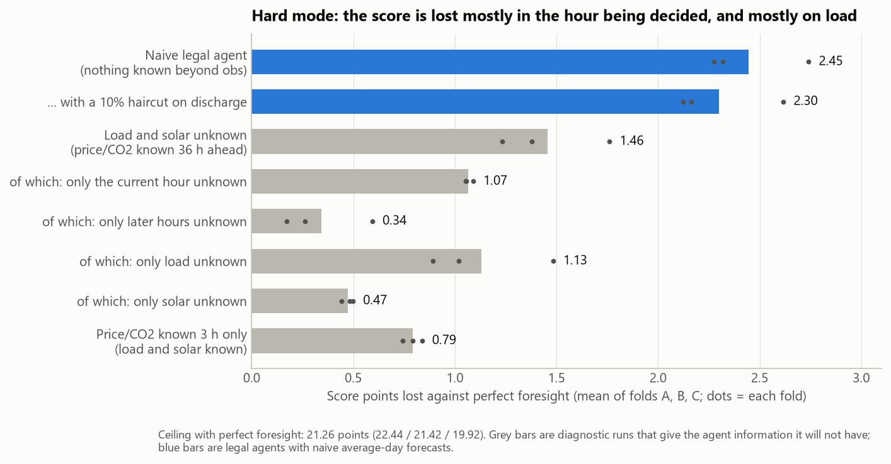

# Hard mode: first numbers and plan of attack

**Written:** Sat 14 Nov 2026, 17:22. Rules of the mode: [`docs/NEW_RULES.md`](../../docs/NEW_RULES.md).

## 1. Summary

- **The ceiling is about 21 points.** With perfect knowledge of the future the best possible score on our three test-like train folds is 22.44 / 21.42 / 19.92.
- **A naive legal agent already scores about 19.** Average-day forecasts plus an optimiser that re-plans every hour: 19.83 / 19.29 / 17.76, with 0 infractions.
- **The 2.3 points in between are lost mostly in the hour being decided.** The agent does not know the load of the hour it is acting in. When it discharges more than the campus is drawing, the excess goes to the grid for nothing.
- **Load matters more than solar, and both matter more than the price window.** Naive forecasts cost 1.13 points for load, 0.47 for solar and 0.79 for the 3-hour price/CO₂ window.
- Five subagents are working on these, in that priority order (section 4).

## 2. How the numbers were obtained

- **Folds.** Three runs built like the hidden test, from train days: A = days 1–7 of every month, B = days 8–14, C = days 15–21, each concatenated. Solar is multiplied by 12, the battery is 6,000 kWh / 1,500 kW, and the agent sees 3 values of price and CO₂. November has no meter data and is absent, so each fold has about 1,725–1,850 hours.
- **Ceiling.** A linear programme over the whole run with everything known (`src/hard.py`, `oracle`). No schedule can score higher.
- **Agent.** Every hour it forecasts the score signal and the net load for the next 36 hours, solves the best plan for that window, and applies the first hour (`src/hard_mpc.py`, `MPCHard`). Forecasts are fitted only on train days outside the fold.
- **Simulator check.** Our fast simulator and the organisers' `environment.py` give the same score on fold B (19.10 both, 0 infractions).

## 3. Results

Scores on the three folds (mean in the last column):

| Agent | A | B | C | Mean |
|---|---|---|---|---|
| Perfect foresight (ceiling) | 22.44 | 21.42 | 19.92 | 21.26 |
| Re-planning each hour with the true next 24 h | 22.44 | 21.42 | 19.92 | 21.26 |
| Price/CO₂ known 3 h only (average-day forecast after), load and solar known | 21.60 | 20.62 | 19.18 | 20.47 |
| Price/CO₂ known, load and solar from average-day forecasts | 20.68 | 20.04 | 18.69 | 19.80 |
| **Naive legal agent** (both forecast) | 19.70 | 19.10 | 17.64 | 18.81 |
| **Naive legal agent, discharge limited to 90 % of the forecast load** | **19.83** | **19.29** | **17.76** | **18.96** |

What the rows say:

- **Looking 24 hours ahead is enough.** Re-planning with the true next 24 hours equals the ceiling to 0.002.
- **The 3-hour window costs 0.79.** With load and solar known, replacing the true signal beyond 3 hours by a monthly average-day curve loses that much.
- **Not knowing load and solar costs 1.46.** Splitting it:

| What is unknown (price/CO₂ known) | Points lost | Energy thrown away per run |
|---|---|---|
| Load and solar, all hours | 1.46 | 22.0 MWh |
| Only the hour being decided | 1.07 | 16.8 MWh |
| Only the later hours | 0.34 | 3.3 MWh |
| Only load | 1.13 | 14.4 MWh |
| Only solar | 0.47 | 10.4 MWh |

- **A crude haircut already helps.** Discharging at most 90 % of the forecast load recovers 0.15, because over-discharging wastes the energy while under-discharging only delays its use.

Two facts about the load that should make it much more predictable than the naive forecast assumes (to be confirmed by the load subagent):

- **At night the meter is not read.** The 22:00 reading is held until 06:00, so from 23:00 to 05:00 the load of the next hour equals the last reading exactly. The naive forecast ignores this.
- **The first hour of each test week follows a three-week gap.** The "last reading" is stale there and has to be replaced by something else.

## 4. What is being tried now

| Subagent | Question | Reference to beat |
|---|---|---|
| Packager | Can the naive agent be a valid ZIP for this shift? | 18.96, 0 infractions, under 20 s |
| Load forecaster | How well can the current hour's load be predicted? | 1.13 points lost |
| Solar forecaster | Same for solar ×12, plus the next day's surplus | 0.47 points lost |
| Price/CO₂ forecaster | How much of the 3-hour window loss can a forecast recover? | 0.79 points lost |
| Planner | A faster optimiser that knows the forecast is uncertain | 18.96 with a fixed haircut |

## 5. How this compares with the leaderboard

At 16:57 the hard-mode leaderboard had two teams: 21.27 and 4.50 (public half of the test). Our folds are train weeks, not the test weeks, so the numbers are not directly comparable. In standard mode the public test scored about 10 % higher than our folds for the same agent (6.43 against 5.84). If the same ratio holds, the naive agent would land near 20.9 and the ceiling near 23.4 on the public half. That is an extrapolation; the first submission will tell.

## 6. Files

- `src/hard.py`: hard-mode table, folds, simulator, ceiling.
- `src/hard_mpc.py`: optimiser with pluggable forecasters, naive forecasters, perfect-information forecasters for diagnostics.
- `experiments/20_hard_baseline/`: the three scripts behind the tables (`decompose.py`, `decompose_n.py`, `decompose_parts.py`), their CSVs, and `fig_losses.py`.
