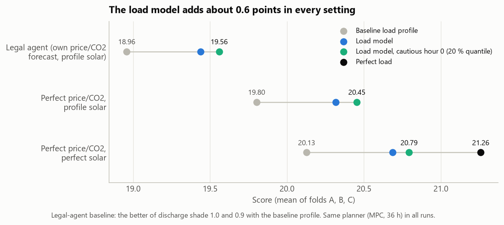
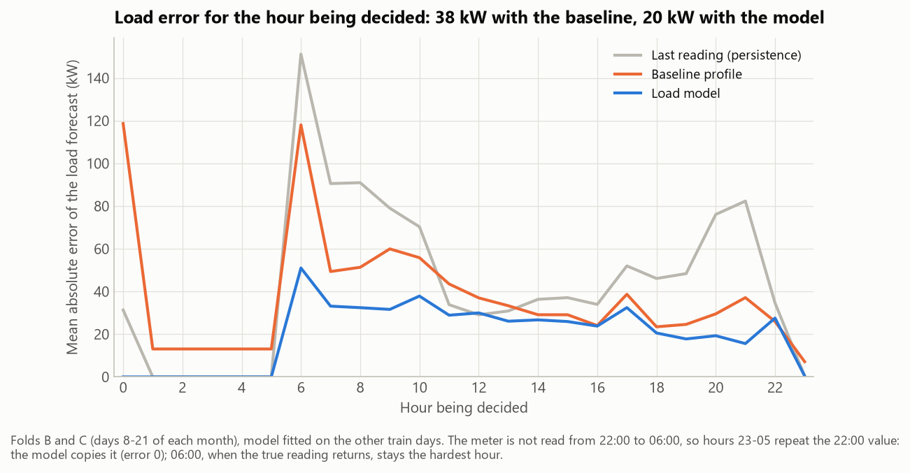
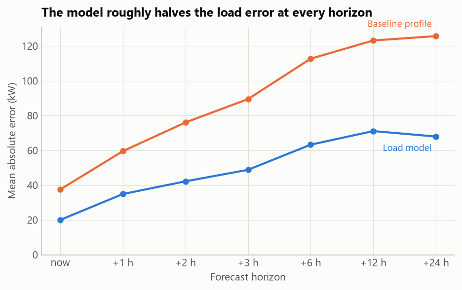
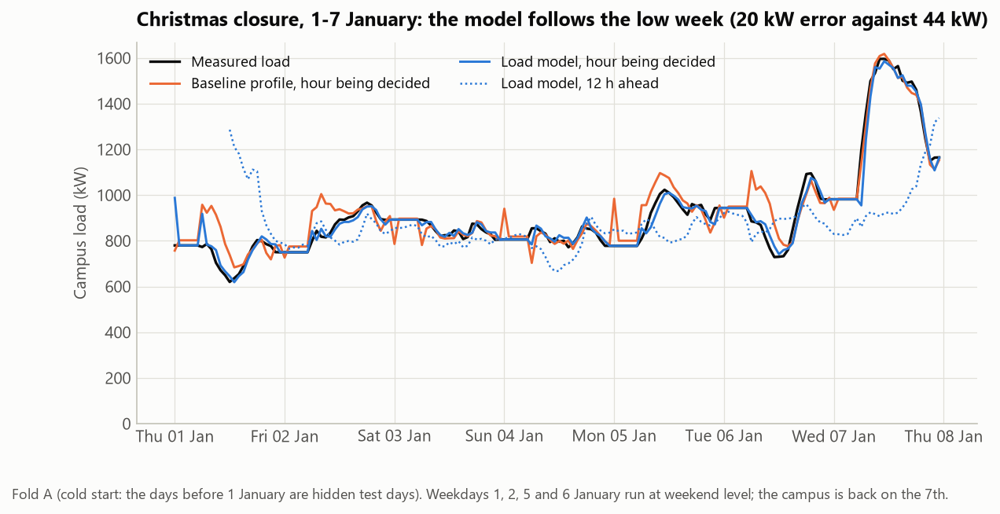
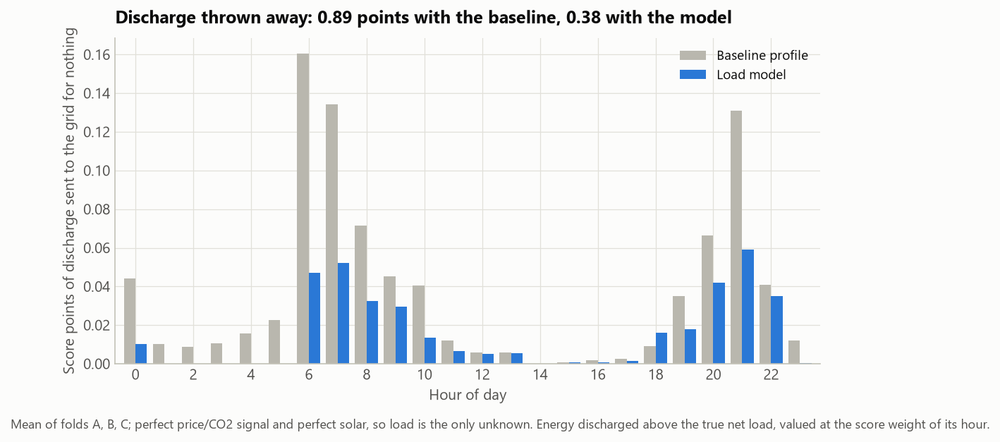

# Load forecast for hard mode

**Written:** Sat 14 Nov 2026, 18:00, by the load subagent. Code: `experiments/21_load/load_fc.py`, class `LoadFC`.

## 1. Summary

- **The new forecaster halves the load error for the hour being decided:** 38 → 20 kW on folds B and C.
- **It adds about 0.6 points in every setting.** In the fully legal agent: 18.96 → 19.56.
- **58 % of the load-only gap is recovered:** 0.66 of the 1.13 points between the naive forecast and perfect load.
- **A low quantile for the current hour beats a flat haircut** by +0.10 to +0.15. It shades nothing at night, when the load is known exactly, and more at 06:00.

Closed loop with the deterministic planner, mean of folds A, B, C:

| Setting | Naive load | `LoadFC`, median | `LoadFC`, current hour at the 20 % quantile | Perfect load |
|---|---|---|---|---|
| Perfect signal, perfect solar | 20.13 | 20.69 | **20.79** | 21.26 |
| Perfect signal, naive solar | 19.80 | 20.32 | **20.45** | 20.78 |
| Legal (naive signal and solar) | 18.81 | 19.41 | **19.56** | not run |



## 2. What the meter does

Measured on the organisers' hourly table (5,993 h):

- **Night freeze, confirmed.** For hours 00–05 the load equals the previous hour on all 250 nights. At 23:00 the difference is 0.2 kW median, 5.1 kW at most. So from 23:00 to 05:00 the next hour is known exactly.
- **22:00 is the last reading taken,** not an hourly mean. It differs from 21:00 by a median of 27 kW.
- **06:00 does not simply drop.** It depends on the day:

| Day | Mean change at 06:00 (kW) |
|---|---|
| Monday | +383 |
| Tuesday–Friday | +65 to +110 |
| Saturday | −188 |
| Sunday | −29 |

  It is the hardest hour: median change 107 kW, one in ten above 345 kW.
- **The first hour after a gap is stale.** The table has 12 gaps longer than an hour (month boundaries, November, two meter faults). The forecaster detects the jump and looks the previous hour up in its stored table.
- **Meter faults.** While the reading is 0 the forecast is 0, so the planner does not discharge.



## 3. Accuracy

Mean absolute error by horizon, kW, fitted on train days outside each fold:

| Folds | Model | now | +1 | +2 | +3 | +6 | +12 | +24 |
|---|---|---|---|---|---|---|---|---|
| B+C | Naive profile | 37.6 | 59.6 | 76.1 | 89.5 | 112.7 | 123.2 | 125.7 |
| B+C | Persistence | 44.0 | | | | | | |
| B+C | `LoadFC` | **20.0** | 34.9 | 42.2 | 48.9 | 63.3 | 71.1 | 68.0 |
| A (cold start) | Naive profile | 39.3 | 63.0 | 80.9 | 95.5 | 123.5 | 141.3 | 147.3 |
| A (cold start) | `LoadFC` | **23.2** | 35.9 | 45.8 | 54.9 | 78.3 | 96.6 | 99.6 |



**Quantiles** (hours 06–22, folds B+C): the share of true values below the 5 / 10 / 25 / 50 / 75 / 90 / 95 % quantiles is 3 / 8 / 20 / 44 / 71 / 87 / 94 %. They sit about 3 kW low. The 10–90 % band is 118 kW wide at 06–10, 86 kW at 11–17 and 65 kW at 18–22. From 23:00 to 05:00 it has zero width.

## 4. How it works

1. **Regime rules.** Night: copy the last reading. 22:00: predict the freeze value from 20:00 and 21:00. 06:00: predict the release by day of week. After a timestamp jump: look the previous hour up in the stored table.
2. **A reference built from recent days,** not a calendar average: the mean of the last 3 days of the same type, from the stored table and the run's own readings.
3. **A small gradient-boosting model** (LightGBM, 28 features, 300 trees) for the change from the last reading, in daytime hours.
4. **A holiday index** that blends the weekday and Sunday references for the later hours, estimated from today's readings and carried to the next weekday.
5. **Quantiles** from residuals by hour and weekend.

Rules plus the recent-days reference, with no model at all, already give 24 kW and most of the score gain (20.70 against 20.79 in the first setting).

## 5. Holidays and closures

The hidden test weeks include Christmas week and late July, with no train row for those calendar days. The forecaster was built to lean on what it has just observed.

Low weekdays found from the load itself: 11 Sep, 8 Dec, 24 Dec, 1, 2, 5 and 6 Jan, 12 Feb, 2, 3 and 6 Apr, 1 May.

Mean absolute error on those days and on normal days (hours 06–22, folds A+B+C), kW:

| Days | Model | now | +1 | +3 | +6 | +12 | +24 |
|---|---|---|---|---|---|---|---|
| Holiday weekdays (187 h) | Naive profile | 83 | 154 | 267 | 384 | 474 | 489 |
| | `LoadFC` | 34 | 60 | 113 | 180 | 239 | 228 |
| First day of a stretch | `LoadFC` | 40 | 74 | 145 | 249 | 368 | 385 |
| Later days of a stretch | `LoadFC` | 26 | 44 | 73 | 97 | 111 | 133 |
| Normal days (3,649 h) | `LoadFC` | 29 | 45 | 60 | 73 | 84 | 81 |
| | Naive profile | 41 | 62 | 88 | 110 | 126 | 126 |

- **From the second day of a closure the error is back to normal.**
- **The first day is the weak spot.** At 06:00 the model expects the weekday ramp: 146 kW error against 86 for persistence. By 07:00–09:00 it is 39–54 kW.

Discharge thrown away on those stretches, kWh (naive → `LoadFC` median → 25 % quantile):

- 1–7 January: 1,022 → 438 → 223
- 1–7 April (Easter): 1,620 → 529 → 263



## 6. Where the score is still lost

With a perfect signal and perfect solar, discharge sent to the grid for nothing per fold:

| Forecaster | MWh | Score points |
|---|---|---|
| Naive profile | 10.7 | 0.89 |
| `LoadFC` median | 4.8 | 0.38 |
| `LoadFC` 25 % quantile | 2.2 | 0.18 |
| Perfect load | 0 | 0 |



- With the median, the loss is split between the morning ramp (06–10: 0.17 points) and the evening (18–22: 0.18). Evening errors are small, but those are the hours with the most discharge.
- **Further gain needs a smarter use of the distribution in the planner,** not a sharper point forecast. The error for the current hour looks close to its floor.

## 7. What was tried

| Step | Result |
|---|---|
| Rules + recent-days reference, no model | 24.0 kW; most of the gain |
| + gradient boosting, 15 features | 20.3 kW |
| + 13 more features, robust loss (default) | 20.0 kW |
| Holiday index for later hours | error −2 to −3 % on B+C, −8 to −10 % on A, −25 % on holidays |

Did not help:

- Temperature and irradiance features: 0.1 kW.
- Day of year: nothing, and risky on calendar weeks never seen.
- Tree size and learning rate: within ±0.3 kW.
- A separate quantile model per quantile, against one forecast plus residual quantiles: no better.
- Stacking the quantile with a flat haircut: worse (19.11 against 19.54).

## 8. Open risks

1. **November test week.** Train has no load from 25 October to 30 November, so the week starts cold. Fold A is the analogue: 23 kW against 20 kW for the current hour.
2. **First day of a holiday** (25 December, for example): the 06:00–09:00 over-forecast is unavoidable without a calendar of holidays, which was not hard-coded.
3. **Return from a closure:** the 12–24 h forecast runs low for a day or two. This is the cheap direction.
4. **The quantile was tuned with the deterministic planner.** It has to be re-tuned, or replaced, once the planner uses scenarios.
5. **LightGBM on the server.** A version mismatch would break the stored model. The no-model fallback costs 0.07–0.10 points.
6. **The holiday evidence rests on 11 days.**

## 9. How to use it

```python
# experiments/21_load/load_fc.py   (runtime imports: numpy, pandas, lightgbm)
from load_fc import LoadFC, LoadQ
from fit_table import load_fit_table           # not a runtime module (imports src)

fc = LoadFC(load_fit_table())
load = LoadQ(fc, q=0.2)                        # current hour = 20 % quantile; later hours unchanged
fc.predict_load(obs, hist, H)
fc.predict_load_quantiles(obs, hist, qs)       # current hour only
state = fc.to_state(); fc = LoadFC.from_state(state)   # plain dict, 568 kB pickled
```

- **Fit on `load_fit_table()`,** which has 6,187 load hours against 5,993 in the official table: it keeps 17–24 August, the days right before the August test week.
- **Stateful.** One fresh instance per run, called every hour from the first step.
- **Timing:** 0.36 ms per call on a busy machine, about 1.1 s for 2,016 steps. Prediction must stay single-threaded.

Scripts in `experiments/21_load/`: `eval_offline.py`, `closed_loop.py`, `diag.py`, `holidays.py`, `holiday_eval.py`, `timing.py`, `figs.py`, and four research scripts.
