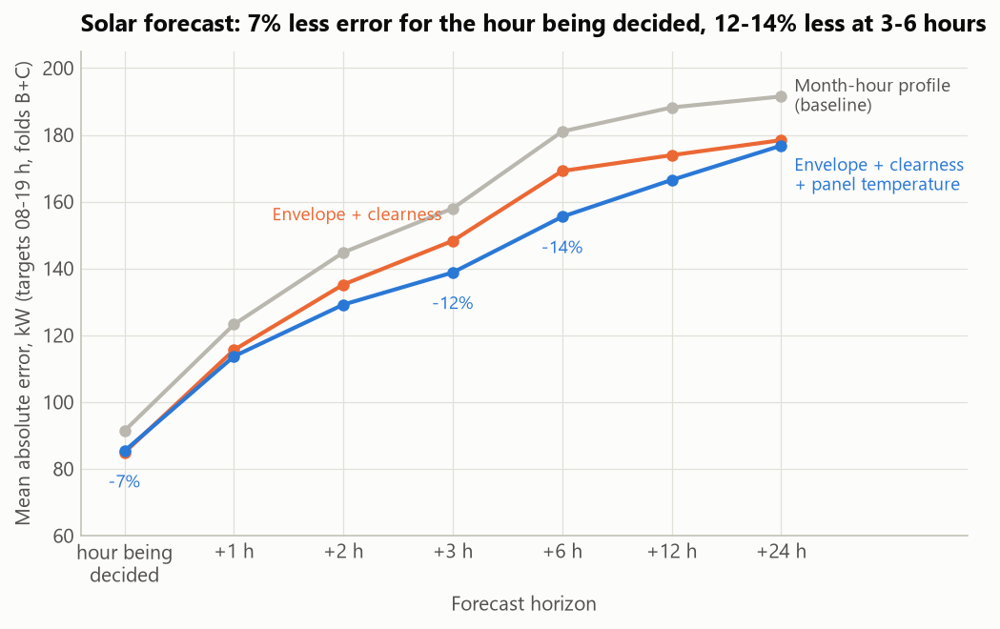
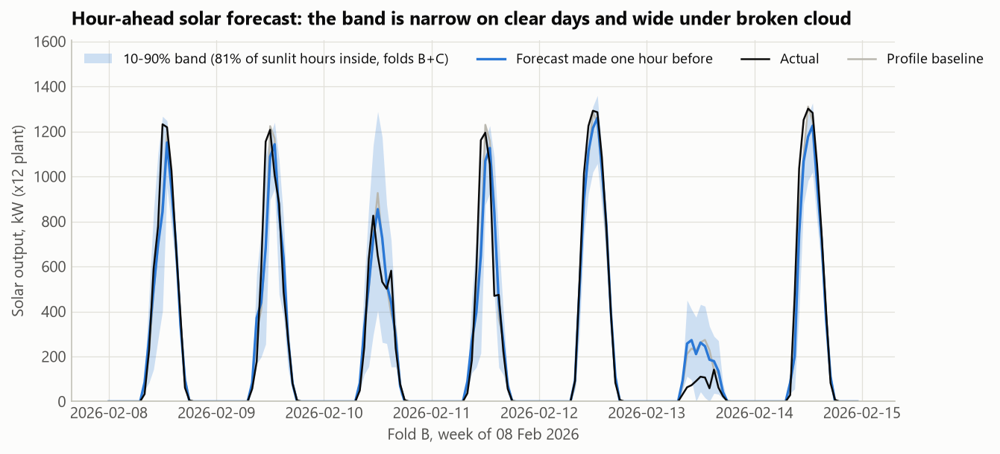
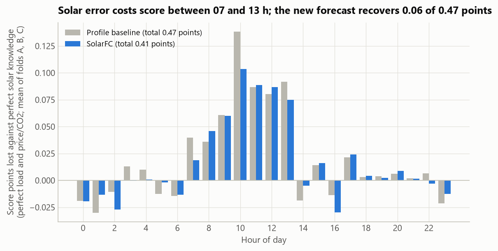
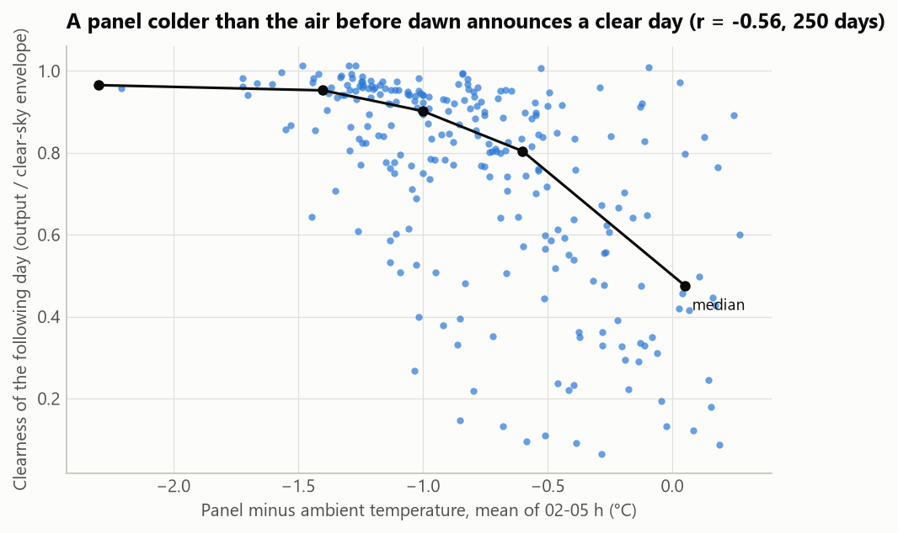

# Solar forecast for hard mode

**Written:** Sat 14 Nov 2026, 17:55, by the solar subagent. Code: `experiments/22_solar/solar_fc.py`, class `SolarFC`.

## 1. Summary

- **A better solar forecast is worth little: +0.06 points.** The new forecaster cuts the error for the hour being decided by 7 % and for the hours after by 6–12 %.
- **Being deliberately optimistic about solar is worth more: +0.17.** Planning the current hour on the 75th percentile of solar (not the mean) recovers three times as much.
- **Why:** almost all the remaining loss is spilled energy. When solar is under-forecast, the agent thinks the campus draws more than it does and discharges too much.
- **Where it stands** (mean of folds A, B, C; closed loop):

| Configuration | Profile solar (reference) | `SolarFC` mean | `SolarFC`, 75th percentile for the current hour | Perfect solar |
|---|---|---|---|---|
| Perfect price/CO₂, perfect load | 20.78 | 20.85 | **20.96** | 21.26 |
| Perfect price/CO₂, naive load | 19.80 | 19.86 | **20.04** | n/a |
| Fully legal (naive signal and load, 10 % haircut) | 18.96 | 19.00 | **19.10** | n/a |

- The gain has the same sign on every fold. The percentile (0.75) was chosen on these same folds, so the last 0.01–0.02 is optimistic.
- No infractions in any run. About 0.35 ms per call.

## 2. How the forecaster works

1. **Clear-sky envelope** by day of year and hour: the 90th percentile of the train rows in a ±12-day window, smoothed. Timestamps are local time with daylight saving, so the clock change is handled by a hand-coded rule.
2. **Clearness** = output ÷ envelope. One ridge regression per horizon predicts it from four inputs: clearness of the last hour, of today so far, of yesterday, and of the same hour on the last day seen.
3. **Weather correction.** A second ridge on the residual uses panel minus ambient temperature (last hour and last 3 hours) and ambient temperature.
4. **Quantiles** from held-out residuals, by horizon and predicted clearness.
5. **Inverter outage rule.** Sun on the sensor but almost no output scales the forecast towards zero. It lasts longer the longer the outage has lasted and resets at a week jump.

Stored train rows are looked up by timestamp, so yesterday's curve is known in the first hours of a test week. After a timestamp jump the stale "last hour" readings are ignored.

## 3. Accuracy



Mean absolute error in kW on the ×12 scale, daytime hours (08–19 h), folds B and C, fitted on train days outside each fold:

| Horizon | `SolarFC` | Without the weather step | Profile baseline | Persistence |
|---|---|---|---|---|
| Current hour | **85** | 85 | 91 | 204 |
| +1 h | **114** | 116 | 123 | 367 |
| +3 h | **139** | 148 | 158 | 605 |
| +6 h | **156** | 169 | 181 | 726 |
| +12 h | **167** | 174 | 188 | 626 |
| +24 h | **177** | 178 | 192 | 297 |

- **Cold start** (fold A, where the days before each week are hidden): 96 against 101 for the current hour, 147 against 175 at +3 h.
- **Quantiles are calibrated.** Over 1,800 sunlit hours the share of actual values below the 10 / 25 / 50 / 75 / 90 % quantiles is 10.0 / 26.3 / 51.8 / 77.9 / 90.6 %. This is after a widening factor of 1.1 fitted on the same folds.



## 4. Where the solar error costs score



Measured from traces with perfect load and perfect price/CO₂:

- **It sits in the morning ramp.** Hours 07–13 lose 0.48 points; the other hours net slightly negative.
- **It is spill.** The spilled energy, valued at its own hour, is 0.40 of the 0.41 points lost. 7.5 of the 9.1 MWh spilled per fold fall between 07 and 13 h.
- **Only under-forecasts cost.** Daily loss correlates 0.44 with under-forecast kWh and about 0 with over-forecast kWh.
- **It is concentrated.** The worst 20 % of days carry about 70 % of the loss.
- **Accuracy beyond the current hour barely matters.** The weather step cuts the error by 6–8 % at 3–6 hours and is worth +0.01 points.

Percentile sweep for the current hour (perfect load): 0.6 gives 20.92, 0.7 gives 20.95, 0.8 gives 20.96, 0.9 gives 20.92. Flat between 0.7 and 0.8.

## 5. A finding worth showing



**A panel colder than the air before dawn announces a clear day.** Under a clear night sky the panels radiate heat and cool below the air temperature. Over 250 train days, the 02–05 h mean of panel minus ambient temperature correlates −0.56 with the next day's clearness. It predicts tomorrow morning better than yesterday's clearness does.

## 6. What was tried

**Helped**

- Envelope × clearness in place of the month-and-hour profile: 7 % less error for the current hour.
- Night-time panel minus ambient temperature (section 5).
- A high solar percentile for the current hour: +0.11 to +0.18 points on top of the mean forecast.

**Did not help**

- **Gradient boosting (LightGBM) with 22 features.** 151 kW error for the current hour against 91 for the baseline, and 1.2–3.2 ms per call. The suspected cause is that it memorises days; not confirmed. Removed.
- **One model per horizon and hour of day:** no better than one per horizon.
- **Extra inputs**, each worth under 1 kW: trend between the last two hours, variability of today, the day before yesterday, squared terms.
- **Irradiance.** Output is 1.65 × irradiance with a correlation of 0.995, so it adds nothing beyond last hour's output. It is used only to detect outages.
- **Wind.** It is always 0 in the data.

## 7. Robustness

- **Synthetic outage week** (output set to 0 for a July week, irradiance normal): error 3.6 kW with the outage rule, 89 without it, 180 for the profile. The following week recovers normally.
- The outage rule is hand-set; train has no outage to fit it on.

## 8. Open risks

- **The percentile belongs in the planner.** What matters is a percentile of net load, combining load and solar error. With a better load forecast the best solar percentile may move.
- **The weather mapping is our assumption.** If the server's panel and ambient temperatures are not the `meteo.csv` columns we think, the weather step gets shifted inputs. Turning it off costs about 0.01 points.
- **November** has no solar data in train; the envelope is interpolated and unvalidated.
- **August:** inverter data stop on 16 August. If the test week reports zeros, the outage rule catches it after the first sunlit hour.
- **Clock changes fall inside two test weeks** (26 October, 29 March). The rule is coded but untested on real data.

## 9. How to use it

```python
import sys; sys.path.insert(0, "experiments/22_solar")
from solar_fc import SolarFC, QuantileH0
from src.hard import load_hard

fc = SolarFC(load_hard())                 # final agent: all train rows; folds: train_complement(fold_df)
pv = fc.predict_pv(obs, hist, 36)                              # mean forecast
q = fc.predict_pv_quantiles(obs, hist, [0.25, 0.5, 0.75])      # current hour
n_fc = NetFromParts(load_fc, QuantileH0(fc, q=0.75))           # what the closed-loop runs used
```

Scripts in `experiments/22_solar/`: `eval_offline.py`, `eval_closed.py`, `loss_analysis.py`, `checks.py`, `timing.py`, `cv_final.py`, `figs.py`. Four early scripts (`cv_dev*.py`, `debug0.py`) no longer run and say so in their headers.
