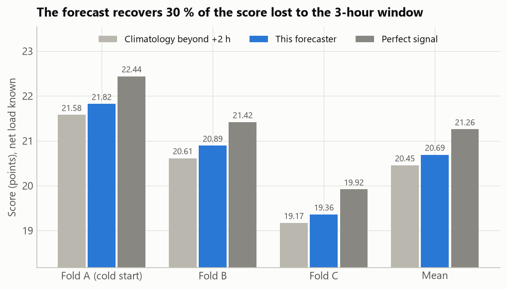
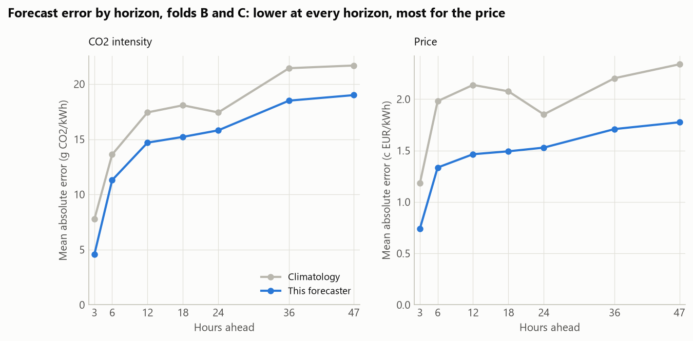
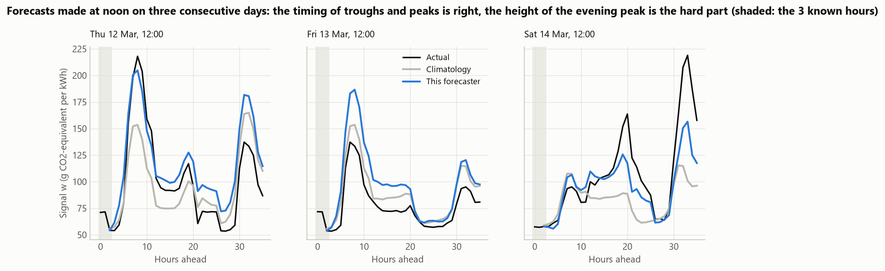
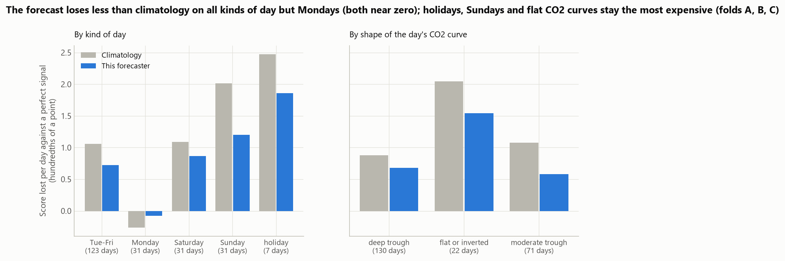

# Price and CO₂ forecast beyond the 3 known hours

**Written:** Sat 14 Nov 2026, 18:03, by the signal subagent. Code: `experiments/23_signal/signal_fc.py`, class `SignalForecaster`.

The **signal** is `w = CO₂ + 0.27 × price`: what one kWh of grid import costs in score. The agent is given it for this hour and the next two; everything from +3 h on has to be forecast.

## 1. Summary

| Closed loop, mean of folds A, B, C | Average-day forecast | This forecaster | Perfect signal |
|---|---|---|---|
| Net load known | 20.46 | **20.69** (+0.24) | 21.26 |
| Fully legal (naive net load, 10 % haircut) | 18.96 | **19.23** (+0.27) | not run |

- **It recovers 30 % of the 0.80 points lost to the 3-hour window.** The gain holds in every fold, with 0 infractions.
- **The rest of the gap sits in hours +3 to +11,** and more of the same modelling is unlikely to close it.
- **Accuracy is a poor guide to score.** The first model beat the average-day forecast by 15 % in error and lost to it in closed loop.



## 2. What matters to the planner

Replacing the first hours of the forecast with the truth, on top of an early variant that scored 20.37:

| Signal given to the planner | Mean score |
|---|---|
| Forecast from +3 h | 20.37 |
| Truth to +5 h, forecast beyond | 20.99 |
| Truth to +11 h, forecast beyond | 21.25 |
| Perfect | 21.26 |

- **Hours +3 to +5 carry about two thirds of the loss,** +6 to +11 the rest. Anything beyond +12 h is worth 0.01.
- **Weekday/weekend changes were the trap.** A model on raw past values carries yesterday's day type into today; it lost 0.043 points per Monday where the average-day forecast lost nothing.

## 3. How the forecaster works

- **Store.** One value per calendar hour for CO₂ and for price, filled from the train rows and, during the run, from every value shown to the agent. The hours before a test week come from the train days right before it.
- **Average-day reference.** Mean by month, day type (weekend or fixed holiday) and hour. Each month is blended with its neighbour, because test weeks sit at the end of the month.
- **Model.** One ridge regression per horizon (+3 to +50 h) and per signal, on the difference from that reference. Inputs: the last 48 known differences, the other signal's last 12, and the reference at the target hour.
- **Week boundaries.** Hours past the end of the current test week are forecast for the next one (last 7 days of the next month).
- Price and CO₂ are forecast separately, so their weighting can change without refitting.

## 4. Accuracy



Mean absolute error, folds B and C:

| Hours ahead | +3 | +6 | +12 | +18 | +24 | +36 |
|---|---|---|---|---|---|---|
| CO₂, average day (g/kWh) | 7.8 | 13.6 | 17.4 | 18.1 | 17.4 | 21.4 |
| CO₂, this forecaster | 4.6 | 11.3 | 14.7 | 15.2 | 15.8 | 18.5 |
| Price, average day (c€/kWh) | 1.18 | 1.98 | 2.14 | 2.08 | 1.85 | 2.20 |
| Price, this forecaster | 0.74 | 1.33 | 1.46 | 1.49 | 1.53 | 1.71 |

- **Ordering of the next day's hours:** rank correlation with the truth 0.856, against 0.830.
- **Level:** forecasts run about 3 % low on folds B and C. Not corrected.



The timing of troughs and peaks is right; the height of the evening peak is not.

## 5. What was tried

Net load known, 36 h horizon:

| Variant | Mean A, B, C |
|---|---|
| Ridge on raw past values, with last-week terms | 20.37 |
| Ridge on raw past values | 20.45 |
| Average-day forecast (reference) | 20.46 |
| Ridge on differences from the reference, 24 lags | 20.56 |
| Same, 48 lags | 20.61 |
| + the other signal's differences | 20.65 |
| **+ month-blended reference (recommended)** | **20.69** |

- **Helped:** differences from the reference instead of raw values (+0.15 to +0.25), month blending (+0.04), holiday flag (+0.03), the other signal (+0.02).
- **Did not help:** last-week terms, one model per hour of day, stretching the forecast's spread, a special fallback for the first hours of a run.
- About 35 configurations were scored on the same three folds, so differences under 0.03 are noise.

**Horizon:** 12 h gives 20.58; 18, 24, 36 and 48 h all give 20.65. A 24 h horizon is enough.

**Closer to the real test** (fold C fitted only on days before it, as in the test): the gain over the average-day forecast is +0.15 on that one fold.

## 6. Where the forecast still costs score



Loss per day against a perfect signal (223 full days):

| Kind of day | Days | This forecaster | Average day |
|---|---|---|---|
| Tuesday–Friday | 123 | 0.007 | 0.011 |
| Saturday | 31 | 0.009 | 0.011 |
| Sunday | 31 | 0.012 | 0.020 |
| Fixed holiday | 7 | 0.019 | 0.025 |
| CO₂ flat or inverted (windy) | 22 | 0.015 | 0.021 |
| Winter | 63 | 0.010 | 0.016 |
| Summer | 55 | 0.005 | 0.009 |

- **Most expensive:** holidays, windy days with a flat CO₂ curve, and Sundays, each about twice an ordinary weekday.
- **Holiday stretches in train** (1–7 January, 2–6 April, 6–8 December): the forecaster adapts (loss 0.010 per day against 0.019) but orders the hours worse than on ordinary days (rank correlation 0.70 against 0.86). Christmas week is the nearest test analogue.

## 7. Open risks

1. **The size of the gain on the real test is inferred.** Folds give +0.24 to +0.27; the test-like check gives +0.15 on one fold.
2. **The run layout is assumed:** 7-day blocks, last 7 days of each month.
3. **End of run.** The forecaster always returns a full horizon, so in the last hours the plan keeps charge for a week that does not exist. The agent has to handle that.
4. **Holidays rest on 7 days of evidence.** The test has one flagged day, 25 December.
5. **The 3 % level bias is uncorrected.**

## 8. How to use it

```python
import sys; sys.path.insert(0, "experiments/23_signal")
from signal_fc import SignalForecaster, SignalFC
from src.hard import load_hard
from src.hard_mpc import KAPPA

fc = SignalForecaster(load_hard("filled"), KAPPA)   # folds: signal_fit_table(fold) from common.py
w = fc.predict(obs, hist, 24)
fc.to_npz(path); fc = SignalFC.from_npz(path)       # ship without refitting (297 kB)
```

- Runtime imports: numpy and pandas. 0.07 ms per call on an idle machine.
- No external data: the store holds no value on any test day.

Scripts in `experiments/23_signal/`: `closed_loop.py`, `offline.py`, `diag.py`, `strict_c.py`, `timing.py`, `figs.py`.
