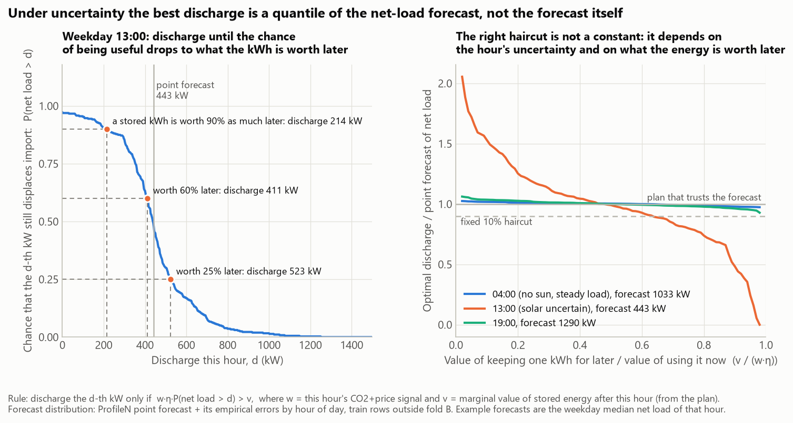
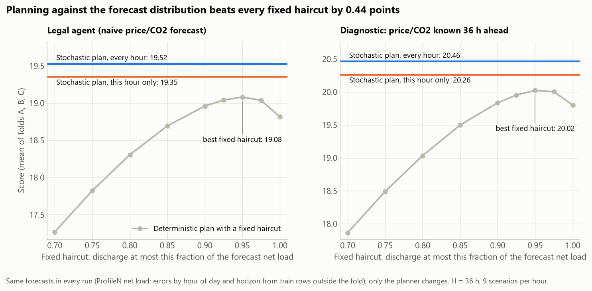
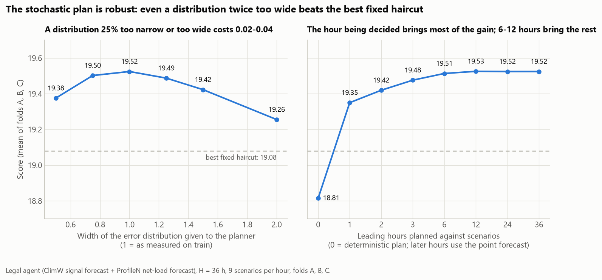

# Planner: exact, fast, and aware that the forecast is uncertain

**Written:** Sat 14 Nov 2026, 17:56, by the planner subagent. Code: `experiments/24_planner/planner.py`.

Everything below is measured on folds A, B, C unless marked as inferred.

## 1. Summary

- **Planning against the forecast's distribution lifts the naive legal agent from 18.81 to 19.52** (+0.71), with the same forecasts. The best fixed haircut reaches 19.08, so the gain over it is +0.44. Energy thrown away falls from 21.9 to 4.8 MWh per run.
- **With a perfect price/CO₂ signal, 19.80 becomes 20.46** (+0.66). That recovers 45 % of the 1.46 points lost to not knowing load and solar.
- **The new planner is exact and needs only numpy.** Its objective matches the linear programme to within 5e-12 on 4,500 cases.
- **It is 15 to 40 times faster:** 0.08 ms per call for the plain plan and 0.16–0.21 ms with scenarios, against 3.1 ms for the linear programme. The 60-second limit stops being a concern.
- 0 infractions in every run.

## 2. The decision rule



Discharge the d-th kW only if `w · η · P(net load > d) > v`, where `w` is this hour's signal, `η` the one-way efficiency and `v` what a stored kWh is worth after this hour (from the plan). Put differently: discharge up to the quantile of the net-load forecast at level `1 − v / (w·η)`. Charging is symmetric.

- If the energy is worth almost as much later, discharge only what is nearly certain to be needed.
- If it is worth little later, discharge beyond the point forecast.
- So the right haircut is not a constant. At 04:00 or 19:00 it stays within a few percent of the forecast. At 13:00, when solar is uncertain, it ranges from 0 to 2 times the forecast.

## 3. How the planner works

The value of the energy in the battery is a convex, piecewise-linear function of the state of charge. Its slope (what one more kWh is worth) is a decreasing step function, kept as a short sorted list of (value, width in kWh).

- **One hour of the campus is also a sorted list:** the p-th kW of charge costs `(w/η) · P(net load > −p)`, free while solar surplus covers it; the d-th kW of discharge earns `w·η · P(net load > d)`, nothing once it exceeds the load.
- **One step back in time** merges the two lists and cuts what the inverter cannot move in an hour off both ends. This is exact, including the load-dependent limits that the standard-mode solver could not handle.
- **With scenarios** it is the same algorithm with a few more segments per hour.
- No grid over the state of charge, so there is no accuracy setting to tune.

## 4. Results

Horizon 36 h, 9 scenarios per hour. The distribution is the naive net-load forecast plus its own past errors by hour of day and horizon, fitted on train days outside each fold.

**Legal agent (naive signal and net-load forecasts)**

| Planner | A | B | C | Mean | Thrown away, MWh |
|---|---|---|---|---|---|
| Trusts the forecast | 19.70 | 19.10 | 17.64 | 18.81 | 21.9 |
| Fixed haircut 0.90 | 19.83 | 19.29 | 17.76 | 18.96 | 12.5 |
| Best fixed haircut (0.95) | 19.97 | 19.39 | 17.88 | 19.08 | 15.3 |
| Scenarios for the current hour only | 20.31 | 19.67 | 18.07 | 19.35 | 8.1 |
| Scenarios for hours 0–5 | 20.55 | 19.79 | 18.20 | 19.51 | 5.0 |
| **Scenarios for hours 0–11 (recommended)** | 20.58 | 19.79 | 18.21 | **19.52** | 4.8 |
| Scenarios for all hours | 20.58 | 19.78 | 18.21 | 19.52 | 4.8 |

**Perfect signal, naive net-load forecast**

| Planner | A | B | C | Mean | Thrown away, MWh |
|---|---|---|---|---|---|
| Trusts the forecast | 20.68 | 20.04 | 18.69 | 19.80 | 22.0 |
| Best fixed haircut (0.95) | 20.89 | 20.25 | 18.93 | 20.02 | 15.9 |
| Scenarios for the current hour only | 21.12 | 20.55 | 19.09 | 20.26 | 10.3 |
| Scenarios for all hours | 21.47 | 20.74 | 19.18 | 20.46 | 6.5 |



The gain over the best haircut is positive on every fold: +0.33 to +0.61.

## 5. Exactness and speed

| Test | Cases | Largest gap to the linear programme |
|---|---|---|
| Random, no end value | 1,500 | 9e-13 |
| Random, with an end value | 1,500 | 5e-12 |
| Real inputs (fold B, random state of charge) | 1,500 | 2e-12 |
| With scenarios, against a scenario linear programme | 400 | 2e-12 |

It also reproduces the four closed-loop reference scores (21.26, 19.80, 18.81, 18.96) and gives the same score in the organisers' environment (19.78 on fold B, 0 infractions).

| Planner | Quiet machine, ms per call | Busy machine | 2,016 calls |
|---|---|---|---|
| Linear programme (scipy) | 3.1 | 11–12 | 6–24 s |
| New, plain | 0.08 | 0.3 | 0.2–0.7 s |
| New, 9 scenarios on hours 0–11 | 0.16 | 0.6 | 0.3–1.3 s |
| New, 9 scenarios on all hours | 0.21 | 0.75 | 0.4–1.5 s |

## 6. Sensitivity



| Setting | Result (legal agent) |
|---|---|
| Scenarios, all hours | 3: 19.47, 5: 19.49, 9: 19.52, 20: 19.53, 60: 19.54 |
| Hours planned with scenarios | 0: 18.81, 1: 19.35, 2: 19.42, 3: 19.48, 6: 19.51, 12: 19.53, all: 19.52 |
| Horizon 24 / 36 / 48 h | no change (under 0.001) |
| Value of energy left at the end of the horizon | no change |
| Width of the distribution ×0.5 / 0.75 / 1 / 1.25 / 1.5 / 2 | 19.38 / 19.50 / 19.52 / 19.49 / 19.42 / 19.26 |
| Errors pooled over all hours of the day | 19.37, against 19.52 by hour of day |

**What did not help**

- More than about 9 scenarios: +0.02 at most.
- Horizons beyond 24 h, and any value for energy left at the end.
- Correcting the forecast's bias alone: same score as trusting the forecast. The whole gain comes from the distribution.

**What did help beyond the current hour:** scenarios for the next 6–12 hours add 0.17. A plan that assumes future discharges will land perfectly overvalues stored energy.

## 7. Open points

- **The naive forecasters are now the slow part,** not the planner (about 10 ms per step in the harness, because of per-hour table lookups in pandas). A packaged agent uses plain arrays.
- **Scenarios must describe net load, the difference of load and solar.** Subtracting the same quantile of each is wrong.
- **Sharper distributions should be worth more (inferred).** Conditioning on hour of day alone was worth +0.15 over a pooled distribution.
- **The planner does not guard against NaN inputs.** The packaged agent must clean the forecasts first.
- **Hour-0 errors are not correlated from one hour to the next** (−0.004), so there is no cheap error-correction term to add.

## 8. How to use it

```python
import sys; sys.path.insert(0, "experiments/24_planner")
import planner as P
from src.hard import get_folds, simulate, train_complement
from src.hard_mpc import ClimW

df = get_folds()["B"]; fit = train_complement(df)
agent = P.MPCStoch(ClimW(fit), P.QuantileN(fit, H=36), H=36, Q=9, scen_hours=12)
res = simulate(agent, df)

p0 = P.plan_stoch(w, n_scen[:12], probs, soc, n_tail=n_point[12:])   # n_scen (H, Q), probs (Q,)
p0 = P.plan_det(w, n, soc)                                           # same optimum as the linear programme
```

Scripts in `experiments/24_planner/`: `test_exact.py`, `eval_closed.py`, `eval_pooled.py`, `final_check.py`, `check_official.py`, `timing_h36.py`, `figs.py`.
