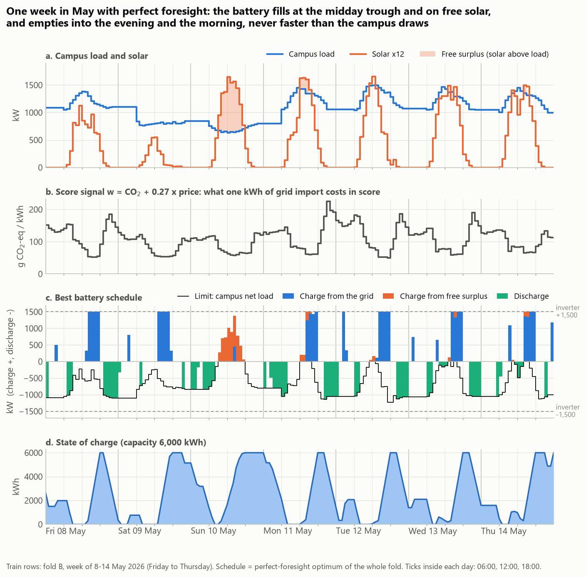
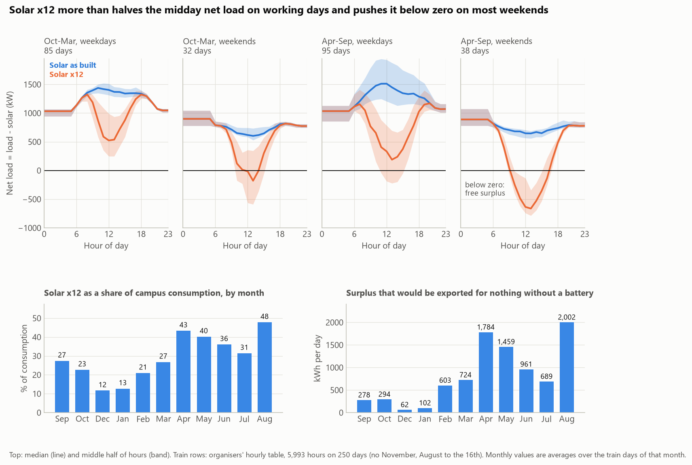
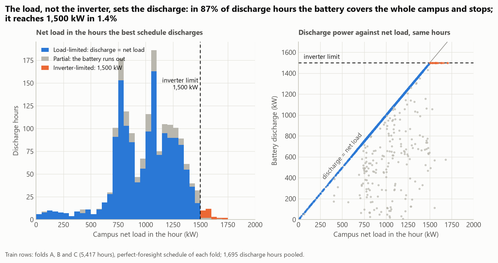
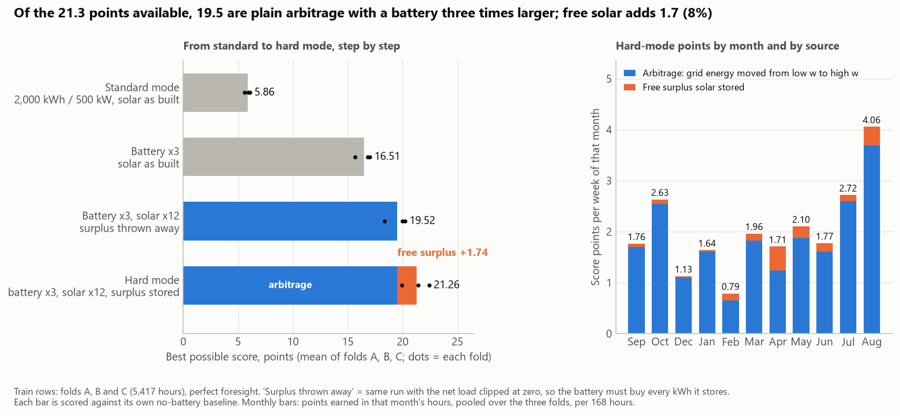
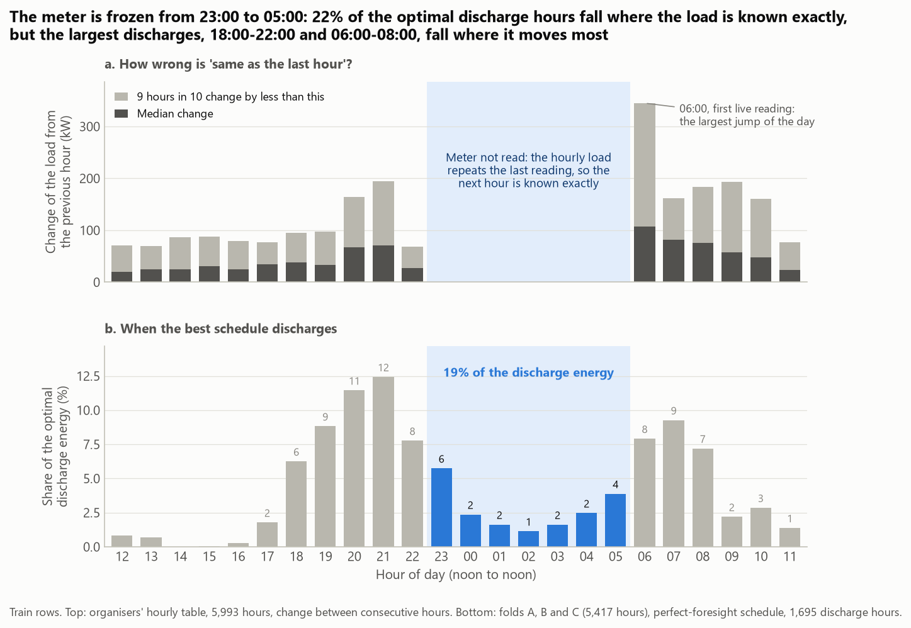
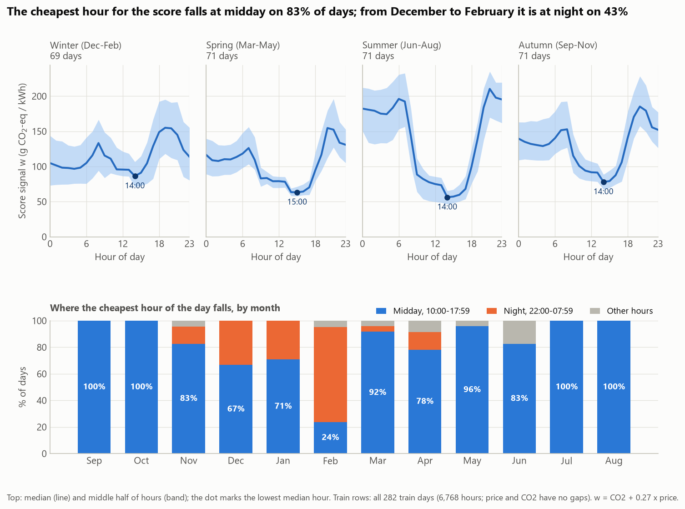

# Hard mode: what changes and where the battery's value comes from

**Written:** Sat 14 Nov 2026, 17:45, by the analyst subagent. Rules: [`docs/NEW_RULES.md`](../../docs/NEW_RULES.md). First numbers: [`reports/10_hard_mode/report.md`](../10_hard_mode/report.md). Scripts: `experiments/26_hard_eda/`.

Everything here is computed on train rows only. Three samples are used, and each number says which:

- **Hourly table:** the organisers' train table with solar ×12, 5,993 hours on 250 days (no November, August up to the 16th).
- **Folds A, B, C:** days 1–7, 8–14 and 15–21 of every train month, 5,417 hours in total. "Best schedule" means the perfect-foresight optimum of each fold (`src/hard.py`, `oracle`).
- **Signal days:** all 282 train days (6,768 hours), for price and CO₂ only, which have no gaps.

The **score signal** is `w = CO₂ + 0.27 × price` (kg CO₂ per kWh plus 0.27 kg per €). It is what one kWh of grid import costs in score.

## 1. Summary

1. **Most of the 21 points are plain arbitrage with a bigger battery.**
   - The standard-mode ceiling on the same folds is 5.87 points.
   - Tripling the battery takes it to 16.51.
   - Solar ×12 takes it to 19.52 without saving one more kg of CO₂: the no-battery baseline it is divided by shrinks.
   - Storing the free solar surplus adds 1.74, which is 8 % of the 21.26 total.
2. **The load sets the discharge, not the inverter.**
   - In 87 % of the best schedule's discharge hours the battery covers the whole campus and stops (91 % of the discharge energy).
   - It reaches 1,500 kW in 1.4 % of them.
   - Discharging 1,500 kW blindly in those hours would export 33 % of the output for nothing.
3. **Charging is still limited by the inverter.** 63 % of charge hours are at 1,500 kW (83 % of the charge energy).
4. **Solar ×12 hollows out the midday.**
   - Solar goes from 2.4 % to 28 % of consumption.
   - The median midday net load on working days falls from 1,390 to 528 kW; at weekends it falls from 648 to −320 kW.
   - There is surplus in 9 % of hours, on 108 of 250 days, and 72 % of that energy falls at weekends.
5. **The discharge happens in the dark.**
   - 72 % of the discharge energy is delivered in hours with no solar at all.
   - 19 % falls between 23:00 and 05:00, when the meter is frozen and the next hour's load is known exactly.
   - 47 % falls between 18:00 and 22:00, and 24 % between 06:00 and 08:00, where the load moves most.
6. **The charge window is predictable; winter is the exception.**
   - The cheapest hour of `w` is at midday on 83 % of days.
   - From December to February it is at night on 43 % of days, and in February on 71 %.

## 2. One week under the best schedule

The battery buys at the midday trough of `w` at full power, takes the free surplus when there is one, and discharges in the evening and before the morning ramp. The green bars stop at the black line (the campus net load) in almost every discharge hour. The battery goes from empty to full and back about once a day.

The week is 8–14 May 2026 (fold B). It is not uniformly sunny: Friday and Saturday are cloudy, Sunday has the big surplus, Monday to Thursday are sunny working days.

Numbers for this week (168 hours, schedule taken from the optimum of the whole fold):

- **Energy:** load 180.2 MWh, solar ×12 69.1 MWh (38 %).
- **Surplus:** 7.45 MWh in 20 hours on 5 days, more than half of it on Sunday.
- **Charge:** 50.6 MWh, of which 43.2 MWh bought and 7.45 MWh free.
- **Discharge:** 42.4 MWh, or 1.06 full cycles a day.
- **Signal:** the battery buys at a mean `w` of 66 g/kWh and discharges at 150 g/kWh, a ratio of 2.3 against a break-even of 1.11.
- **Discharge hours:** 51. In 47 the discharge equals the net load exactly; in none does it reach 1,500 kW.
- **Score:** the week earns 1.65 of the fold's 21.42 points.

## 3. What ×12 solar does to the campus

With the solar plant as built, the net load is the load. With ×12, the midday net load on working days is cut by more than half, and on most weekends it goes below zero. Nights and evenings do not change, and that is where the battery discharges.

Numbers (hourly table, 5,993 hours on 250 days):

- **Share of consumption:** solar covers 28.3 % (2.4 % as built). Grid import without a battery falls by 23.6 %, from 6,569 to 5,016 MWh.
- **Net load with ×12:** median 927 kW; half of all hours lie between 668 and 1,104 kW; 98.4 % are below 1,500 kW.
- **Midday (11:00–15:59) median net load:**

| Day type | Solar as built | Solar ×12 | Midday hours with surplus |
|---|---|---|---|
| Weekdays | 1,390 kW | 528 kW | 21 % |
| Weekends | 648 kW | −320 kW | 66 % |

- **Surplus:** 541 hours (9.0 %) on 108 of 250 days; 95 % of those hours fall between 10:00 and 16:59.
- **Who has surplus:** 83 % of weekend days and 28 % of weekdays.
- **Exported without a battery:** 194 MWh, which is 10.2 % of the solar output, or 776 kWh a day on average.
- **A surplus day:** median 1,207 kWh; the largest is 5,867 kWh, about one full battery; the peak hour is 1,117 kW.

By month:

| Month | Train days | Solar ×12, % of consumption | Hours with surplus | Days with surplus | Exported without a battery, MWh | Per day, kWh | % of solar |
|---|---|---|---|---|---|---|---|
| Sep | 23 | 27 | 20 (3.6 %) | 5 | 6.4 | 278 | 3.7 |
| Oct | 24 | 23 | 26 (4.5 %) | 6 | 7.1 | 294 | 4.7 |
| Dec | 24 | 12 | 11 (1.9 %) | 4 | 1.5 | 62 | 2.0 |
| Jan | 24 | 13 | 13 (2.3 %) | 4 | 2.4 | 102 | 3.1 |
| Feb | 21 | 21 | 33 (6.5 %) | 7 | 12.7 | 603 | 11.0 |
| Mar | 24 | 27 | 48 (8.3 %) | 12 | 17.4 | 724 | 10.4 |
| Apr | 23 | 43 | 119 (21.6 %) | 22 | 41.0 | 1,784 | 17.2 |
| May | 24 | 40 | 90 (15.6 %) | 20 | 35.0 | 1,459 | 14.7 |
| Jun | 23 | 36 | 45 (8.2 %) | 6 | 22.1 | 961 | 8.6 |
| Jul | 24 | 31 | 43 (7.5 %) | 6 | 16.5 | 689 | 6.3 |
| Aug | 16 | 48 | 93 (24.5 %) | 16 | 32.0 | 2,002 | 21.1 |

- **June and July** have the most sun but little surplus, because cooling keeps the weekday load high.
- **August** covers only days 1–16, when the campus is half closed. We have no data for the August test week (25–31), so this row may not describe it.

## 4. The load limits the discharge; the inverter limits the charge

In the hours the best schedule discharges, the campus draws a median of 1,042 kW, and 98.3 % of those hours are below 1,500 kW. The schedule sits on the diagonal: it covers the whole campus, brings the grid import to zero, and stops.

Numbers (folds A, B, C; 1,695 discharge hours out of 5,417; 1,598 MWh discharged):

| What limits the hour | Hours | Share of hours | Share of discharge energy |
|---|---|---|---|
| The load (discharge = net load, import 0) | 1,469 | 86.7 % | 90.7 % |
| The battery runs out, or the hour is marginal | 202 | 11.9 % | 7.1 % |
| The inverter (1,500 kW) | 24 | 1.4 % | 2.3 % |

- **By fold:** the load-limited share is 88 % (A), 87 % (B), 85 % (C).
- **Discharge power:** median 990 kW; above 1,400 kW in 4.7 % of discharge hours.
- **Emptying takes longer.** A full battery lasts 5.7 hours at the median discharge power, not the 3.8 hours the inverter would allow.
- **Fewer cycles.** The best schedule makes 1.24 full cycles a day, against 1.39 for the standard battery on the same folds.
- **Blind full power wastes a third.** Discharging 1,500 kW in every one of those hours would export 33 % of the output for nothing.
- **Standard mode for comparison:** the net load was below the 500 kW limit in 0.52 % of hours (hourly table), so the load never mattered there.
- **Charging is the opposite.** Of 1,558 charge hours, 62.9 % are at 1,500 kW, carrying 83.2 % of the charge energy.
- **The battery uses its full range.** It reaches full on 95 % of fold days and empty on 97 %.

## 5. Where the points come from

Four perfect-foresight runs per fold, each scored against its own no-battery baseline. The free-surplus value is the last run minus the one before it, where the net load is clipped at zero so the battery must buy every kWh it stores.

Scores (folds A, B, C):

| Run | A | B | C | Mean |
|---|---|---|---|---|
| Standard mode (2,000 kWh / 500 kW, solar as built) | 6.09 | 5.93 | 5.58 | 5.87 |
| Battery ×3, solar as built | 17.03 | 16.81 | 15.68 | 16.51 |
| Battery ×3, solar ×12, surplus thrown away | 20.22 | 19.97 | 18.37 | 19.52 |
| Hard mode (surplus stored) | 22.44 | 21.42 | 19.92 | 21.26 |
| of which free surplus | 2.22 | 1.45 | 1.55 | 1.74 |

What each step does (means per fold; a fold is about 75 days):

- **Battery ×3: +10.64 points.** The score multiplies by 2.81, not 3, because the load caps the discharge: 550 MWh discharged against 3 × 198 MWh.
- **Solar ×12 without the surplus: +3.01 points, with no extra saving.**
  - The battery avoids 26.1 t of CO₂ in both runs, and 51.5 against 50.5 k€.
  - The baseline it is divided by falls from 166.6 to 141.7 t CO₂ (−15 %) and from 280 to 229 k€ (−18 %).
- **Free surplus: +1.74 points (8 % of the total).**
  - 59 MWh per fold is stored for free, 10 % of the 589 MWh charged.
  - All of it is captured; none is exported.
  - It adds 2.6 t CO₂ and 3.3 k€ of savings.
- **Arbitrage spread:** the battery buys at a mean `w` of 84 g/kWh and discharges at 164 g/kWh (fold mean of `w`: 123 g/kWh).

By month (points per 168 hours of that month, three folds pooled):

| | Sep | Oct | Dec | Jan | Feb | Mar | Apr | May | Jun | Jul | Aug |
|---|---|---|---|---|---|---|---|---|---|---|---|
| Arbitrage | 1.70 | 2.55 | 1.11 | 1.60 | 0.65 | 1.82 | 1.24 | 1.87 | 1.61 | 2.60 | 3.69 |
| Free surplus | 0.07 | 0.09 | 0.02 | 0.03 | 0.13 | 0.14 | 0.47 | 0.23 | 0.17 | 0.12 | 0.36 |
| Total | 1.76 | 2.63 | 1.13 | 1.64 | 0.79 | 1.96 | 1.71 | 2.10 | 1.77 | 2.72 | 4.06 |

- **A summer week is worth several winter weeks.** August earns 5 times what February does; July and October come next.
- **Free surplus matters most in April** (28 % of that month's points) and February (17 %); it is under 5 % from September to January and in July.
- **Arriving empty is how the surplus is captured.** On the 100 surplus days of the folds, the state of charge just before the first surplus hour is 0 kWh on a median day and at most 1,500 kWh on 90 % of them.

## 6. The meter's night freeze

The meter is not read at night, so the hourly load repeats the last reading. For the decisions taken from 23:00 to 05:00, "the load of this hour equals the last reading in `obs`" is exact. Solar is zero then, so the net load is known too.

Numbers:

- **The freeze (hourly table, pairs of consecutive hours):**
  - From 00:00 to 05:00 the load equals the previous hour exactly, on every night.
  - At 23:00 it differs from 22:00 by a median of 0.25 kW (within 1 kW on 91 % of nights).
  - Over the whole window 23:00–05:00 the change is within 1 kW in 98.7 % of 1,738 hours, and never above 5.1 kW.
  - In the other hours the load changes by a median of 37 kW; one hour in ten changes by more than 139 kW.
- **Discharge in the frozen window (folds A, B, C):** 367 of 1,695 discharge hours (21.7 %) and 18.8 % of the discharge energy. By fold: 21 % (A), 18 % (B), 17 % (C) of the energy.
- **The rest of the discharge is where the load moves:**

| Window | Share of discharge energy | Median hourly change of the load |
|---|---|---|
| 18:00–22:00 | 46.7 % | 27 to 71 kW (largest at 20:00 and 21:00) |
| 23:00–05:00 | 18.8 % | 0 kW |
| 06:00–08:00 | 24.4 % | 76 to 107 kW |
| 09:00–17:00 | 10.1 % | 20 to 57 kW |

- **06:00 is the hardest hour.** It is the first live reading after the freeze, and the last value in `obs` is eight hours old. It carries 7.9 % of the discharge energy. The direction depends on the day:
  - On weekdays the load rises by a median of 107 kW from the held value (it is lower on 13 % of days). Discharging the held value wastes nothing.
  - At weekends the load falls on 86 % of days, by a median of 76 kW. Discharging the held value exports the difference.
- **Solar hardly matters for the discharge.** 72.5 % of the discharge energy is delivered in hours with solar below 10 kW, and 90 % in hours where solar is under a tenth of the load. Solar forecasts matter for the charge side: how much room to leave for the surplus.

## 7. When the signal is cheapest

The daily shape of `w` is the same all year: a trough in the early afternoon and a peak in the evening. In summer the nights are as dear as the evening. In winter the curve is flat and the night competes with midday.

Numbers (signal days, 282):

- **Cheapest hour:** at midday (10:00–17:59) on 83.3 % of days, at night (22:00–07:59) on 13.1 %. It is exactly 14:00 on 42 % of days.
- **By day type:** midday on 80 % of weekdays and 93 % of weekend days.
- **By month:**
  - 100 % midday in September, October, July and August.
  - 67 % in December, 71 % in January, 24 % in February.
  - December to February together: at night on 43.5 % of 69 days.
- **A fixed window loses little on the charge side.** The mean `w` over 13:00–16:59 is 5 % above the mean of the day's four cheapest hours (median day). That window holds 2.4 of the four cheapest hours on average.
- **Dearest hour:** between 18:00 and 22:59 on 73.8 % of days, between 05:00 and 09:59 on 13.1 %.
- **Every day pays.** The dearest hour is 2.65 times the cheapest on a median day and 1.24 times on the worst, against a break-even of 1.11.
- **Median profile by season:**

| Season | Midday (12:00–16:59) | Night (00:00–05:59) | Evening peak |
|---|---|---|---|
| Winter | 95 g/kWh | 100 g/kWh | 155 g/kWh at 19:00 |
| Spring | 70 | 111 | 155 at 20:00 |
| Summer | 64 | 179 | 210 at 21:00 |
| Autumn | 86 | 133 | 185 at 20:00 |

## 8. Checks against earlier reports, and surprises

- **Ceilings match.** The best-schedule scores (22.44 / 21.42 / 19.92) are the ones in `reports/10_hard_mode/report.md`.
- **`docs/NEW_RULES.md` §6 numbers match.** Net load median 927 kW, 98 % of hours below 1,500 kW, surplus in 9 % of hours on 108 of 250 days, solar at 28 % of consumption.
- **The night-freeze statement in report 10 holds,** with one detail: it is exact from 00:00 to 05:00 and within 1 kW at 23:00.
- **Refinement of "battery timing is unchanged" (`NEW_RULES` §6).** That is true for charging (4.2 hours). Emptying takes about 5.7 hours in practice because the load caps the discharge, and the battery makes 10 % fewer cycles than the standard one.
- **Surprise: free solar is a small part of the prize.** The site presents the surplus as the new opportunity, but it is 8 % of the ceiling. The larger effect of ×12 solar is that the baseline shrinks, which lifts every team's percentage equally.
- **Surprise: the 06:00 risk is one-sided by day type.** The 10 % discharge haircut in report 10 protects weekend dawns; on weekday dawns the load rises and there is nothing to protect.
- **Caveat on August.** Train August is days 1–16 with the campus half closed (surplus on all 16 days, the highest points per week). Whether the August test week looks like that is unknown, so August numbers here may not carry over.
- **Caveat on the attribution.** "Free surplus = full run minus run with the surplus removed" is one way to split the points. An energy count gives the same order of size: 10 % of the energy charged is free.

## 9. Files

Each script runs from the repo root with `.venv/Scripts/python.exe experiments/26_hard_eda/<name>.py` and regenerates its PNG.

- `common.py`: shared helpers, including an oracle that accepts a modified net load or battery size.
- `fig1_week.py`, `fig2_solar.py`, `fig3_limit.py`, `fig4_value.py`, `fig5_night.py`, `fig6_signal.py`.
- `extra_numbers.py`: numbers quoted here that no figure script prints.
- CSVs next to the scripts: `solar_by_month.csv`, `value_sources.csv`, `value_sources_by_month.csv`, `signal_min_by_month.csv`.
