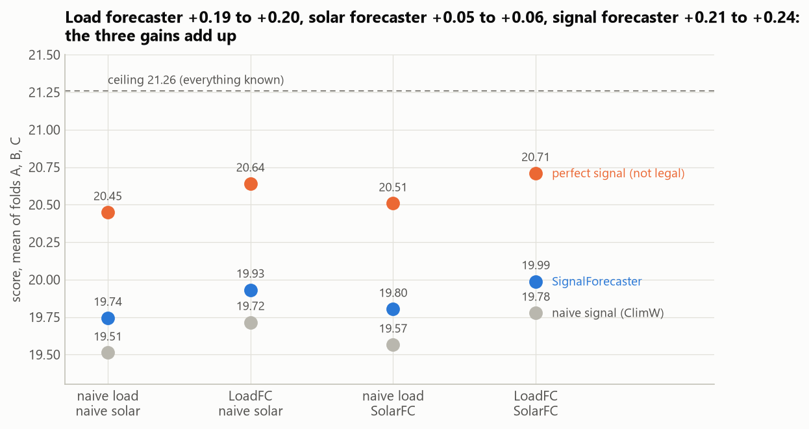
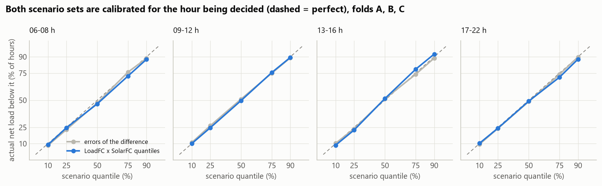
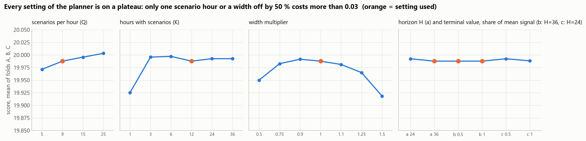
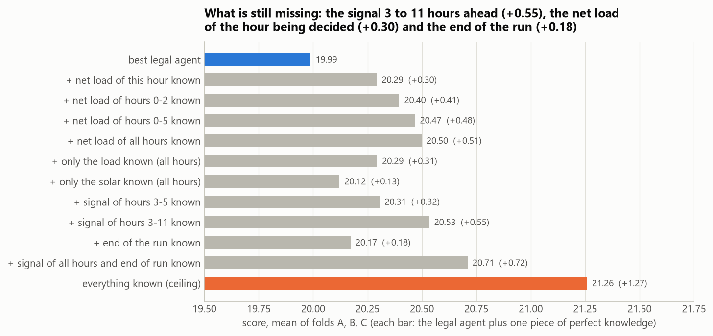
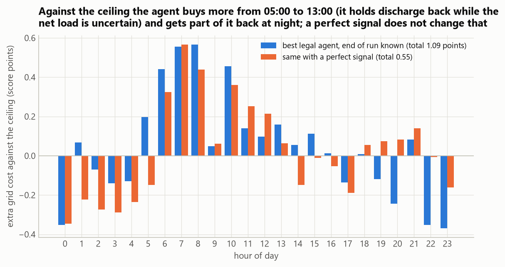

# The combined agent: planner + load, solar and price/CO₂ forecasters

**Written:** Sat 14 Nov 2026, 18:36, by the integrator subagent. Code: `experiments/27_combined/combined.py`.

All numbers are closed-loop scores on folds A, B, C, with every forecaster, error table and quantile fitted outside the fold. 468 runs, 0 infractions in all of them.

## 1. Summary

| Best legal agent | A | B | C | Mean |
|---|---|---|---|---|
| All four pieces, no end-of-run handling | 21.14 | 20.26 | 18.57 | **19.99** |
| + plan only the hours that exist when `obs` shows fewer than 3 prices | 21.14 | 20.30 | 18.70 | **20.04** |
| + the run cannot go past the last hour of August 2026 | 21.27 | 20.37 | 18.70 | **20.11** |
| Ceiling (everything known) | 22.44 | 21.42 | 19.92 | 21.26 |

- **What each piece adds** (the gains add up):
  - planning with scenarios instead of trusting the forecast: +0.31
  - price/CO₂ forecaster: +0.21 to +0.24
  - load forecaster: +0.19 to +0.20
  - end-of-run handling: +0.06, or +0.13 with the calendar
  - the boosted model inside the load forecaster: +0.06
  - solar forecaster: +0.05 to +0.06
- **What is still missing** (19.99 → 21.26): the signal 3 to 11 hours ahead 0.54, the net load 0.55 (0.30 of it the hour being decided), the end of the run 0.18.
- **Cross-checks:** the organisers' environment gives 20.37 on fold B with 0 infractions, equal to the fast simulator.
- **Run time:** 4.6 s for 2,016 steps.



## 2. The full ladder

Stochastic plan, 9 scenarios, scenarios on 12 hours, 36 h horizon, no end-of-run handling unless stated. "Thrown away" is MWh exported for nothing, mean of folds.

| Signal | Load | Solar | A | B | C | Mean | Thrown away |
|---|---|---|---|---|---|---|---|
| Average day | naive | naive | 20.56 | 19.77 | 18.20 | 19.51 | 4.8 |
| Average day | `LoadFC` | naive | 20.86 | 19.93 | 18.35 | 19.72 | 2.7 |
| Average day | naive | `SolarFC` | 20.60 | 19.81 | 18.28 | 19.57 | 4.3 |
| Average day | `LoadFC` | `SolarFC` | 20.92 | 19.98 | 18.43 | 19.78 | 2.2 |
| Forecaster | naive | naive | 20.86 | 20.07 | 18.31 | 19.74 | 5.1 |
| Forecaster | `LoadFC` | naive | 21.10 | 20.21 | 18.48 | 19.93 | 3.3 |
| Forecaster | naive | `SolarFC` | 20.90 | 20.12 | 18.40 | 19.80 | 4.7 |
| **Forecaster** | **`LoadFC`** | **`SolarFC`** | **21.14** | **20.26** | **18.57** | **19.99** | 2.8 |
| Forecaster | `LoadFC` without the boosted model | `SolarFC` | 21.02 | 20.22 | 18.54 | 19.93 | 3.5 |
| Forecaster | `LoadFC` | `SolarFC`, plan trusts the forecast | 20.69 | 20.05 | 18.29 | 19.68 | 13.1 |
| Perfect | naive | naive | 21.46 | 20.71 | 19.17 | 20.45 | 6.6 |
| Perfect | `LoadFC` | `SolarFC` | 21.77 | 20.91 | 19.45 | 20.71 | 3.7 |
| Ceiling | | | 22.44 | 21.42 | 19.92 | 21.26 | 0.0 |

- **A quantile trick in a forecaster and scenarios in the planner do not stack.** The load forecaster with scenarios gives 19.72; the same forecaster at its 20 % quantile with a plan that trusts it gave 19.56.
- **The rules-only load forecaster costs 0.06** in every setting.

## 3. How the net-load scenarios are built

Net load is load minus solar, so the scenarios must describe the error of the difference. Three constructions were compared:

- **(a) Past errors of the difference,** by hour of day and horizon. The errors are cross-fitted: each other fold's week is removed, the forecasters refitted without it, and the week replayed.
- **(b) The forecasters' own distributions, combined.** For the current hour, the load forecaster's quantiles and the solar forecaster's quantiles are combined as if independent: all 45 × 45 differences, sorted and cut into equal-probability bins. Later hours use cross-fitted load errors with the solar forecaster's quantiles for that horizon.
- **(c) A hybrid:** (b) for the current hour, (a) after.

| Scenarios (load and solar forecasters) | Average-day signal | Signal forecaster | Perfect signal | Thrown away |
|---|---|---|---|---|
| None | 19.48 | 19.68 | 20.38 | 13.1 |
| (a), current hour only | 19.66 | 19.86 | 20.55 | 5.7 |
| (b), current hour only | 19.72 | 19.93 | 20.62 | 4.6 |
| (a), hours 0–11 | 19.71 | 19.93 | 20.66 | 3.4 |
| (c), hours 0–11 | 19.76 | 19.98 | 20.69 | 2.8 |
| **(b), hours 0–11** | **19.78** | **19.99** | **20.71** | 2.8 |

(b) beats (a) in all 9 fold-by-signal comparisons. The method was chosen on these folds; its consistency is the evidence.

**Calibration for the current hour.** Share of hours with the actual net load below each scenario quantile:



| Hours | Method | 10 % | 25 % | 50 % | 75 % | 90 % | 10–90 % width, kW |
|---|---|---|---|---|---|---|---|
| 06–08 | (b) | 9.0 | 24.6 | 46.6 | 72.3 | 87.7 | 154 |
| 09–12 | (b) | 10.1 | 24.6 | 49.7 | 75.6 | 89.4 | 463 |
| 13–16 | (b) | 8.6 | 22.5 | 51.5 | 78.6 | 92.5 | 435 |
| 17–22 | (b) | 10.3 | 24.2 | 49.1 | 71.2 | 87.8 | 99 |

- **At night** (23:00–05:00) the scenarios have zero width in 1,570 of 1,581 hours, and the actual value is within 5 kW in all of those. The other 11 are week starts.
- **Load and solar errors are not independent** (rank correlation −0.31 in sunlit hours: more sun than forecast goes with less load than forecast). Modelling it changed the score by −0.002, so it was left out.

## 4. Sensitivity



| Setting | Values and scores (base 19.988) |
|---|---|
| Scenarios per hour | 5: 19.971 · **9: 19.988** · 15: 19.996 · 25: 20.003 |
| Hours with scenarios | 1: 19.925 · 3: 19.996 · 6: 19.997 · **12: 19.988** · 24: 19.993 |
| Horizon | 24 h: 19.992 · **36 h: 19.988** |
| Width of the scenarios | ×0.5: 19.950 · ×0.75: 19.983 · **×1.0: 19.988** · ×1.25: 19.965 · ×1.5: 19.918 |
| Value of energy left at the end of the horizon | no effect |

Everything sits on a plateau. Only a single scenario hour (−0.06) or a width off by 50 % costs more than 0.03.

## 5. The end of the run

The signal forecaster always returns a full horizon, so in the last hours the plan keeps charge for a week that does not exist.

| Rule | A | B | C | Mean |
|---|---|---|---|---|
| None | 21.14 | 20.26 | 18.57 | 19.99 |
| Plan only the hours that exist when `obs` shows fewer than 3 prices | 21.14 | 20.30 | 18.70 | 20.04 |
| Also: nothing after the last hour of August 2026 | 21.27 | 20.37 | 18.70 | 20.11 |
| True end known (diagnostic) | 21.27 | 20.37 | 18.87 | 20.17 |

- **The first rule is safe:** the organisers' `environment.py` shortens the lists in exactly that way.
- **The calendar rule** is worth about +0.07 more if the test's last row is 31 August 2026 at 23:00. If the run ends earlier it changes nothing. It could only hurt if the run went past that hour, which the test calendar (September 2025 to August 2026) rules out. **Adopted.**

## 6. Where the remaining gap is



What each piece of perfect knowledge would add to the legal agent (19.99):

| Knowledge added | Gain |
|---|---|
| Net load of this hour | +0.30 |
| Net load of hours 0–5 | +0.48 |
| Net load of all hours | +0.51 |
| Only the load, all hours | +0.31 |
| Only the solar, all hours | +0.13 |
| Signal of hours 3–5 | +0.32 |
| Signal of hours 3–11 | +0.55 |
| Signal of hours 3–23 | +0.54 |
| End of the run | +0.18 |

- **Signal:** nothing beyond 11 hours ahead matters. Hours 3–5 carry 0.32 and hours 6–11 another 0.23.
- **Net load:** the hour being decided is 60 % of it, and load matters more than solar.



- **The loss is held-back discharge, not waste.** Only 1.8 MWh per fold is discharged into nothing, out of 518 MWh.
- **Measured:** from 06:00 to 13:00 the agent discharges 140 MWh where the ceiling discharges 172 (−19 %). At night, when the net load is known exactly, it discharges 11 % more.
- **Inferred:** it holds back in the morning because it cannot tell how much load there will be, and spends the energy in hours worth less.
- **The net-load loss is a weekday loss:** with a perfect signal, 0.53 on weekdays and 0.02 at weekends.

## 7. What did not help

- Modelling the dependence between load and solar errors: −0.002.
- A value for energy left at the end of the horizon: no effect.
- Scenarios on more than 6 hours: within ±0.005.
- Changing the width of the scenarios.
- Past errors of the difference (method a) and the hybrid (c): −0.05 and −0.01 against (b).

## 8. Run time

2,016 steps, single process: 4.6 s (4.9 to 7.2 s on the folds with other jobs running, about 10 s under heavier load).

| Component | Share |
|---|---|
| Building scenarios | 25 % |
| Load and solar point forecasts | 23 % |
| Planner | 17 % |
| Load and solar quantiles | 16 % |
| Signal forecaster | 12 % |
| Simulator and bookkeeping | 7 % |

## 9. Open risks

- **Choices made on these folds:** the scenario method and the planner settings. The plateau is flat, so little optimism is expected.
- **Holiday weeks.** The error distributions are by hour and weekday/weekend only. The Christmas test week will be miscalibrated by an unknown amount.
- **Server speed.** 5 to 7 s here leaves about 8× margin on the 60 s limit.

## 10. How to use it

```python
import sys; sys.path.insert(0, "experiments/27_combined")
from combined import make_agent

agent = make_agent(None, end_ts="2026-08-31 23:00")   # shipped configuration: fitted on every train row
agent = make_agent(fold_df)                           # evaluation on a fold, fitted outside it
```

Defaults: signal forecaster, `LoadFC`, `SolarFC`, scenario method (b), 36 h horizon, 9 scenarios on 12 hours. To reproduce: `build_cache.py`, then `sweep.py <set>`, `calibration.py`, `check_live.py`, `make_figs.py` in `experiments/27_combined/`.
