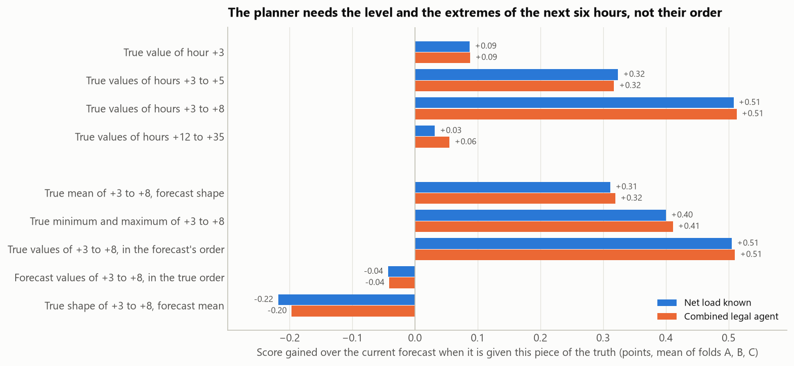
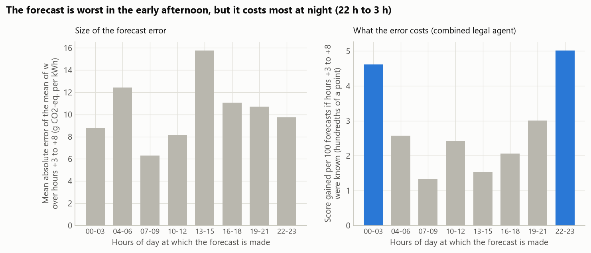
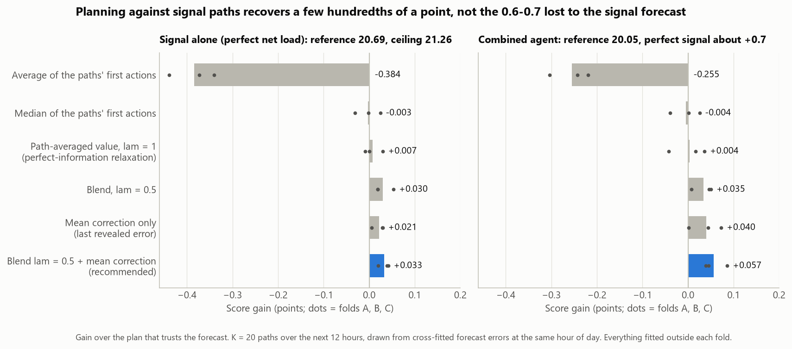
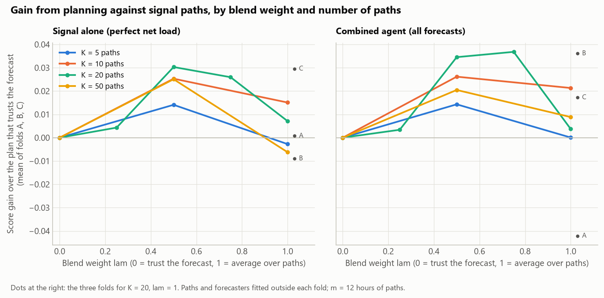

# Second round on the price/CO₂ signal: a better forecast and a planner that doubts it

**Written:** Sat 14 Nov 2026, 18:46, from the reports of the signal subagent (18:44) and the planner subagent (18:46). Code: `experiments/23_signal/signal_fc2.py` and `experiments/28_signal_planning/sigplan.py`.

Both are measured against the combined agent with the safe end-of-run rule: 20.045 on folds A, B, C (21.138 / 20.296 / 18.700).

## 1. Summary

- **Forecaster, round 2: +0.045** (A +0.026, B +0.074, C +0.037).
- **Planning against scenario paths of the signal: +0.057** (A +0.039, B +0.086, C +0.046); about +0.04 to +0.05 once the settings are chosen on other folds.
- **Neither closes the gap.** About 0.5 points remain lost to the signal 3 to 11 hours ahead.
- **Why:** what the planner pays for is the *level* of the next six hours. Every richer model moved that error by 5 to 8 % and the score by 0.03 or less. The information to predict it better does not seem to be in `obs`.
- Whether the two gains stack is being measured; if they do, they become h3.

## 2. What the planner needs from the signal forecast

Each row gives the round-1 forecast one piece of the truth (gain in the combined agent, mean of folds):

| Piece of truth given | Gain |
|---|---|
| Hour +3 | +0.09 |
| Hours +3 to +5 | +0.32 |
| Hours +3 to +8 | +0.51 |
| Hours +3 to +11 | +0.55 |
| Hours +12 to +35 | +0.06 |
| True mean of +3..+8, forecast shape | +0.32 |
| True minimum and maximum of +3..+8 | +0.41 |
| True values of +3..+8, in the forecast's order | +0.51 |
| Forecast values of +3..+8, in the true order | −0.04 |
| True shape of +3..+8, forecast mean | −0.20 |

- **The order of the hours is worth nothing.** True values in the wrong order recover everything; the right order with our values recovers nothing.
- **The level is 60 % of the value,** level plus extremes 80 %.
- **The error is mostly one common shift:** 69 % of the squared error in +3..+8 is the error of the window's mean (10 g/kWh, 8 % of the mean signal).
- **Forecasts made at night (22:00 to 03:00) carry 42 % of the loss** in 25 % of the hours.

## 3. Forecaster, round 2 (`SignalForecaster2`)

| Idea | Gain in the combined agent, A / B / C | Verdict |
|---|---|---|
| **Bridge at the end of a week.** The day after every test week is a train day, so its values are in the store; the model's error on those stored hours is carried back to the hours in between. | +0.010 / +0.050 / +0.006 | adopted |
| **Night-time level averaged with a per-hour-of-day model,** which predicts the level 10 % better at night. | +0.019 / +0.034 / +0.033 | adopted |
| Both | +0.026 / +0.074 / +0.037 | recommended |
| Boosted second stage for +3..+11 with weather, campus load and solar, slope of the known hours | +0.015 / +0.013 / +0.071, but changes sign with net load known | not adopted |
| Per-hour-of-day model everywhere | −0.030 mean | rejected |
| Level raised by 3 % | helps the combined agent, hurts with net load known and in the test-like check | not adopted |
| Forecast spread ×0.85 / ×1.15 | −0.138 / −0.058 | rejected |

- **Better accuracy failed to convert to score three times** (raw-lag ridge, per-hour models, boosted stage). It is not a safe selection criterion here.
- **The forecast is calibrated:** against the actual value, the maximum of +3..+11 has slope 1.03 and the minimum 0.99. There is no spread or level left to correct.
- Leak rules: only train rows are read. The bridge reads the train hours right after each test week, never a test hour.
- 0.16 ms per call, numpy only.

## 4. Planning against scenario paths of the signal

The plan so far trusts the signal forecast. The agent re-plans every hour with one more true value, so a plan built on the mean ignores that it will know more later.

| Variant (20 paths over 12 hours unless stated) | Signal alone | Combined |
|---|---|---|
| Value of stored energy averaged over paths, each treated as known in advance | +0.007 | +0.004 |
| **Half forecast, half paths** | +0.030 | +0.035 |
| Average of the paths' first actions | −0.384 | −0.255 |
| Hours revealed progressively | +0.017 | +0.012 |
| Correction of the forecast mean from the last revealed error, no paths | +0.021 | +0.040 |
| **Half-and-half blend + mean correction (recommended)** | **+0.033** | **+0.057** |

- **Averaging over paths as if each were known overvalues waiting,** so alone it gives nothing. Half weight is the plateau.
- **The mean correction is a forecaster fix, not a planning one,** and it is worth as much as the paths: the surprise on the newest known hour correlates 0.3 with the next error.
- **Error paths** are whole error vectors of the round-1 forecaster from held-out weeks, drawn from origins at the same hour of day, so their correlation along the horizon is preserved (+3 with +4: 0.81; with +6: 0.48; with +12: 0.13).

**Guard against choosing settings on the scoring folds.** Picking the configuration on two folds and scoring the third:

| Family scanned | Configurations | In-sample gain → held-out gain (combined) |
|---|---|---|
| Paths, number × blend weight | 16 | +0.037 → +0.024 |
| Mean-correction strength | 5 | +0.060 → +0.060 |
| Paths + mean correction | 11 | +0.063 → +0.051 |
| Everything scanned | 65 | +0.063 → +0.043 |

About half to two thirds of the gain survives. Seed-to-seed noise is about ±0.01.

**Cost:** the combined agent goes from 2.5 to 2.9 ms per step.

## 5. What this means

- The signal side is close to what can be had from `obs` and train data: about +0.05 to +0.10 if the two pieces stack.
- **Inferred, not tested:** the payoff is nearly linear in the signal, so mis-ranking future hours is mostly irreducible given the forecast; hedging only helps through the battery's capacity limits.
- **Not tried:** a full multi-stage model in which hours +3 to +5 are revealed one at a time with re-forecasting.

## 6. Files

- `experiments/23_signal/`: `signal_fc2.py`, the diagnostics `need*.py`, `errstruct.py`, `round2.py`, fitted copy `signal_fc2_full.npz`.
- `experiments/28_signal_planning/`: `sigplan.py`, `xfit_signal.py`, `errors_*.npz`, `sweep_sig.py`, `analyse.py`, `figs.py`.
