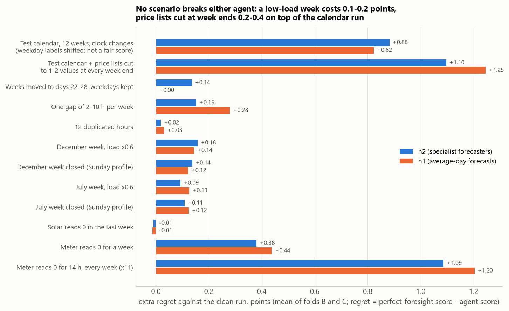
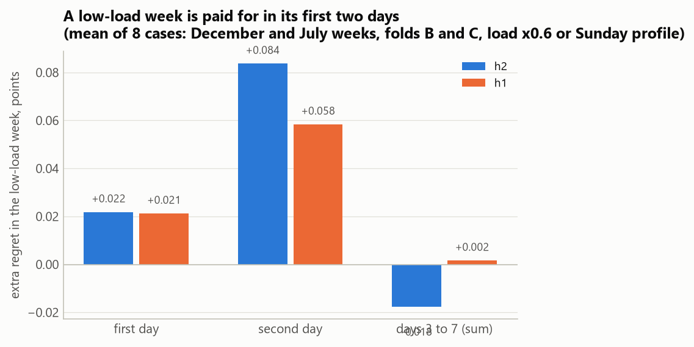
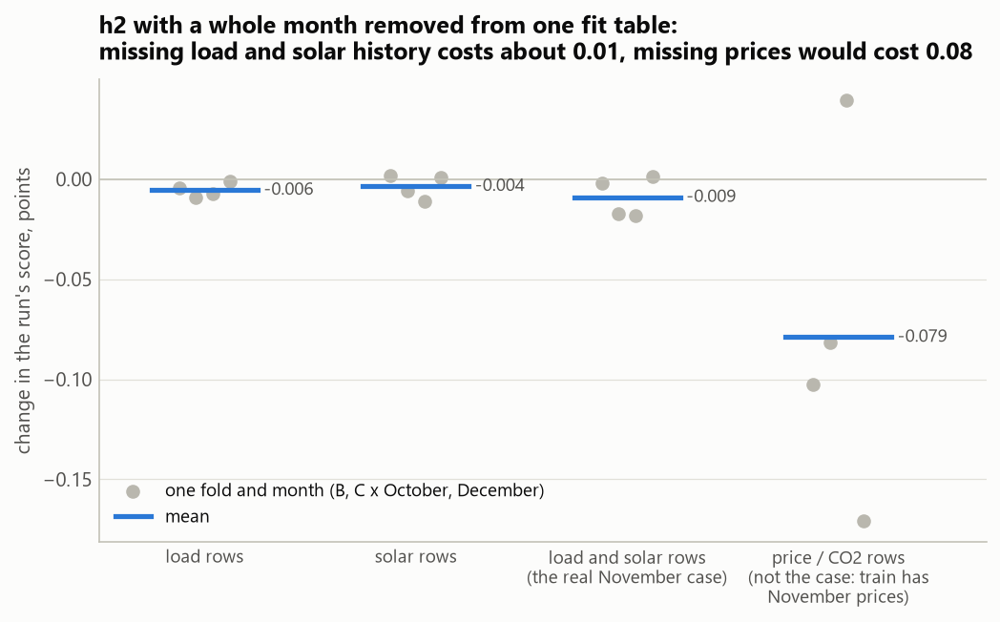

# Stress test of the hard-mode agents (h1 and h2)

**Written:** Sat 14 Nov 2026, 19:05, by the red-team subagent; two notes added by me at 19:08 where the server probe has since settled a point. Code and outputs: `experiments/29_stress_hard/`.

Scope, after the team down-weighted anomalies at 18:29: no crash or infraction under any `obs` the server might send, the real test layout, holiday weeks, and months missing from train. Synthetic faults are a quick check only.

## 1. Summary

- **Neither agent crashed, returned a bad value or caused an infraction in any plausible scenario.** About 600 full runs: 0 exceptions, 0 non-finite returns.
- **Two "the server differs slightly from the published environment" hazards were found.** A rounded state of charge is fixed in both ZIPs. Absent price lists cannot happen on the server (the probe shows them) and the fix goes into h3.
- **h2's fallback counter is 0 on every normal run,** including a 2,016-hour run on the test calendar with both clock changes.
- **The real layout holds.** Last-7-day dates, short months, 23- and 25-hour days, 10 or 12 weeks and an early end produce no failure. The clock changes move the score by less than 0.01.
- **A low-load week costs 0.1 to 0.2 points for either agent,** taken in its first two days. No cheap fix survived testing.
- **The missing November is not a problem for h2:** a month removed from its load and solar fit rows costs 0.00 to 0.02 on the run.
- **Not covered:** h3.

> **Note (19:08):** the second server probe has since shown that the state of charge is not rounded at all (deviation 0 from the published dynamics over 47 steps), that the lists shrink only in the last two hours of a run, and that the readings are finite. So the rows below about rounding to whole kWh, short lists mid-run and absurd weather describe things the server does not do.

## 2. What was tested

- **Builds:** `submissions/h1/nov_fill/submission.zip` (18:39) and `submissions/h2/submission.zip` (18:45).
- **States** fitted outside each fold, so scores are honest.
- **Measure:** "extra regret" is (optimum − agent) on the modified run minus the same on the clean run, so "the data got harder" is separated from "the agent handled it badly".

Clean reference (0 infractions):

| Agent | Fold A | Fold B | Fold C |
|---|---|---|---|
| h1 | 20.581 | 19.790 | 18.353 |
| h2 (end of run from the lists only) | 21.138 | 20.296 | 18.700 |

## 3. What the server might send in `obs`

Score change in points on folds B / C. No exception and no non-finite return in any row.

| Scenario | h1 | h2 | Note |
|---|---|---|---|
| Timestamp as text, ISO text, `datetime`, numpy, with time zone | 0 / 0 | 0 / 0 | |
| Timestamp missing or `None` | −0.75 / −0.86 | −1.26 / −1.21 | h2 hands every step to h1 |
| Lists as numpy, pandas or text | 0 / 0 | 0 / 0 | |
| 24 values instead of 3 | +0.81 / +0.66 | +0.55 / +0.58 | the agents use what they are given |
| 1–2 values at 1 hour in 50 | −0.48 / −0.59 | −0.48 / −0.45 | does not happen on the server |
| Lists absent | −19.4 / −17.8 | −19.9 / −18.1 | does not happen on the server; fix in h3 |
| Battery size or power missing | 0 / 0 | 0 / 0 | |
| State of charge slightly outside the range, as text, or only as a percentage | 0 / 0 | 0 / 0 | |
| State of charge rounded to 0.01 kWh | 0 / 0 | 0 / 0 | fixed at 18:39; before: 52–66 infractions |
| State of charge rounded to 1 kWh | 86 / 74 infractions | 82 / 72 infractions | does not happen on the server |
| Readings missing for the whole run | −0.96 / −0.64 | −0.67 / −0.57 | |
| Solar reading not ×12 | −0.66 / −0.85 | −1.10 / −1.25 | the probe confirms ×12 |
| Readings of the current hour instead of the last | −0.26 / −0.17 | −0.23 / −0.21 | |
| Weather missing, NaN or under other names | 0 / 0 | −0.02 / −0.03 | |
| Weather constant | 0 / 0 | −0.21 / −0.19 | |
| Weather absurd (1e9 W/m², −9999 °C) | 0 / 0 | −1.12 / −1.36 | the probe shows normal readings |

A different starting charge (0, 1,500 or 6,000 kWh) changes the regret by at most 0.008.

## 4. Layout, low load, faults

Extra regret in points on folds B / C. 0 infractions, 0 exceptions and 0 h2 fallbacks in every row.

| Scenario | h1 | h2 |
|---|---|---|
| Both clock changes (23 h and 25 h days), against the same run without them | under 0.01 | under 0.01 |
| Weeks in a different order | −0.13 to +0.07 | −0.13 to +0.07 |
| August week dropped | +0.11 / −0.08 | +0.16 / −0.09 |
| Run ends 60 h early | −0.13 / −0.15 | −0.05 / −0.16 |
| One gap of 2–10 h per week | +0.12 / +0.44 | +0.04 / +0.26 |
| December week, load ×0.5 / ×0.6 / ×0.7 | +0.20 / +0.13 / +0.08 (B) | +0.17 / +0.17 / +0.12 (B) |
| December week closed (weekdays take the Sunday profile) | +0.11 / +0.13 | +0.17 / +0.11 |
| July week closed | +0.14 / +0.11 | +0.09 / +0.13 |
| Every week closed | +1.87 / +1.54 | +1.03 / +0.88 |
| *Quick checks, no tuning:* | | |
| Meter 0 for 14 h, every week | +1.20 / +1.20 | +1.09 / +1.08 |
| Meter 0 for one whole week | +0.54 / +0.34 | +0.46 / +0.30 |
| Solar 0 for the last week | −0.04 / +0.01 | −0.03 / +0.02 |

The rows that relabel train weeks to the last 7 days of each month are not a score forecast: moving a week changes its weekday labels, so they show what wrong weekday labels cost (0.6 to 1.0), not what the test costs.

## 5. Findings

### 5.1 Week boundaries are where h2's remaining loss sits

- **Share of h2's regret on the first day of a week:** 75 % on fold A, 50 % on B, 11 % on C.
- **What happens** (fold A, 1 January): h2 arrives at midnight with 1,873 kWh where the optimum arrives with 5,178. It is empty by 02:00 and cannot cover three night hours. From 06:00 it tracks the optimum.
- **These are price/CO₂ timing errors across the three-week jump, not load errors.** h2 exported nothing for free on the days examined.
- **Tested and rejected:** letting h1 answer the first 6 to 48 hours after a jump loses 0.03 to 0.23 on every fold.
- Inferred from two traces, not from a full decomposition.

### 5.2 Holiday and low-load weeks

- **Real low weekdays in train (11 days):** h2 exports 43 kWh a day for nothing, against 27 on a normal weekday. h1 exports 241 against 45.
- **Synthetic closed week:** +0.07 to +0.20 per week for both agents; +0.02 on day 1, +0.06 to +0.08 on day 2, about zero on days 3 to 7.
- **A calendar of holidays for the load forecaster** gains at most 0.01 when right and loses 0.05 to 0.08 when a normal week is wrongly flagged. Not recommended: the forecaster already picks up a closure within hours.

### 5.3 Months missing from train

- Only load and solar lack November; prices and CO₂ are there for its train days.
- **h2 with a month's load and solar removed from the fit:** −0.002 to −0.018 on the run. On the hidden week alone, 0.01 to 0.15.
- **h1:** the tables interpolated from neighbouring months beat the all-month average in 7 of 8 cases, which supports the `nov_fill` variant.
- **Late August:** solar reading 0 for the whole last week costs nothing.

## 6. Fixes: status

| Fix | Effect where it applies | Cost on clean folds | Status |
|---|---|---|---|
| Clamp margin 0.01 kW | 52–66 infractions → 0 if the state of charge were rounded to 0.01 | 0.00004 | in h1 and h2 |
| Count only finite values in the price lists | 0.35 → 18.98 (B) if the lists were absent | none | going into h3 |
| Clamp margin 0.6 kW | covers rounding to whole kWh | 0.002 | not needed: the server does not round |
| Treat a short list as the end only in July/August | +0.05 to +0.54 if lists were short mid-run | none, but −0.06 to −0.20 if the run ended before July | declined; the server shortens lists only at the end |
| Holiday calendar for the load forecaster | +0.01 at best | −0.05 to −0.08 if wrong | not adopted |
| h1 answers the first hours after a week jump | −0.03 to −0.23 | | rejected |

## 7. What held up

- **Interface:** every timestamp type, list type, missing key and state-of-charge variant runs without exception.
- **h2's fallback paths** (fold B, 0 infractions in all): state file missing → h1 answers every step (19.94); a forecaster's arrays missing or no pandas → h1 (19.79); load-model trees damaged → rules-only mode (20.26); 100 hours without timestamp mid-run → h1 for those steps, then recovery (20.23).
- **Shipped ZIPs on a 2,016-hour test-calendar run with both clock changes:** 0 infractions, 0 fallbacks, 1.4 s (h1) and 4.1 s (h2).

## 8. Limits

- Holiday evidence is thin: 11 real low weekdays, synthetic weeks otherwise.
- Scenario suites ran on folds B and C, not A.
- h3 was not available in time.

Scripts in `experiments/29_stress_hard/`: `lib.py` (simulator with an obs hook), `suite.py`, `shipped_check.py`, `eps_margin.py`, `fix_endrule.py`, `holiday.py`, `firstday.py`, `boundary.py`, `lowload_days.py`, `hidden_month.py`, `figs.py`.
