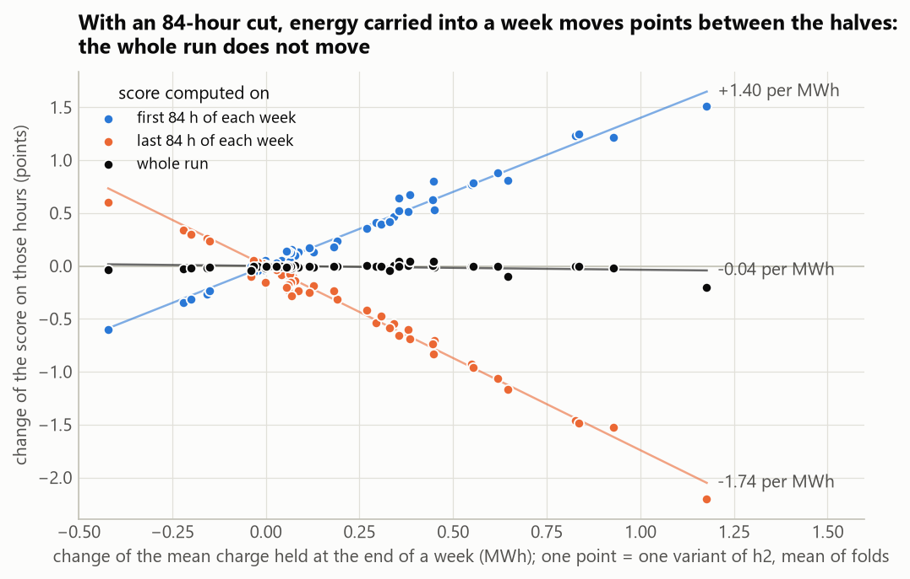
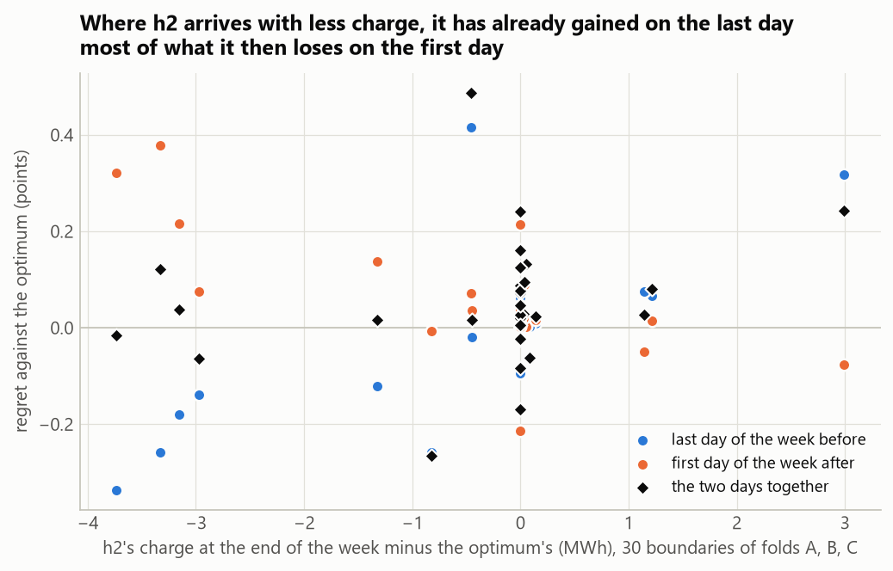
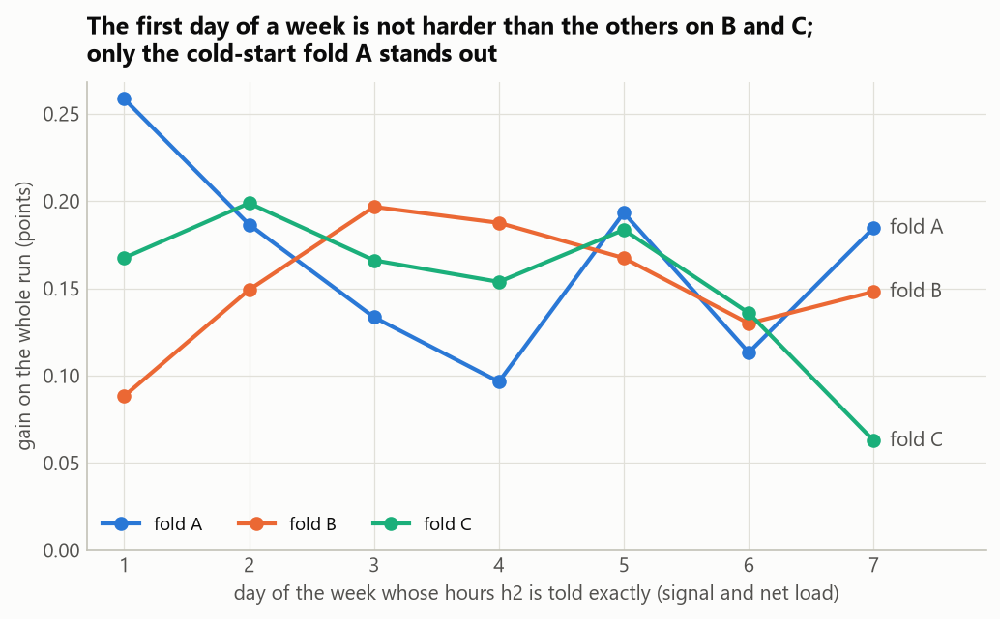
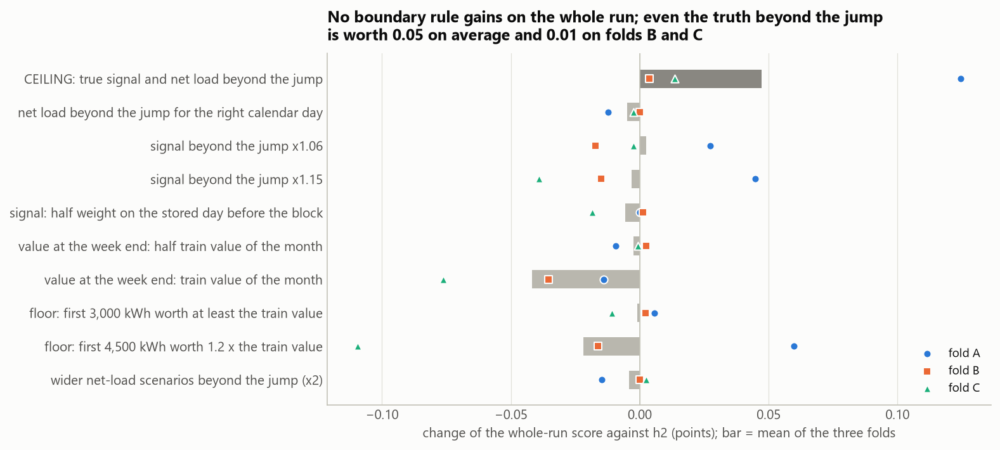
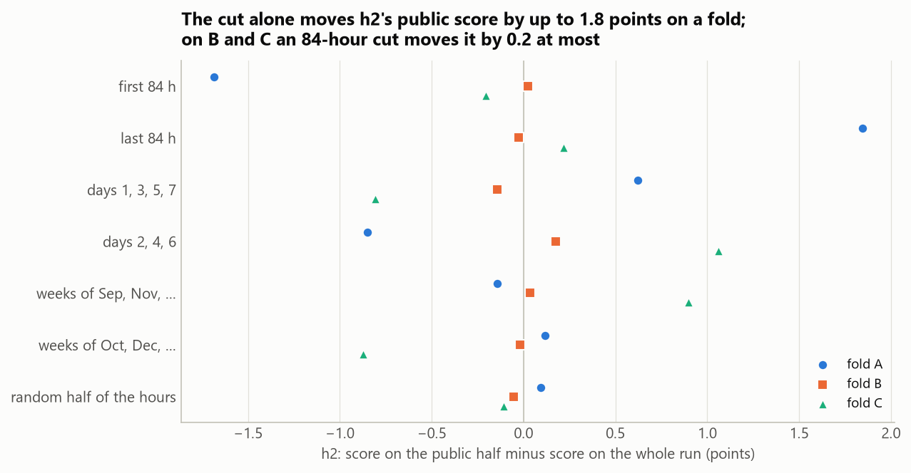

# Week boundaries: what the agent carries across them, and what the public cut does with it

**Written:** Sat 14 Nov 2026, 19:36, by the boundary subagent. Code and tables: `experiments/30_boundaries/`.

Background: the 12 test weeks are run as one continuous simulation, so the battery's charge carries across the three-week jumps between weeks. The score on the leaderboard is then computed on half of the hours ("50 % of each test week"); the private ranking uses the other half. Which hours are public is not documented.

## 1. Summary

- **Boundaries are not where h2 loses on the whole run.** Given the true signal and true net load for every hour beyond a week's end, h2 gains +0.125 / +0.004 / +0.013 on folds A / B / C. On the two test-like folds the ceiling for any boundary rule is about 0.01.
- **No boundary rule is recommended.** 69 legal variants were tried; the best gains +0.004 on average, and every one chosen on two folds loses on the third.
- **The cut of the public half is where boundaries matter.** If the cut is an 84-hour split of each week, every MWh of extra charge carried into each week moves about +1.4 points onto the first half and −1.7 off the last half, while the whole run moves by −0.04.
- **Consequence for reading the leaderboard.** Under an 84-hour cut, the 0.40 between us and the nine teams above equals about 0.3 MWh of average charge at the cut, which has no real value. Under alternate days or random hours this effect is about zero.
- ~~Which cut it is remains unknown.~~ **Known since 20:40:** the first 84 hours of each week are public, the last 84 private (section 6).

## 2. What h2 carries across boundaries

Charge at the last hour of a week, h2 against the optimum of the whole run (10 boundaries per fold, kWh):

| Fold | h2 | Optimum | Difference, mean | Median | h2 more than 500 below |
|---|---|---|---|---|---|
| A | 2,418 | 3,125 | −707 | 0 | 4 of 10 |
| B | 3,599 | 3,530 | +69 | 0 | 0 of 10 |
| C | 2,546 | 2,962 | −416 | 0 | 2 of 10 |

- **Not systematically low.** h2 equals the optimum at most boundaries and is far below at 6 of 30, four of them on fold A, the cold-start fold. h3 is the same within 30 kWh.
- **Why the red-team saw most of the regret on day 1.** Regret counted by day is not corrected for the state of charge. Where h2 arrives low, it had already sold that energy on the last day of the previous week, which shows as *negative* regret there.

| Fold | Day 1 | Day 7 | Days 2–6 | Total |
|---|---|---|---|---|
| A | +0.98 | −0.32 | +0.50 | 1.17 |
| B | +0.56 | +0.86 | −0.36 | 1.05 |
| C | +0.13 | −0.41 | +1.50 | 1.22 |

- **The traced case** (1 January, fold A): h2 sells 3.3 MWh on the last evening where the optimum holds it for the night. The net cost of arriving with 1,873 kWh instead of 5,178 is about 0.03 points.
- **Day 1 is not harder than other days.** Giving h2 perfect information for the hours of one day only is worth 0.09 on day 1 against 0.17 on days 2–6 (fold B).

Forecasts across the jump are worse (signal error 1.2 to 1.8 times the within-week one, and the load forecaster forecasts the next calendar day, not the first day of the next week), but replacing them with the truth buys almost nothing, because the last evening of a week and the first night of the next are worth nearly the same.

## 3. Boundary rules tried

Change in whole-run score against h2, mean of folds:

| Rule | Mean | Note |
|---|---|---|
| Net load beyond the jump forecast for the right calendar day | −0.005 | |
| Signal beyond the jump scaled ×0.95 / ×1.06 / ×1.15 | −0.013 / +0.003 / −0.003 | helps A, hurts B and C |
| More weight on the stored train day before the next week | 0.000 to −0.023 | |
| A value on the energy held at the week's end (the month's typical value) | −0.001 to −0.042 | |
| A floor of 1,500 kWh at the week's end | +0.001 | |
| A floor of 4,500 kWh | −0.022 | |
| Wider signal error paths beyond the jump (h3) | 0.000 to −0.003 | |

- **Pattern:** anything that makes the agent carry more helps fold A and hurts B and C.
- **Chosen on two folds, scored on the third:** every pick loses (−0.002 to −0.110).
- **By boundary (29 of them):** the truth is better at 13, worse at 2, unchanged at 14. No legal rule comes close.

## 4. How much the cut of the public half matters

h2's score on the public half minus its whole-run score, by hypothesis:

| Public half | Fold A | Fold B | Fold C |
|---|---|---|---|
| First 84 h of each week | −1.69 | +0.03 | −0.21 |
| Last 84 h | +1.84 | −0.03 | +0.22 |
| Days 1, 3, 5, 7 | +0.62 | −0.14 | −0.81 |
| Days 2, 4, 6 | −0.85 | +0.18 | +1.06 |
| Alternate weeks | −0.14 | +0.04 | +0.90 |
| Random half of the hours (200 draws) | +0.09 | −0.06 | −0.11 |

**Sensitivity.** h2 forced to hold more charge at the last hour of every week (0.65 MWh actually added):

| Public half | Whole run | Public half | Private half |
|---|---|---|---|
| First 84 h | −0.10 | +0.81 | −1.16 |
| Last 84 h | −0.10 | −1.16 | +0.81 |
| Alternate days | −0.10 | −0.18 or 0.00 | 0.00 or −0.18 |
| Random hours | −0.10 | −0.09 | −0.11 |

- **Working formula for an 84-hour cut:** change of the first half ≈ change of the whole run + 1.4 × (MWh more at the week's end) − 0.8 × (MWh more at hour 84). Signs reverse for the last half.
- **No rule is good for both halves.** Across all 69 variants: +1.40 per MWh on the first half, −1.74 on the last, −0.04 on the whole run. Even the ceiling of section 1 is 93 % transfer: +0.67 on one half for +0.047 real.
- **Under alternate days or random hours** the halves follow the whole run and there is nothing to gain or lose.

**Which cut is it?** Our h2 scores 14.7 % more on the public test than on our folds; in standard mode the plain optimum scored 9.5 % more. The ratio of the two, 1.047, can be compared with what each hypothesis predicts:

| Public half | Predicted ratio (mean of folds) |
|---|---|
| First 84 h | 0.94 |
| Last 84 h | 1.07 |
| Days 1, 3, 5, 7 | 0.98 |
| Days 2, 4, 6 | 1.05 |
| Alternate weeks | 1.00 |
| Random hours | 0.99 |

"Last 84 h public" fits best and "first 84 h" worst. This is weak: three folds, a single week moves a ratio by several percent, and it contradicts the standard-mode reading in `06_edge/report.md`. Treat the cut as unknown.

## 5. What this means

- **Ship h3 as it is.** No boundary rule to switch on.
- **Choose the two jury submissions on whole-run fold scores,** not on public differences under about 0.5.
- **h3 holds the same charge as h2 at the cuts,** so its public gain should be real: +0.11 expected if the first 84 h are public, +0.04 if the last, +0.05 to +0.08 otherwise.
- **For any future candidate,** report the mean charge at week ends and at hour 84 next to the fold score; the formula then says how much of a public change is transfer.
- **Not built, on purpose:** the variants that would look best on an 84-hour public half (a very optimistic signal beyond the jump, a 4,500 kWh floor). They are neutral or negative on the whole run and cost about 1.5 points on the other half.
- **A probe exists if the team wants to know the cut:** one submission of a whole-run-neutral variant (signal beyond the jump ×1.2) would score about +1.25 if the first 84 h are public, −1.5 if the last, about 0 otherwise. It costs an attempt and must never be a jury pick.

## 6. The cut is known, and what it does to the private half (added 20:50)

**The probe result.** The team submitted the probe of section 5 (h3 with the signal beyond the week's end ×1.2): **24.25** on the public leaderboard against h3's 23.32, +0.93. On the folds that variant gains +1.0 to +1.9 on the first halves and loses 1.1 to 1.9 on the last halves. So **the public half is the first 84 hours of each week, and the private half, which decides the podium, is the last 84.** One measurement; nothing else we tested moves the score that way.

**A second probe:** an agent that acts only on August 2026 dates scored exactly 0, twice. With the first halves public, an existing August week would have shown above zero. So the test has no August week and the run ends on 31 July 2026 at 23:00. **Confirmed at 20:50 by a control:** the same code acting on July 2026 dates scored 0.53 on the server (296.3 kg CO₂ avoided, 596.31 € saved, 0 infractions), which is the battery's starting charge discharged on the first night of the July week.

**The family "how much is energy worth beyond the week's end" on h3** (mean of folds; change against h3 in brackets):

| Signal beyond the week's end | Whole run | First 84 h | Last 84 h | Charge at week end, kWh |
|---|---|---|---|---|
| ×1.2 (the probe) | 20.194 (+0.004) | 20.941 (+1.34) | 19.270 (−1.56) | 3,728 |
| ×1.0 (h3) | 20.190 | 19.603 | 20.828 | 2,845 |
| ×0.75 | 20.108 (−0.08) | 18.532 (−1.07) | 21.883 (+1.06) | 2,025 |
| ×0.5 | 19.905 (−0.29) | 17.455 (−2.15) | 22.698 (+1.87) | 1,233 |
| Plan cut at the week's end | 19.397 (−0.79) | 15.533 (−4.07) | 23.867 (+3.04) | 19 |

- **Every variant below ×1.0 raises the last-half score by moving points off the first half, and loses on the whole run.**
- **The last-half gain is consistent:** for the plan cut, 25 of 33 weeks better and 1 worse (interval +2.1 to +4.0).
- **The whole-run loss is real for the plan cut** (negative on all three folds); for ×0.75 it is not distinguishable from zero.
- **The charge at hour 84 is the same in every variant** (1,218 kWh): the rule acts only in the last day of a week.

**Scaled to the real test.** The probe moved the public score by 0.7 times the fold mean (0.9 times folds B and C). On that scale, for the private half: probe −1.1 to −1.4; ×0.75 +0.7 to +0.9; plan cut +2.1 to +2.7, with a public score about 3 lower and a real loss of about 0.6 to 0.7 on the whole run. The private half itself has not been observed.

**The size of the distortion in principle** (perfect foresight, mean of folds):

| Schedule | Last 84 h | First 84 h | Whole run |
|---|---|---|---|
| Optimum of the last-half score alone | 28.69 | 11.90 | 19.66 |
| Optimum of the whole run | 20.87 | 21.52 | 21.26 |

A schedule built only for the last halves scores 7.8 points more there while being 1.6 points worse overall. It has two parts: arriving empty at the week's end (the plan cut gets +3.0 of it) and arriving nearly full at hour 84 on energy charged in uncounted hours. No agent was built for the second part.

**What it means for the team:**

- The public board cannot be used to compare teams: 0.8 points is about half a MWh of charge at week ends.
- Teams that tune against the public board are pushed towards carrying more, which costs them on the private half.
- The two jury submissions must be selected by hand: the automatic choice would take the probe (24.25), our worst agent on the private half.
- Whether to submit a variant that empties the battery at each week's end is the team's decision. It breaks no written rule; it is an agent tuned to where the scoring cut falls, and it is a worse controller over the whole run.

## 7. Limits

- The folds skip November, so one boundary per fold behaves unlike the test.
- That the test behaves like folds B and C rather than A is inferred from the fold design.
- The reading of the 0.40 gap as about 0.3 MWh applies our measured sensitivity to other teams, whose agents we cannot see.

Scripts in `experiments/30_boundaries/`: `q1.py`, `q1c.py`, `sweep_b.py`, `rules.py`, `rules2.py`, `q3.py`, `q3_std.py`, `q24.py`, `figs.py`.
